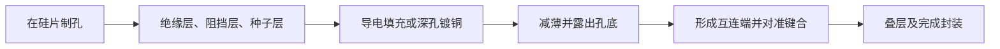
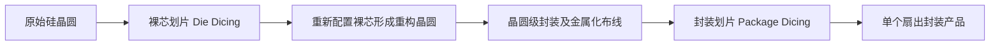

# 目录

**集成电路封装与测试**

- [要点速背](#要点速背)
- [画图重点候选与练习方法](#03-画图重点候选与练习方法)
- [第 1 章 绪论](#第-1-章-绪论)
- [第 2 章 集成电路封装流程](#第-2-章-集成电路封装流程)
  - [2.6 引线键合的原理、材料与焊点形状](#26-引线键合的原理材料与焊点形状)
    - [2.6.1 球形键合与楔形键合的区别](#261-球形键合与楔形键合的区别)
    - [2.6.2 球焊与楔焊动作序列](#262-球焊与楔焊动作序列)
  - [2.14 倒装芯片、C4 与三种互连的比较](#214-倒装芯片c4-与三种互连的比较)
    - [2.14.1 C4焊料凸点制作流程](#2141-c4焊料凸点制作流程)
    - [2.14.2 C4完整连接流程](#2142-c4完整连接流程)
  - [2.17 蒸镀与电镀凸点的工艺](#217-蒸镀与电镀凸点的工艺)
    - [2.17.1 蒸镀凸点制作流程](#2171-蒸镀凸点制作流程)
    - [2.17.2 电镀凸点制作流程](#2172-电镀凸点制作流程)
- [第 3 章 气密性与非气密性封装](#第-3-章-气密性与非气密性封装)
- [第 4 章 常规芯片封装技术](#第-4-章-常规芯片封装技术)
- [第 6 章 基板技术](#第-6-章-基板技术)
- [第 8 章 先进封装技术](#第-8-章-先进封装技术)
- [作业题：三次作业共16题](#作业题)

# 要点速背

## 0.1 关键概念

**封装与测试主线**

- 封装的四项核心功能：**信号分配、电源分配、热耗散、支撑与防护**；先进封装进一步实现性能和功能密度提升。本课主要讨论器件级封装。[第1章课件，PDF第3—5页](<ppt/Chapter 1 绪论.pdf#page=3>)
- 传统引线框架封装：**减薄 → 划片 → 贴片 → 引线键合 → 塑封 → 后处理 → 测试/检验与包装**。具体后处理含固化、去飞边、电镀、切筋成型、标识等，按产品工艺安排。[第2章课件，PDF第1—2、32—37页](<ppt/Chapter 2 集成电路封装流程.pdf#page=1>)
- 质量检测回答“现在是否达标”，可靠性评价回答“在后续使用条件下能否持续正常工作”。[第1章课件，PDF第9页](<ppt/Chapter 1 绪论.pdf#page=9>)

**工艺与材料**

| 关键词 | 可直接背诵的含义或区别 |
| --- | --- |
| 晶圆减薄 | 降低厚度、重量和热阻，并满足后续装配；研磨、CMP、湿法刻蚀、干法刻蚀要比较效率、损伤和表面质量 |
| 芯片贴装 | 芯片固定到承载体；四种方法为共晶、焊料、黏合剂（可导电或绝缘）、玻璃胶贴装 |
| WB / TAB / FC | WB用细金属线逐点互连；TAB用载带图形引线连接；FC使芯片正面向下、通过凸点连接 |
| 引线键合 | 按能量方式分热压、超声、热超声；按焊点形状分球焊、楔焊 |
| UBM | 焊盘与凸点之间的金属结构，承担黏附、扩散阻挡、润湿等功能；层数与功能分组须看具体结构 |
| 底部填充 | 分散热膨胀失配导致的应力、保护焊点和芯片；不是把材料本身的CTE“变成相同” |
| 气密封装 | 用低渗透材料、壳体及封接控制污染物进入；气密仍有测试条件和允许泄漏量 |
| 封装基板 | 芯片到PCB之间的承载与互连平台，兼顾绝缘、散热及高速信号控制 |

依据：[第2章课件，PDF第3—5、10—18、22、37—44、59页](<ppt/Chapter 2 集成电路封装流程.pdf#page=3>)；[第3章课件，PDF第1页](<ppt/Chapter 3 气密性与非气密性封装.pdf#page=1>)；[第6章课件，PDF第1页](<ppt/Chapter 6 基板技术.pdf#page=1>)。

**先进封装**

- **RDL**负责重新布置信号走线与I/O位置；**TSV**提供穿过硅的垂直通路；**Bump**负责相邻连接界面的金属接合。[第8章课件，PDF第7—10页](<ppt/Chapter 8 先进封装技术.pdf#page=7>)
- **2.5D**重在中介层连接多芯片；本课的**3D TSV集成**重在堆叠芯片间的直接垂直互连。两者都可能使用RDL、凸点与封装基板。[第8章课件，PDF第4—6页](<ppt/Chapter 8 先进封装技术.pdf#page=4>)
- **SoC**在芯片内实现系统集成；**SiP**在封装内组合不同芯片/器件；**Chiplet**强调可组合、可复用的功能裸芯，借助先进封装构建系统。[第8章课件，PDF第18、27页](<ppt/Chapter 8 先进封装技术.pdf#page=18>)
- **FIWLP与FOWLP**看布线和外部I/O能否扩展到裸芯轮廓之外；**CoWoS与InFO**的课件比较重点是是否采用硅中介层及其互连方式。[第8章课件，PDF第19、21—22页](<ppt/Chapter 8 先进封装技术.pdf#page=19>)

## 0.2 易混淆点

| 容易混淆 | 应如何区分 |
| --- | --- |
| 工艺方法、封装外形、系统架构 | WB/TAB/FC讲互连；DIP/QFP/BGA/CSP讲封装形式；SoC/SiP/Chiplet讲集成位置或组织方法，分类维度不同 |
| 引线键合的“三种”与“两种” | 三种按热/压力/超声作用方式；两种按球形或楔形焊点，不是互相矛盾的答案 |
| 芯片贴装与引线键合 | 前者固定芯片并形成相应界面；后者完成芯片焊盘到引脚/载体的细线互连 |
| UBM沉积与凸点制作 | 课件UBM三法为溅射、蒸镀、化学镀镍；电镀凸点在后续另讲，不能把两道工序混在一起 |
| 倒装焊四步 | 按课件是UBM → 凸点制作 → 组装 → 底填；若把前两步合并，便不是课件采用的同一划分 |
| 气密与可靠 | 气密是阻隔性能之一；非气密塑封也可达到特定可靠性要求 |
| 热导率与热膨胀系数 | 高热导利于散热；CTE匹配利于减小热应力，不能互相替代 |
| 有机基板与陶瓷基板 | 低介电、低成本与高导热、耐高温需要综合比较；不同材料的参数不能脱离组成与测试条件 |
| 物理堆叠与3D互连 | 只靠键合线绕到基板的堆叠，课件归为2D+；课件3D TSV强调芯片间直接垂直互连 |
| 2.5D与TSV | 2.5D有无TSV方案，不能用“有没有TSV”单独判定2.5D/3D |
| 数值与单位 | 时间h/min、厚度μm/mm、电流效率百分数/小数、延迟s/m与s必须分清 |

## 0.3 画图重点候选与练习方法

**选图依据。**据本次提供的教师题型线索，另两门课曾考浅沟槽隔离、双大马士革的工艺流程图，双阱CMOS结构和ENMOS转移特性曲线。因此本课优先练习“逐步工艺截面、层次结构、时间或温度曲线”。下列均为**画图重点候选**：作业明确涉及的结构/流程是较直接的依据，学长A4的取舍作为补充；这些材料不能证明本课程已考过相同画图题。

| 练习内容与跳转 | 图中必须保留的内容 |
| --- | --- |
| [TSV层次](#87-tsv结构25d3d-tsv与制孔时序)与[截面流程](#88-tsv制造总流程与硅通孔成形) | 硅、绝缘/阻挡/种子层、铜；盲孔→填充→背面减薄露出 |
| [FOWLP三条路线](#813-晶圆级封装扇入与扇出) | 初始朝向、塑封、RDL先后、露铜与脱载位置 |
| [倒装焊四步](#214-倒装芯片c4-与三种互连的比较) | UBM→凸点→翻转组装→底填 |
| [C4焊料凸点制作](#2141-c4焊料凸点制作流程)及[连接](#2142-c4完整连接流程) | 焊盘/钝化开口→UBM→焊料沉积→回流成球；完整连接再画倒装对准、回流连接与底填 |
| [UBM局部剖面](#215-ubm-的功能层材料及结构要求) | 焊盘与钝化开口、功能金属层、凸点 |
| [2.5D与3D剖面](#84-中介层的作用类型与25d结构实例) | 并排/堆叠区别；TSV究竟在中介层还是芯片中 |
| [WB球焊与楔焊循环](#262-球焊与楔焊动作序列) | 球焊六步、楔焊五步；烧球与直接压线的区别、工具、两焊点、线弧及断线 |
| [转移成型装置与过程](#211-转移压缩成型) | 柱塞、转移罐、浇道、模腔、芯片框架和流向 |
| [蒸镀](#2171-蒸镀凸点制作流程)与[电镀](#2172-电镀凸点制作流程)凸点逐步截面 | 蒸镀：对准掩模→UBM→焊料→去掩模→回流；电镀：连续导电层→光刻开窗→电镀→去胶/外露UBM刻蚀→回流 |
| [TAB两种凸块位置](#28-tab-凸点的形成形状与转移) | 凸块在载带端还是芯片焊区、金属引脚与载带 |
| [WB-PBGA及倒装BGA](#411-bga-的结构特点与分类) | 芯片、金线或凸点、封装基板、外焊球 |
| [TBGA剖面](#412-tbgacbga-与-mbga) | TAB载带、芯片、散热/加固结构、焊球 |
| [波峰焊时间](#45-波峰焊)与[回流温度曲线](#49-回流焊) | 波峰焊的接触/润湿/脱离事件；回流曲线的坐标、四阶段、液相线、峰值及TAL |

**练习顺序：**先画作业对应的TSV、FOWLP、倒装焊/UBM和2.5D/3D，再练其余候选。工艺题每一步都画截面，并在箭头上写“沉积、光刻、刻蚀、填充、减薄”等发生的变化；只写方框流程会漏掉层次关系。结构题先画大层次，再补互连并标名称；曲线题先标横纵轴、关键温度/时间及区段意义。最后遮住图重画，按本表检查遗漏。

**图像读法。**课件图和学长原图为结构示意，尺寸、层厚不按比例；原图保留的合金配比仅属示例。两张中文教学重绘图分别说明倒装焊四步与回流温度曲线，不替代原始工艺细节。FOWLP图另标课外来源；其他图的内容均回到课件核对。

# 第 1 章 绪论

## 1.1 封装的定义

**芯片封装**是把半导体芯片安装在基板或引线框架上，完成固定和电气连接，引出与外部相连的端子，再用外壳或封装介质保护，使其成为可以装配和使用的器件。

> 芯片（Chip/Die）＋基板/引线框架（Package）→ 经封装工艺（Packaging）→ 微电子器件（Device）。

## 1.2 封装的基本功能

| 基本功能 | 要解决的问题 |
| --- | --- |
| 信号分配 | 芯片与外部电路之间的信号连接 |
| 电源分配 | 电能传递、电压分配与导通 |
| 热耗散 | 把芯片工作时产生的热量传到外部 |
| 支撑与防护 | 芯片及互连易受机械、化学、电磁及环境因素影响 |
| 性能增强 | 先进封装中的互连与功能集成需求 |

## 1.3 按材料划分的金属、陶瓷与塑料封装

| 类型 | 主要优点 | 主要局限 |
| --- | --- | --- |
| 金属封装 | 气密性好，结构坚固 | 成本高，外形灵活性较小 |
| 陶瓷封装 | 可形成信号、地、电源多层结构；气密性和可靠性好；适于散热与较大功率需求 | 烧结收缩与尺寸公差控制困难；较高介电常数增加寄生电容；成本较高 |
| 塑料封装 | 材料与工艺较简单、适合自动化批量生产；成本低、体积小、重量轻；绝缘和耐化学腐蚀性能较好 | 导热与热失配、湿气进入、电磁屏蔽、老化等需要控制 |

## 1.4 封装技术的发展阶段与发展方向

发展阶段：插装、表面贴装、面阵列封装、堆叠封装

发展方向：高集成度、大芯片、高散热、高频、多引脚、薄型化。

# 第 2 章 集成电路封装流程

本章按工艺链整理晶圆减薄、划片、贴装、互连、塑封及后处理，并展开载带自动键合（TAB）和倒装芯片（FC）工艺。

## 2.1 芯片封装的前后端工艺链

**前端的任务是形成芯片与载体之间的机械连接和电气互连。**典型流程为：**晶圆减薄**（将晶圆背面研磨到所需要的厚度） → **晶圆切割**（将减薄后的晶圆切成单个芯片） → 芯片贴装（将切割好的芯片固定到引线框架或基板上） → **引线键合**（通过金属线将芯片焊盘与基板引脚连接，实现电气互连） 。[第2章课件，PDF第1—2页](<ppt/Chapter 2 集成电路封装流程.pdf#page=2>)

**后端的任务是保护芯片、完成外引脚和最终交付。**典型流程为： 塑封（用环氧模塑料将芯片和引线框架封装起来，提供物理保护和增强可靠性） → **去飞边毛刺**（去除塑封后的余料边角料，保证精度） → **电镀**（在引脚表面镀上锡或其他金属，提高导电性或可焊性）→ **切筋成型**（将封装体分离为独立单元，并将引脚弯曲成标准形状） → **打标**（在封装体上标注产品信息） → **成品测试与包装**（对封装好的芯片进行功能测试，合格后进行包装出货）。[第2章课件，PDF第32页](<ppt/Chapter 2 集成电路封装流程.pdf#page=32>)

## 2.2 晶圆减薄

**目的：**

1. 降低封装高度与体积。适应封装要求。
2. 改善散热效率。减薄后热量传导路径缩短，热阻降低，散热好。
3. 优化电气性能。减薄后可降低芯片的导通电阻和寄生电容，提高芯片的响应速度并降低功耗。
4. 支持 3D 集成与先进封装。在 3D 堆叠、硅通孔等工艺中，必须将晶圆减薄至 100 μm 以下甚至更薄，才能实现层间互连。

| 方法 | 去除材料的原理 | 特点与后续处理 |
| --- | --- | --- |
| 机械研磨 | 研磨盘、磨粒与硅片相对运动，利用摩擦去除背面材料 | 表面较粗糙，会产生损伤层和残余应力；常接 CMP、湿法或干法腐蚀以降低损伤、提高抗折强度 |
| 干法腐蚀 | 等离子体中的活性物种与硅表面反应，形成挥发性产物 SiF₄ 等而去除材料 | 去除效率高；表面质量均匀性较差、成本高 |
| 湿法腐蚀 | 化学溶液连续腐蚀硅片背面，课件示例为向旋转硅片喷洒混合酸液 | 效率高、表面粗糙度低；必须对正面电路进行特殊保护 |
| 化学机械抛光（CMP） | 化学反应先形成较软的表面反应膜，再由磨粒机械去除，反应成膜与机械去膜交替 | 表面质量高、成本高，常用于最后的精加工 |

四种方法应从“材料如何被去除—引入什么损伤—表面质量与成本”比较。[第2章课件，PDF第3—4页](<ppt/Chapter 2 集成电路封装流程.pdf#page=3>)

**TAIKO 减薄：**保留晶圆外围约 3 mm 的边缘支撑环，只将环内区域研薄。[第2章课件，PDF第4—5页](<ppt/Chapter 2 集成电路封装流程.pdf#page=4>)

## 2.3 晶圆划片、清洗与崩边检查

**基本流程：**晶圆安装（Wafer Mount）→ 切割（Wafer Saw）→ 清洗（Wafer Wash）。蓝膜使切开的芯片保持位置、避免散落；切割沿芯片之间的划片槽进行；清洗去除切割产生的硅屑和粉尘，便于后续拾片及贴装。[第2章课件，PDF第5页](<ppt/Chapter 2 集成电路封装流程.pdf#page=5>)

| 划片方式 | 原理 | 特点 |
| --- | --- | --- |
| 刀片切割（BD） | 微细金刚石磨轮高速转动，将硅磨成粉末，去离子水带走硅屑 | 质量受磨粒影响；晶圆越厚越难切割，背面崩裂较明显 |
| 激光全切割 | 聚焦激光在短时间内集中能量，使局部材料升华、蒸发 | 速度快、切割槽窄、材料损失少，能减少背面崩裂；受功率和束斑直径影响 |
| 激光开槽 + 刀片切割 | 先用短脉冲激光开两条细槽，再在中间用磨轮全切 | 减少热影响、崩裂和薄膜分层等问题 |

切割后通过显微镜进行第二道光学检查，重点识别崩边（Chipping Die）等外观缺陷。[第2章课件，PDF第6页](<ppt/Chapter 2 集成电路封装流程.pdf#page=6>)

## 2.4 引线框架与封装载板

**引线框架（Lead Frame，L/F）**是连接芯片内部接触点与外部导线的薄板金属结构，承担芯片支撑固定和电路引出功能，主要由芯片承载区（die paddle）和引脚（lead finger）构成。[第2章课件，PDF第7页](<ppt/Chapter 2 集成电路封装流程.pdf#page=7>)

**材料要求：**热膨胀匹配好，导热导电好，耐热、耐蚀、耐氧化且易电镀；具有足够强度、刚度和成形性；冲裁不易起毛刺，平整度好、残余应力小，同时成本适合批量生产。[第2章课件，PDF第7—8页](<ppt/Chapter 2 集成电路封装流程.pdf#page=8>)

| 制造方法 | 工艺与适用性 | 主要限制 |
| --- | --- | --- |
| 蚀刻型（Etch） | 贴膜制备 → 蚀刻成型；换型周期短、精度高，适合多品种小批量、多引脚和超薄产品 | 投资较大，不适合厚产品及有凸形结构的产品；低引脚大批量产品成本不占优 |
| 冲压型（Stamp） | 精密模具制作 → 高速带料精密冲制 → 选择性电镀、切断校平 | 依赖精密模具 |

**IC 载板材料：**包括铜箔、基板、干膜/湿膜光阻及其他金属材料。载板采用超薄、均匀的电解铜箔；ABF 用于倒装芯片等较高阶载板。[第2章课件，PDF第8—9页](<ppt/Chapter 2 集成电路封装流程.pdf#page=9>)

## 2.5 芯片贴装的四种方法

**芯片贴装（Die Attachment）**是把芯片固定在封装载板或引线框架承载区的过程，要求机械结合牢固、散热良好；采用倒装形式时，还与电连接直接相关。四种主要方法如下。[第2章课件，PDF第7、10—12页](<ppt/Chapter 2 集成电路封装流程.pdf#page=10>)

| 方法 | 原理、材料与过程 | 工艺条件及优缺点 |
| --- | --- | --- |
| 共晶贴装 | 共晶合金在共晶温度下在芯片和焊盘之间形成共晶体从而形成连接 | 导热导电好，但温度高、CTE 失配会引入热应力甚至开裂 |
| 焊接贴装 | 焊料与金属化表面发生冶金结合 | 导热导电好，但工艺较复杂、焊料易氧化 |
| 黏合剂贴装 | 利用高分子聚合物黏结剂的胶粘特性将硅芯片黏附在基座上 | 加 Ag 粉/颗粒可导电导热，加 Al₂O₃ 可用于绝缘需求。成本低、易自动化、温度低、应力小；剪切强度和热稳定性较低，可能吸湿或高温放气。 |
| 玻璃胶贴装 | 低熔点玻璃粉与有机溶剂/树脂制成浆料，涂覆后放芯片，分阶段加热，玻璃熔融后冷却连接 | 强度较高、适于自动化，但加热过程复杂、温度高，散热弱于共晶和焊料贴装 |

**拾片与贴装：**顶针从蓝膜下方顶起芯片 → 吸取头从上方吸起芯片 → 将芯片移至已点银胶的承载区 → 施加适当压力固定 → 固化。银胶兼有固定、散热和导电三种作用。[第2章课件，PDF第11—12页](<ppt/Chapter 2 集成电路封装流程.pdf#page=12>)

## 2.6 引线键合的原理、材料与焊点形状

**互连**是把芯片焊区与封装引脚或基板布线焊区连接，实现电信号传输。**常见方法**为引线键合（WB）、载带自动键合（TAB）和倒装键合（FCB）。**WB** 利用高纯度金属丝或窄带，把芯片焊盘与引线框架/基板连接点焊接起来。外部能量破坏氧化层和污染物，使接触金属塑性变形、紧密接触并发生界面原子扩散。[第2章课件，PDF第13—14页](<ppt/Chapter 2 集成电路封装流程.pdf#page=13>)

**按第一焊点形状分：**球形键合与楔形键合，第二焊点均为楔形。[第2章课件，PDF第14—17页](<ppt/Chapter 2 集成电路封装流程.pdf#page=14>)

### 2.6.1 球形键合与楔形键合的区别

两者都通过压力及相应的热/超声能量，使**引线与焊区破膜、变形、紧密接触并形成键合**。比较如下。

| 比较项 | 球形键合（球焊） | 楔形键合（楔焊） |
| --- | --- | --- |
| 起始动作与工具 | 金属丝穿过毛细管劈刀（Capillary）；EFO打火杆将线端熔成球，再压到芯片焊盘上 | 引线置于楔形劈刀下，直接在焊盘上受压键合，不需先烧球 |
| 焊点组合 | 第一焊点为球形，第二焊点为楔形 | 第一、第二焊点均为楔形 |
| 线弧方向 | 可形成不同方向的线弧，无需为线弧方向专门旋转工具轴 | 工具方向须配合引线走向，转到第二焊点前按程序定角 |

[第2章课件，PDF第13—15页](<ppt/Chapter 2 集成电路封装流程.pdf#page=13>)；[PDF第16—17页](<ppt/Chapter 2 集成电路封装流程.pdf#page=16>)。

**三种引线键合互连技术：** 热压、超声与热超声键合

| 方法 | 典型流程及焊点 | 主要特点 |
| --- | --- | --- |
| 热压键合 | 加热焊区 → 加压形成第一点 → 拉出线弧 → 形成第二点 | 温度和压力较高、时间较长，易氧化及损伤芯片；常见球—楔 |
| 超声键合 | 楔劈刀施压和超声形成第一点 → 抬刀送线拉弧 → 第二点键合 → 断线 | 通常可在室温进行，压力较低；常见楔—楔 |
| 热超声键合 | EFO 烧球 → 第一焊区球形键合 → 抬刀送线形成线弧 → 第二焊区鱼尾形键合 → 断线 | 可降低热压温度、提高键合强度；常见球—楔 |

### 2.6.2 球焊与楔焊动作序列

**画图重点候选。**

**球焊六步（对应图中1—6）：**

1. 金属丝从毛细管劈刀伸出
2. EFO烧球
3. 劈刀下降，在芯片焊盘上加压并施加相应能量，形成第一球形焊点
4. 抬刀、送线并移向第二焊区，形成线弧
5. 在引线框架/基板焊区形成第二楔形或鱼尾形焊点
6. 抬刀并在第二焊点旁断线，完成一次互连。

[第2章课件，PDF第16页右下图](<ppt/Chapter 2 集成电路封装流程.pdf#page=16>)

**楔焊五步（对应图中1—5）：**

1. 引线与楔形劈刀在第一焊区定位
2. 加压并施加超声，形成第一楔形焊点
3. 抬刀送线，形成线弧并移向第二焊区
4. 在引线框架/基板上再次加压并施加超声，形成第二楔形焊点
5. 抬刀，在第二焊点旁断线。

[第2章课件，PDF第16页左下图](<ppt/Chapter 2 集成电路封装流程.pdf#page=16>)

**引线键合四要素：**压力（Force）、超声强度（USG Power）、时间（Time）、温度（Temperature）。[第2章课件，PDF第17—18页](<ppt/Chapter 2 集成电路封装流程.pdf#page=18>)

## 2.7 TAB 的结构、优势

**载带自动键合（Tape Automated Bonding，TAB）**使用带金属引线图形的柔性载带，把芯片焊区与封装外壳或基板焊区连接。载带既承载芯片，又提供连接引线；齿孔驱动载带步进，使引线与芯片精确对准，可实现多点一次键合。常用结构由 PI 等有机膜和 Cu 箔构成。[第2章课件，PDF第20、23页](<ppt/Chapter 2 集成电路封装流程.pdf#page=20>)

**相对 WB 的主要优势([第2章课件，PDF第21页](<ppt/Chapter 2 集成电路封装流程.pdf#page=21>))：**

1. 高密度，细间距：结构轻薄，电极尺寸和节距较小，可容纳更多 I/O；
2. 电气性能好：互连电阻、电容、电感较小，有利于高频、高速信号传输；
3. 一致性、可靠性好：光刻精度高，铜箔导热导电及机械性能较好；
4. 便于测试与老化：可以在载带上进行老化、筛选和测试；
5. 生产效率高：适合载带尺寸标准化与自动化批量制造。

| 类型 | 结构 | 特点 |
| --- | --- | --- |
| 单层带 | Cu 箔 | 成本低、工艺简单、耐热好；课件指出不能用于载带上的老化筛选测试 |
| 双层带 | Cu-PI | 柔性、成本较低、可做精细图形和筛选测试；带过宽时尺寸稳定性下降 |
| 三层带 | Cu-黏结剂-PI | Cu 与 PI 黏结较好、可卷绕、适于批量生产和筛选测试；工艺较复杂、成本较高 |
| 双金属带 | Cu-PI-Cu | 用于改善高频信号特性 |

**材料要求：**基带需耐高温、与铜黏结及热匹配良好、收缩小、尺寸稳定、耐腐蚀、强度高、吸水率低，如 PI、PET、BCB。金属引线需导电好、强度和延展性好、表面平整、易光刻及电镀，通常采用 Cu 箔。[第2章课件，PDF第21—22页](<ppt/Chapter 2 集成电路封装流程.pdf#page=22>)

## 2.8 TAB 凸点的形成、形状与转移

**凸点作用：**越过钝化层高度，实现引线连接；提供所需金属化条件；避免引线与芯片短路，并提供受压变形的缓冲。

TAB 凸点一般沿芯片周边均匀、对称布置。凸块可制作在芯片焊盘上（**凸块式芯片 TAB**），也可制作在载带内引线端（**凸块式载带 TAB**）。[第2章课件，PDF第24—25页](<ppt/Chapter 2 集成电路封装流程.pdf#page=25>)

**典型金属凸点流程：**已钝化芯片 → 沉积黏附/阻挡/压焊金属层 → 涂光刻胶并开窗口 → 电镀凸点 → 去胶 → 去除凸点以外的金属层；对焊料凸点继续回流成形。[第2章课件，PDF第25页](<ppt/Chapter 2 集成电路封装流程.pdf#page=25>)

| 形状 | 形成原因 | 影响 |
| --- | --- | --- |
| 蘑菇状 | 光刻胶较薄，凸点长出胶面后继续横向生长 | 顶部及尺寸较难控制；受压横向变形后相邻点更易短路 |
| 柱状 | 厚胶限制侧向生长 | 同高度和顶面积下，底部接触面积较大、强度较高，顶面较平整 |

压力过大可使软金凸点变形过量而短路；压力过小又无法补偿高度差，影响结合。提高强度时可组合 Au、Ni、Cu 等金属。**凸点转移技术**先在玻璃载体上制作凸块并转移至载带内引线端，再把带凸点的载带键合到芯片，减少直接在芯片上制凸点的负担。[第2章课件，PDF第26—27页](<ppt/Chapter 2 集成电路封装流程.pdf#page=26>)

**画图重点候选：TAB凸块究竟位于哪一侧。**

**手绘要点：**两图都先画芯片、焊区与载带金属引脚，再分别画“载带引脚端凸块”和“芯片焊区凸块”；按原图标出载带及支撑关系，不给单层载带额外补画PI层。仅改变标题、却把两图凸块画在同一侧，就没有体现区别。

## 2.9 TAB 载带设计与制作

**设计对应关系：**内引线的指端位置、尺寸和节距应与芯片凸点一一对应；外引线焊区应与基板焊区一一对应。引线由内向外扇出并逐渐加宽，避免宽度突变引起较大热应力和机械应力。[第2章课件，PDF第27页](<ppt/Chapter 2 集成电路封装流程.pdf#page=27>)

**不同载带的制作要点：**

1. 单层 Cu 箔带：清洗 → 涂胶、光刻显影及背面保护 → 腐蚀引线图形 → 去胶 → 电镀 → 退火。
2. 双层带：将有机膜体系与金属箔结合，双面制图，一面形成金属引线、另一面形成 PI 图形及定位传送孔，再完成去胶、固化/亚胺化和表面电镀。
3. 三层带：制作模具 → 冲压 PI 定位传送孔与框架孔 → 涂黏结剂并覆 Cu 箔 → 加热加压黏覆 → 切割 → 制作引线图形。
4. 双金属带：PI 支撑框架两面形成铜层，双面光刻引线图形，并通过局部电镀的通孔实现上下金属互连。

## 2.10 TAB 内外引线焊接、封胶与筛选

**完整流程：**制备芯片凸点和载带 → 内引线键合（ILB）→ 芯片及焊点封胶保护 → 老化、筛选、测试 → 外引线键合（OLB）。ILB 连接“载带引线—芯片”，OLB 连接“载带引线—封装外壳或基板”；完成两者后芯片才与外部基板电路连通。[第2章课件，PDF第23—24、28页](<ppt/Chapter 2 集成电路封装流程.pdf#page=24>)

**内引线焊接：**对位 → 焊接（热压头下降、加热加压焊接） → 抬起（焊头抬起并卷带步进） → 芯片传送（供片系统传送下一颗良品）

**焊接方法：**①热压焊②热压回流焊（硬金属）。关键变量是温度 $T$、压力 $P$、时间 $t$，以及焊头平整度、平行度、凸点高度和引线厚度的一致性。。[第2章课件，PDF第29—30页](<ppt/Chapter 2 集成电路封装流程.pdf#page=29>)

**封胶：**内引线焊后涂覆环氧树脂或硅酮保护芯片和焊点，要求低黏度、流动性好、低应力、低离子及低 α 粒子含量，固化时避免气泡和预应力。

**外引线键合包含供片、冲压焊接和回位三个步骤**：通过筛选的载带芯片裁切、对准并贴装在基板，再用热压或热压回流焊连接外引线，固化黏结剂。[第2章课件，PDF第30页](<ppt/Chapter 2 集成电路封装流程.pdf#page=30>)

**筛选与测试：** **加热筛选**可在烘箱或 N₂ 保护设备内进行；**老化试验**前切断公共联接，使每颗芯片独立，再接电源总线和地线。[第2章课件，PDF第31页](<ppt/Chapter 2 集成电路封装流程.pdf#page=31>)

## 2.11 转移、压缩成型

**封装成型**将完成互连的芯片与框架/基板包裹起来，保护内部结构。以塑料封装中的**热固性聚合物的转移成型技术**为主。[第2章课件，PDF第32—33页](<ppt/Chapter 2 集成电路封装流程.pdf#page=32>)

**EMC 特性：**低温存储，使用前需先回温；其特性为：固化前为液态、或块状、颗粒状，在高温下先处于熔融状态，然后会逐渐硬化，最终成型。[第2章课件，PDF第33页](<ppt/Chapter 2 集成电路封装流程.pdf#page=33>)

**转移成型流程（[第2章课件，PDF第33—34页](<ppt/Chapter 2 集成电路封装流程.pdf#page=33>)）：**

1. 上料：装入已贴片并完成互连的框架/基板
2. 预热：使得后续树脂能更好地填充模具
3. 合模：达到预设温度后，模具上下两部分将模具夹紧
4. 加压注入转移：EMC进入转移罐，活塞加压，经浇口注入模腔，包裹芯片和引线
5. 保压固化：加热进一步固化
6. 脱模：打开模具，取出器件
7. 后处理：去溢料、飞边毛刺、

**转移成型的限制：**耗材利用率不高；用于固定引线框架；树脂流动可能冲歪甚至冲断金线；气孔难以完全消除。

**压缩成型：** 将产品浸入熔融状态树脂进行成形封装

**压缩成型优势：** 耗材利用率高、树脂横向流动较少，工序少。[第2章课件，PDF第34页](<ppt/Chapter 2 集成电路封装流程.pdf#page=34>)

**常见缺陷：**冲线、碰线、断线、孔洞、内部气泡、缺角、上下错位和溢胶。[第2章课件，PDF第34页](<ppt/Chapter 2 集成电路封装流程.pdf#page=34>)

**画图重点候选：转移成型装置与料流。**

## 2.12 模后固化、去飞边、电镀与镀后退火

**模后固化（PMC）**使塑封料继续固化并趋于稳定、消除内部应力。[第2章课件，PDF第34—35页](<ppt/Chapter 2 集成电路封装流程.pdf#page=35>)

**去毛边飞刺（De-flash）**去除管体周围、引脚之间溢出的塑封料，避免影响切筋成形。方法包括**介质去飞边毛刺**（高压气体携研磨料）、**水去毛边飞刺**（高压水冲洗）及**溶剂去毛边飞刺**（适合薄毛刺的溶剂处理）。[第2章课件，PDF第35页](<ppt/Chapter 2 集成电路封装流程.pdf#page=35>)

**外引脚电镀**用于保护引线框架表面、提高可焊性及导电性：

1. 无铅电镀：纯锡等镀层
2. 锡铅电镀。

**上焊锡：**在框架引脚上做保护性镀层，以增加其可焊性：

1. 浸锡：清洗 → 浸助焊剂 → 浸锡 → 清洗 → 烘干

2. 电镀：清洗 → 电镀 → 烘干

   [第2章课件，PDF第35页](<ppt/Chapter 2 集成电路封装流程.pdf#page=35>)

**镀后退火**：降低无铅锡镀层潜在的晶须生长风险。（晶须是可能从锡镀层长出的须状晶体，接触相邻引脚后可能造成短路）[第2章课件，PDF第36页](<ppt/Chapter 2 集成电路封装流程.pdf#page=36>)

## 2.13 分割、切筋成型、标识与终测

**分割（Singulation）：** 把包含多个器件的基板分成单颗；**切筋（Trim）**切除引线框架连筋，使单元分离；**成型（Form）**把外引脚弯成所需形状并放入料管或托盘。三者都可能涉及分离，但加工对象与目的不完全相同。[第2章课件，PDF第36页](<ppt/Chapter 2 集成电路封装流程.pdf#page=36>)

**打码（Marking）：**记录制造商、器件代码、名称、日期和批次等。**油墨印码**依靠光/热固化，表面要求较高、可能擦除；**激光打码**依靠表面加工形成标记。

**终测** 重点检查塑封、电镀和切筋成形缺陷；最终产品还需老化及测试。[第2章课件，PDF第37页](<ppt/Chapter 2 集成电路封装流程.pdf#page=37>)

包装时将器件放入包装带、料管或托盘及外包装，在搬运过程中避免物理和静电损伤。[第2章课件，PDF第37页](<ppt/Chapter 2 集成电路封装流程.pdf#page=37>)

## 2.14 倒装芯片、C4 与三种互连的比较

**倒装芯片键合（FCB）**使芯片有源面朝下，利用芯片凸点与基板对应焊区直接连接，可同时完成多点互连。[第2章课件，PDF第38页](<ppt/Chapter 2 集成电路封装流程.pdf#page=38>)

| 比较点 | WB | TAB | FCB |
| --- | --- | --- | --- |
| 连接介质 | 金属丝/窄带 | 图形化载带引线 | 芯片凸点 |
| 焊区分布 | 芯片周边 | 芯片周边 | 芯片表面 |
| 连接及装配特点 | 逐点拉线，线弧占空间 | 载带多点一次键合，需制作载带和凸点 | 芯片直接面朝下安装，互连短、占板面积小 |
| 相对趋势 | 安装密度较低 | 安装密度较高，便于载带测试 | 安装密度高，适合较多 I/O 与高速互连 |

**FCB 优点：**

1. 电气性能好：互连短，寄生电阻、电容、电感小；
2. 可面阵排布、占板面积小
3. 安装和互连同时完成，适合自动化；
4. 背面暴露结构便于从背面冷却。

**缺点：[第2章课件，PDF第39—40页](<ppt/Chapter 2 集成电路封装流程.pdf#page=39>)**

1. 凸点制作增加工艺与成本
2. 焊点检查困难
3. 底填需要固化时间
4. 材料热膨胀失配引起应力。

**C4（Controlled Collapse Chip Connection，可控塌陷芯片连接）**：利用焊料回流形成连接。工艺简单，熔化焊料可补偿一定的凸点高度差或基板不平，对芯片产生的压力小不易损伤芯片，并通过表面张力产生自对准作用。[第2章课件，PDF第40、56、59页](<ppt/Chapter 2 集成电路封装流程.pdf#page=40>)

**四步总流程：**① UBM 制作；② 芯片凸点制作；③ 芯片与基板回流焊组装互连；④ 底部填充与固化。对准及回流等是第三步的展开。[第2章课件，PDF第40页](<ppt/Chapter 2 集成电路封装流程.pdf#page=40>)

**画图重点候选：倒装焊四步截面。**

**手绘要点：**前两步画焊盘上UBM和凸点；第三步将有源面翻向基板，使凸点与基板焊盘相连；第四步在已形成的连接点周围填胶。UBM不是大焊球，底填料也不是代替凸点的导电通路。具体连接可采用正文所列多种方法，不把回流写成所有倒装方案必经的步骤。

### 2.14.1 C4焊料凸点制作流程

**画图重点候选。**

1. Al焊盘及钝化层开口
2. 金属沉积、刻蚀后形成凸点下金属化
3. 沉积Pb/Sn焊料
4. 回流使焊料聚集成球形凸点。

[第2章课件，PDF第40页右上图](<ppt/Chapter 2 集成电路封装流程.pdf#page=40>)

**手绘要点：**四幅图保持焊盘位置和钝化开口一致，依次补画UBM、回流前焊料层、回流后球形凸点；用箭头标“金属沉积与刻蚀”“焊料沉积”“回流成球”。图中Cr、Cr+Cu、Cu-Sn为该课件示意的金属层标注。本图终点仍是芯片上的凸点，尚未连接封装基板；可统一画成截面，不必照抄透视效果。

## 2.15 UBM 的功能层、材料及结构要求

**凸点下金属化（Under Bump Metallurgy，UBM）**是芯片焊盘与凸点之间的多层金属结构，用于黏附、扩散阻挡、润湿/导电以及防氧化。按功能分成三层：

| 从焊盘向上 | 作用 |
| --- | --- |
| 黏附层 | 与焊盘及周围钝化层黏附结合，保持低接触电阻和合适的热匹配 |
| 扩散阻挡层 | 抑制凸点金属相互扩散，避免形成不利的金属间化合物 |
| 润湿层 | 使焊料/凸点材料能良好润湿和连接，并可作为电镀种子层 |

**要求：**与焊盘及钝化层结合牢固；与焊盘形成良好欧姆接触，因此沉积前需去除 Al 表面氧化物；能够阻挡不利扩散；表面易润湿并抗氧化；对硅片引入的应力小，避免底部开裂和凹陷。[第2章课件，PDF第42页](<ppt/Chapter 2 集成电路封装流程.pdf#page=42>)

**画图重点候选：UBM功能层与凸点局部剖面。**

**手绘要点：**先画Si芯片、Al焊盘和两侧钝化层开口，再画UBM及上方凸点。按题目口径标“黏附→阻挡→润湿”，或注明采用“黏附/阻挡合层→润湿→防氧化”的功能分组。原图B合并黏附与阻挡，不能据图中颜色块数否定正文另一种分法；画图应写出层的作用，勿按示意厚度背数值。

## 2.16 UBM 沉积、化学镀镍与铝焊盘预处理

**三种 UBM 沉积方法：**

1. **溅射：**逐层沉积薄膜，再通过光刻和刻蚀形成 UBM 图样。
2. **蒸镀：**通过掩模逐层选择性沉积，掩模可用于对应凸点的形成。
3. **化学镀镍：**在适当处理后的 Al 焊盘上选择性沉积 Ni，无需真空和图样刻蚀设备，成本较低；Ni 兼有连接、扩散阻挡和可润湿表面的作用。也可以用于凸点的制作

**预处理：**Al 表面氧化物妨碍镀层黏附。**锌酸盐处理、钯活化、镍置换和直接镀镍**四种方法。

**锌酸盐法：**通过清洗 → 腐蚀（去除表面氧化物） → 镀锌（浸入锌槽） → 化学镀镍，在铝表面形成 Zn 层，抑制再氧化、为镀镍建立中间层；首次浸锌可能粗糙，去除第一次 Zn 后二次浸锌可使表面更薄、更均匀，但也消耗 Al。化学镀镍前需保护晶圆背面，防止在裸硅上形成易脱落的 Ni 并导致短路。[第2章课件，PDF第43—45页](<ppt/Chapter 2 集成电路封装流程.pdf#page=44>)

**其他路线：**钯活化先在清洁的 Al 上选择性沉积 Pd，再化学镀 Ni；镍置换以 Ni 离子置换 Al 后继续化学镀；直接镀镍则在清洁后用活性剂除氧化物，并立即进入镀槽。化学镀的共同原理是在还原剂作用下将金属离子还原并沉积。[第2章课件，PDF第45、53页](<ppt/Chapter 2 集成电路封装流程.pdf#page=45>)

## 2.17 蒸镀与电镀凸点的工艺

焊料回流可利用表面张力形成球形凸点并产生自中心作用；熔化及塌落能补偿部分共面性差异。凸点制作需兼顾 I/O 数、节距、高度一致性、材料兼容性、批量与成本。[第2章课件，PDF第45—55页](<ppt/Chapter 2 集成电路封装流程.pdf#page=46>)

这里所说的**蒸镀、电镀指的是凸点主体的制作方法**，UBM的制作方法在2.16中已经提及

### 2.17.1 蒸镀凸点制作流程

**蒸镀凸点：**清洗并去除氧化物 → 对准金属掩模（或厚光刻胶掩模）→ 沉积 UBM → 蒸镀凸点金属 → 去掩模/剥离 → 焊料回流成球。[第2章课件，PDF第46—47页](<ppt/Chapter 2 集成电路封装流程.pdf#page=47>)

**画图重点候选：**

### 2.17.2 电镀凸点制作流程

**电镀凸点：**清洗硅片 → 沉积 UBM → 对准金属掩膜（或厚光刻胶掩膜） →  沉积一定高度的Cu和Au凸点 → 焊料的电镀（再次施加掩模，以电镀凸点） → 剥离掩膜，刻蚀掉暴露在外的UBM → 回流焊成球。[第2章课件，PDF第48页](<ppt/Chapter 2 集成电路封装流程.pdf#page=48>)

**画图重点候选：电镀凸点的逐步截面。**

**手绘顺序：**(a)连续UBM/种子层；(b)光刻胶开窗；(c)在窗口内镀Cu/Au；(d)第二层胶开窗并镀焊料；(e)去胶、刻蚀凸点外露UBM；(f)回流成球。每幅保留相同的芯片焊盘和钝化开口作参照，只改变当步加工的层。不能漏画电镀时的导电层，也不能在刻蚀后把所有凸点继续画成被连续金属短接。

**两种流程的区别：**金属掩模蒸镀靠掩模孔选择沉积位置，完成后移除掩模；电镀靠连续导电层提供电流、厚胶窗口限定镀层形状，完成后须去胶并去除外露导电层。[第2章课件，PDF第47—48页](<ppt/Chapter 2 集成电路封装流程.pdf#page=47>)

## 2.18 倒装芯片的四类组装互连与导电胶

组装首先要求基板顶层焊区与芯片凸点位置一一对应，并与凸点金属具有合适的压焊或焊料润湿条件。[第2章课件，PDF第56页](<ppt/Chapter 2 集成电路封装流程.pdf#page=56>)

| 互连方法 | 原理和步骤 | 关键条件及限制 |
| --- | --- | --- |
| 焊料焊接 | 在基板焊区施加焊膏/焊剂，对准凸点后回流，再清洗和测试 | 充分润湿、避免残留；传统不可返修底填应在测试之后进行 |
| 热压焊接 | 加热与加压使凸点和对应金属表面形成连接 | 金凸点温度约 300 ℃；芯片与基板平行度直接影响各点变形及强度 |
| 热声焊接 | 在热压基础上从芯片背面向连接区施加超声 | 可降温、减压、缩短时间；超声过强可能在硅片形成凹坑或损伤 |
| 导电胶连接 | 在凸点/焊盘之间通过导电胶形成连接并固化 | 工艺简单、固化温度低、连接后通常无需清洗；课件指出其电和热性能通常弱于 Pb-Sn 焊料 |

[第2章课件，PDF第56—57页](<ppt/Chapter 2 集成电路封装流程.pdf#page=57>)。

**ICA 与 ACA：**各向同性导电胶（ICA）通常由树脂和导电颗粒组成，各方向均可导电；各向异性导电胶（ACA）含适量金属颗粒或金属包覆聚合物颗粒，连接后在垂直方向建立导电接触而保持横向绝缘。[第2章课件，PDF第58页](<ppt/Chapter 2 集成电路封装流程.pdf#page=58>)

**光固化连接：**基板涂光敏树脂 → 芯片凸点与基板金属焊区对位 → 施压并紫外光固化，利用固化后的结构保持微凸点接触。[第2章课件，PDF第58页](<ppt/Chapter 2 集成电路封装流程.pdf#page=58>)

## 2.19 底部填充的作用、材料与工艺顺序与热疲劳

**目的：**芯片与基板 CTE 不同，减小温度变化时产生差异变形和焊点热应力。底部填充把部分集中于焊点的应力分散到更大的结构范围，抑制焊料蠕变，提高连接强度、刚度及抗振动冲击能力，并阻隔湿气和离子污染。[第2章课件，PDF第59页](<ppt/Chapter 2 集成电路封装流程.pdf#page=59>)

**材料要求：**低挥发、低杂质离子、敏感器件用低 α 放射材料；填料粒径小于填充间隙，在填充温度下流动性好；适当 CTE、较高玻璃转化温度及合适的弹性模量/强度；固化温度不能造成 PCB 变形；高温高湿下仍应保持较高绝缘电阻。[第2章课件，PDF第59—60页](<ppt/Chapter 2 集成电路封装流程.pdf#page=59>)

| 顺序 | 流程 |
| --- | --- |
| 焊接后填充 | 对准 → 焊料回流 → 清洗、测试 → 边缘点胶并靠毛细流动充填 → 固化 |
| 焊接前填充 | 基板预置兼具焊剂与底填功能的材料 → 芯片对准贴装 → 回流与固化 |

**填充过程中的关键因素：**

1. 填充量：填充不足会留下空隙、影响应力支撑，过量会溢流；
2. 填充温度：温度改变流动性；
3. 填充温度：单侧进胶路径长，多侧进胶的汇合可能困气。[第2章课件，PDF第56、60—61页](<ppt/Chapter 2 集成电路封装流程.pdf#page=60>)

**主要失效：**热循环引起焊点疲劳，腐蚀或原子迁移导致短路/断路；底填若将自身变形过度传给芯片，也可能造成芯片开裂。**热疲劳**取决于焊料性能、芯片与基板 CTE、焊点高度、焊点距结构中心的距离及温度循环范围。[第2章课件，PDF第61页](<ppt/Chapter 2 集成电路封装流程.pdf#page=61>)

# 第 3 章 气密性与非气密性封装

## 3.1 气密性封装定义与分类

**定义与目的：**气密性封装用低透气、防水的结构与壳体隔离芯片和外界环境，降低液体、固体、气体污染物的侵入与腐蚀，以获得长期可靠性。**没有材料能对水汽做到真正永久密封**。[第3章课件，PDF第1页](<ppt/Chapter 3 气密性与非气密性封装.pdf#page=1>)

按壳体材料，气密性封装分为**金属、陶瓷、玻璃**三类。**塑料封装则属于非气密性封装**。[第3章课件，PDF第1—2页](<ppt/Chapter 3 气密性与非气密性封装.pdf#page=1>)

## 3.2 金属气密性封装

金属封装主要用于分立元器件及高可靠性军事应用。选材要同时满足：与芯片或陶瓷基板的热膨胀匹配、良好导热性、加工成形性、水汽阻隔能力、可镀覆性、可焊性、耐腐蚀性以及 EMI/RFI 屏蔽能力。**热膨胀匹配用于减轻热应力，导热性用于把热量导出，两者不能相互替代。**[第3章课件，PDF第2页](<ppt/Chapter 3 气密性与非气密性封装.pdf#page=2>)

**基本结构：** 金属基座常镀 Ni 或 Au；基座表面可设 Mo 金属缓冲层，缓和 Si 与金属之间的热膨胀失配并改善散热。针状引脚用玻璃绝缘材料固定、密封在基座孔内；芯片贴装后用金属引线完成互连，最后连接金属封盖。[第3章课件，PDF第3页](<ppt/Chapter 3 气密性与非气密性封装.pdf#page=3>)

**关键流程：** 芯片贴装 → 引脚在基座钻孔内固定并密封 → 引线键合 → 金属封盖与基座密封焊接。芯片可采用硬焊或焊锡接合；盖板接合可采用钎焊或熔焊。钎焊使用焊片或焊料薄膜；熔焊不另加焊料，依靠外加热源实现接合。

## 3.3 陶瓷气密性封装

**基本结构：** 典型陶瓷 DIP 由陶瓷基座、芯片、互连线、引脚、陶瓷盖和玻璃密封区域组成。常用于航空航天、军事工程等高可靠性场合，以及高频、耐高温、高功率产品。[第3章课件，PDF第4页](<ppt/Chapter 3 气密性与非气密性封装.pdf#page=4>)

陶瓷共性是绝缘性好、耐高温、化学稳定、耐腐蚀、吸湿性极低、线膨胀系数较低

**为什么要金属化：**多数金属与陶瓷热失配较大，受热后接合处容易形成残余应力，削弱结合强度；陶瓷表面对金属润湿性较差，也不易直接形成可靠焊接。陶瓷金属化是在陶瓷表面牢固形成一层或多层金属层，为后续焊接和电连接创造条件。[第3章课件，PDF第5页](<ppt/Chapter 3 气密性与非气密性封装.pdf#page=5>)

| 方法 | 形成金属层的方式 | 工艺要点 |
| --- | --- | --- |
| 高温钼锰法 | 在还原气氛下，高温烧结 Mo、Mo-Mn、Mo-Ti 等金属粉末 | 表面再镀 Ni、Au、Ag 等，提高导电性与可焊性 |
| 薄膜法 | 磁控溅射等方法沉积金属层 | 原子轰击有助于增强附着 |
| 活性金属法 | 利用含 Ti、Ag、Cr、Cu、V 等的合金在一定条件下与陶瓷反应 | 课件示例为 Ti-Ag-Cu/Sn 膏/浆料，丝网印刷，采用高真空或保护气氛 |
| 厚膜法 | 金属粉、粘结剂、有机载体配成浆料后印刷，或热压覆金属箔 | 在还原或真空气氛下烧结 |

**芯片贴装：** 共晶贴装、黏着贴装（非高气密陶瓷封装）。[第3章课件，PDF第6页](<ppt/Chapter 3 气密性与非气密性封装.pdf#page=6>)

**关键流程：** 陶瓷基底与封盖制备 → 芯片贴装 → 引脚与基底组装/焊接 → 引线键合 → 封盖与基座焊接 → 引脚成型。其中四个核心环节是芯片贴装、引脚与陶瓷基底连接、芯片与引脚互连、陶瓷盖与基底封接。[第3章课件，PDF第5页](<ppt/Chapter 3 气密性与非气密性封装.pdf#page=5>)

## 3.4 玻璃气密性封装与塑料非气密性封装

**玻璃气密性封装与玻璃—金属接合：**

玻璃具有化学稳定、抗氧化、电绝缘和致密等特点，且可调整成分以适应不同热性能要求，是电子器件的重要密封材料。玻璃与陶瓷黏着性较好；玻璃与金属的黏着性一般较差，因此**控制玻璃在金属表面的润湿性是稳定接合的关键**。玻璃中溶解的金属氧化物达到饱和时，润湿能力最佳。[第3章课件，PDF第7页](<ppt/Chapter 3 气密性与非气密性封装.pdf#page=7>)

**塑料非气密性封装：**

塑料和引线之间的结合不能完全阻止气体、液体渗入，因此属于**非气密封装**。其优势是重量轻、尺寸小、适合薄型化且成本较低；插装产品可将引脚插入 PCB 金属孔焊盘后钎焊连接。[第3章课件，PDF第8页](<ppt/Chapter 3 气密性与非气密性封装.pdf#page=8>)

# 第 4 章 常规芯片封装技术

## 4.1 封装形式分类与封装效率

| 分类依据 | 主要类别 | 理解要点 |
| --- | --- | --- |
| 一个封装内的芯片数 | SCP（单芯片封装）；MCP（多芯片封装，课件包含 MCM） | 回答“装几颗芯片” |
| 与 PCB 的互连方式 | THT/PTH（通孔插装）；SMT（表面贴装） | 回答“器件怎样装到板上” |
| 引脚的分布 | 单边、双边、四边、底部阵列 | 从周边引脚向面阵列发展，可提高同面积内的 I/O 数 |
| 外形/结构 | SIP、DIP、SOP、QFP、PGA、BGA、QFN、CSP 等 | CSP 主要按尺寸范围定义，不能与某一种具体结构完全等同 |

常见缩写：QFN 为四方无引脚扁平封装；SOIC 为小外形 IC；TSSOP 为薄小外形封装；QFP 为四边引脚扁平封装；BGA 为球栅阵列；CSP 为芯片尺寸级封装。第4章课件，PDF第1—2页](<ppt/Chapter 4 常规芯片封装技术.pdf#page=1>)

决定封装形式的两个关键因素是**封装效率**和**引脚数**。引脚数越多封装越高级，封装效率为

$$
\eta_{\mathrm{pkg}}=\frac{A_{\mathrm{die}}}{A_{\mathrm{pkg}}}.
$$

其中，$A_{\mathrm{die}}$ 为芯片面积，$A_{\mathrm{pkg}}$ 为封装占用面积。该值越接近 1，表示面积利用率越高。引脚数增加则通常要求更复杂的互连与制造工艺。[第4章课件，PDF第1页](<ppt/Chapter 4 常规芯片封装技术.pdf#page=1>)；[PDF第30页](<ppt/Chapter 4 常规芯片封装技术.pdf#page=30>)

## 4.2 DIP（双列直插式封装）

**DIP（Dual In-line Package，双列直插式封装）**的引脚从封装两侧引出，属于插装型封装。产品系列化、标准化程度高。[第4章课件，PDF第2页](<ppt/Chapter 4 常规芯片封装技术.pdf#page=2>)

- **PDIP（塑封 DIP）：**芯片固定在焊盘上，再以金线把芯片电极连接到引线框架，最后塑封保护。
- **CerDIP（陶瓷熔封 DIP）：**采用低熔点玻璃密封
- **多层陶瓷 CDIP：**经多层陶瓷和金属化加工形成封装外壳，再进行芯片安装与封盖。[第4章课件，PDF第3页](<ppt/Chapter 4 常规芯片封装技术.pdf#page=3>)

## 4.3 SOP、SOJ 与 QFP

**SOP（Small Outline Package，小外形封装）**可理解为 DIP 向表面贴装发展的形式：两侧引脚向外弯折约 90°，直接焊在 PCB 表面，无须插孔，尺寸与重量较 DIP 小。SSOP、TSOP 等为改进型；**SOJ** 则采用 J 型引脚。两边出脚仍受周长限制，适用于引脚数要求不高的情形。[第4章课件，PDF第3页](<ppt/Chapter 4 常规芯片封装技术.pdf#page=3>)

**QFP（Quad Flat Package，四边引脚扁平封装）**从四边引脚增加可容纳的 I/O 数，较短引脚有助于减小电感。QFP 通常画成翼形引脚，QFJ/PLCC 图中为 J 形引脚。[第4章课件，PDF第3—4页](<ppt/Chapter 4 常规芯片封装技术.pdf#page=3>)；[PDF第19页](<ppt/Chapter 4 常规芯片封装技术.pdf#page=19>)

**类型：** PQFP（塑封）、CQFP（陶瓷封）、TQFP（薄型）、LQFP（低外形）、FQFP（窄节距）、BQFP（带保护垫）

**塑封引线框架器件流程：**晶圆 → 划片 → 在引线框架上粘接芯片、固化 → WB/TAB 内互连 → 装模具 → 预热塑料 → 塑料加热加压 → 固化后开模 → 切筋、打弯、去溢 → 引线电镀 → 老化筛选 → 测试、分选 → 打印、包装。模具制作是进入装模环节的配套支路。应把“芯片内部互连”与后续“封装外引脚整形/电镀”区分开。[第4章课件，PDF第20页](<ppt/Chapter 4 常规芯片封装技术.pdf#page=20>)

## 4.4 PGA 的面阵列结构

**PGA（Pin Grid Array，针栅阵列封装）**将针状引脚从封装底面阵列引出，使 I/O 数不再只受封装周长约束。多层陶瓷 PGA 适合高可靠性要求，短引脚形式可演化为表面贴装结构。[第4章课件，PDF第4—5页](<ppt/Chapter 4 常规芯片封装技术.pdf#page=4>)

## 4.5 波峰焊

**波峰焊（Wave Solder）**利用泵使熔融焊料形成特定形状的焊料波，已插装元器件的 PCB 在传送链上以规定角度、浸入深度通过波峰，使引脚与焊盘形成焊点。[第4章课件，PDF第5页](<ppt/Chapter 4 常规芯片封装技术.pdf#page=5>)

**工位顺序：**装板 → 涂布助焊剂 → 预热 → 波峰焊接 → 热风刀 → 冷却 → 卸板。助焊剂与预热有利于后续润湿；焊接区提供熔融焊料，冷却使焊点凝固。

**焊点形成过程：**

1. PCB 进入波峰前端，基板和引脚受热，接触处的表面氧化皮破裂。
2. 接触波峰期间，相邻焊区暂时被连续焊料连接。
3. PCB 离开波峰尾部时，润湿力使少量焊料留在焊盘和引脚上；表面张力促使液态焊料收缩形成焊点。
4. 多余焊料在重力作用下回落焊料槽；若相邻焊点间焊料未能分离，则可能留下桥联。

**防止桥联的思路：**选用可焊性好的元器件和 PCB；提高助焊剂活性；适当提高 PCB 预热温度与焊料温度以改善润湿；去除有害杂质，利于相邻焊点间多余焊料分离。调温仍应满足器件和材料允许条件。

九类波峰焊缺陷：沾锡不良、冷焊/焊点不亮、焊点破裂、焊锡量过多、锡尖（冰柱）、防焊绿漆上残锡、白色/深色/绿色残余物、针孔/气孔、短路。[第4章课件，PDF第6页](<ppt/Chapter 4 常规芯片封装技术.pdf#page=6>)

**画图重点候选：波峰焊的时间定义。**

## 4.6 SMT 的基本特征与优缺点

**SMT（Surface Mount Technology，表面贴装技术）**把无引线或短引线元器件直接装在 PCB 表面，元器件主体与焊点位于板的同一侧。其发展与半导体集成度提高、元器件和封装小型化有关。[第4章课件，PDF第7页](<ppt/Chapter 4 常规芯片封装技术.pdf#page=7>)

| 主要优势 | 主要限制 |
| :-- | :-- |
| 高组装密度，产品体积和重量减小 | 发热密度高，清洗和目视检测困难 |
| 短互连有利于高频性能，减小电磁和射频干扰 | 热膨胀系数匹配较难，存在热应力问题 |
| 易于自动化，提高生产效率，节约材料与人力 | 手工返修较难，机械可靠性低 |
| 合适条件下抗振、焊点良率和可靠性较好 | 不能仅凭“采用 SMT”就断言所有工况均更可靠 |

## 4.7 SMT 单面、双面与混装流程

**主线是先印刷/点胶，再贴片，最后焊接或固化。**

1. **单面表面组装：**来料检查 → 印刷焊膏（或点贴片胶） → 贴片 → 按工艺要求烘干/固化 → 回流焊 → 清洗 → 检测 → 返修。
2. **双面均回流：**A 面印刷、贴片、回流、清洗 → 翻板 → B 面印刷、贴片、回流、清洗 → 检测返修。
3. **A 面回流、B 面波峰：**A 面印刷、贴片、回流、清洗 → 翻板 → B 面点胶、贴片、固化 → B 面波峰焊 → 清洗、检测、返修。
4. **含通孔器件的双面混装：**TOP 面印刷、贴片、回流 → 翻板 → BOT 面点胶、贴片、固化 → 翻板、插件 → BOT 面波峰焊 → 检测返修。点胶固化用于使下表面器件在后续装配、焊接前保持位置。[第4章课件，PDF第9页](<ppt/Chapter 4 常规芯片封装技术.pdf#page=9>)；[PDF第13页](<ppt/Chapter 4 常规芯片封装技术.pdf#page=13>)

## 4.8 丝网印刷

**印刷原理：**钢网开口与 PCB 焊盘对准，刮刀推动焊膏在模板上滚动并填满开口，模板脱离后，焊膏留在焊盘上。印刷质量取决于焊膏量、形状和位置能否满足后续贴装、回流要求。[第4章课件，PDF第9页](<ppt/Chapter 4 常规芯片封装技术.pdf#page=9>)

| 影响因素 | 控制项目 |
| --- | --- |
| 设备 | 精度、工艺能力；半自动或全自动丝印机 |
| 工艺参数 | 刮刀压力、速度、角度；脱模速度；清洗间隔 |
| 焊膏 | 颗粒度、金属含量、黏度及相应物理性能 |
| 钢网 | 开孔、加工方式、厚度、材质 |
| 环境与管理 | 温度、湿度、储存和使用条件 |

**刮刀材料：**软刮刀的变形可能使开口中的焊膏受到挖取。压力不足会使填充不良；压力、速度、钢网间隙不匹配还可能造成渗漏和桥连。[第4章课件，PDF第10—12页](<ppt/Chapter 4 常规芯片封装技术.pdf#page=10>)

**速度与脱模：**印刷速度结合刮刀压力和焊膏物理性能选择；焊膏不滚动、开口填充不足会造成漏印/缺损。分离速度影响焊膏形貌；印刷不全时措施之一是减慢脱模速度。[第4章课件，PDF第11页](<ppt/Chapter 4 常规芯片封装技术.pdf#page=11>)

| 缺陷 | 主要原因 | 防止思路 |
| --- | --- | --- |
| 印刷不全 | 模板清洗不足、孔内残留焊膏；钢网上焊膏量不足；激光切割孔未完全分离；金属粉末过大堵塞细孔；黏度不合适使脱模时焊膏不能留在焊盘上；刮刀磨损导致局部压力不足 | 选择合适黏度和粒度的焊膏；清洁模板；更换不满足要求的设备/刮刀；减慢脱模速度 |
| 印刷偏移 | 初始对准不良、PCB 变化；设备定位精度或支撑重复性不足；刮刀摩擦产生侧拉力；PCB 尺寸或钢网制造误差 | 对准开口与焊盘并固定；采用高精度印刷机 |
| 锡膏桥连 | 钢网与 PCB 间隙加上较高压力/速度导致背面渗漏；开口相对焊盘过大；贴装压力不当使焊膏扩展；搅拌过度或原始黏度过低 | 钢网与 PCB 在尽量小的压力下紧密接触；调整刮刀压力和速度；适当增大焊膏颗粒直径，但须与开口可通过性共同考虑 |
| 印刷污染 | 钢网背面污染；较大间隙配合高压力/速度引起渗漏；焊膏流变性差而坍塌；金属含量低、黏度低；操作不慎 |  |

印刷不全常对应“焊料量不够或形状不完整”，印刷偏移对应“位置不对”，桥连对应“相邻焊膏相连”，污染则是焊膏出现在非目标区域。[第4章课件，PDF第11—12页](<ppt/Chapter 4 常规芯片封装技术.pdf#page=11>)

## 4.9 回流焊

**回流焊（Reflow）**使预先印在焊盘上的焊膏熔化、润湿并凝固，将表面组装元器件与 PCB 形成牢固电连接。包括红外式、气相式、热风式。[第4章课件，PDF第12页](<ppt/Chapter 4 常规芯片封装技术.pdf#page=12>)

**热风回流的材料变化顺序：**溶剂挥发 → 助焊剂清除焊件表面氧化物 → 焊料熔融 → 再流动、润湿 → 冷却凝固。加热既要保证焊料熔化，也要给挥发、活化与润湿留下合适的时间

可用氮气等惰性气体减少氧化，改善表面张力相关的成形条件、增加焊点表面光洁度并减少薄型材料变色，尤其用于精细间距器件。

**温度曲线指 PCB 上某一焊点的温度随时间变化，不能直接用炉区设定温度代替。**

| 区段 | 目的 | 时间/温度及过度、不足的后果 |
| --- | --- | --- |
| 预热区 | 使 PCB 与器件由室温升温，温和去除水分、溶剂，减轻热冲击 | 过快会损伤器件、陶瓷电容开裂、焊料飞溅或助焊剂爆喷；应保证溶剂有充分挥发时间 |
| 保温/活性区 | 继续干燥，活化助焊剂，去除焊盘、引脚和焊粉氧化物，使板上温度趋于均匀 | 不能只保持平均温度而忽略不同位置温差 |
| 回流区 | 焊料熔化并润湿焊盘和元器件金属表面 | 温度过高损伤 PCB 与器件，时间过短易残留杂质，过长会使 IMC 过度生长、焊点变脆 |
| 冷却区 | 使焊料凝固并形成稳定焊点 | 控制冷却速率，量级与预热相当；过慢使更多基体金属溶入焊点、表面粗糙暗淡，过快产生热应力并损伤板或器件 |

**是否需要明显保温平台：**板较大、助焊剂活性不佳时，建议较长回流过程并采用明显浸泡/保温区；焊膏活性好、热风速度较缓、各器件温差不大时，可采用无明显浸泡区的曲线以缩短时间。[第4章课件，PDF第16页](<ppt/Chapter 4 常规芯片封装技术.pdf#page=16>)

**画图重点候选：回流焊温度—时间曲线。**

**手绘顺序：**横轴时间、纵轴焊点温度→预热上升→保温/活性缓升→回流峰值→冷却下降；补液相线温度$T_L$、峰值$T_p$及曲线高于$T_L$的时间TAL（Time Above Liquidus）。液相线对应加热时焊料完全液化的温度边界，实际数值由焊料体系确定。

**影响焊接的因素**分为四组：

- **前处理与加工历史：**焊前清洁/处理方法，以及处理后到焊接前是否又加热、剪切或加工。
- **结构设计：**焊盘尺寸和间隙、布线形状与导热性/热容量、元器件方向位置、压力与贴合状态。
- **焊接条件：**温度、时间、预热、升降温速率、加热方式和热源传热特点。
- **材料：**助焊剂成分和活性；焊料成分、组织与杂质；母材组织和导热性；焊膏黏度、比重与触变性；基板材料及表面金属层。[第4章课件，PDF第16页](<ppt/Chapter 4 常规芯片封装技术.pdf#page=16>)

**锡球：**可出现在片式元件两端之间的侧面或细间距引脚之间。解释为：焊料对焊盘和引脚润湿不良 → 熔融焊料收缩、焊缝填充不足 → 部分焊料颗粒不能聚合进正常焊点、从焊缝流出 → 形成小锡球。[第4章课件，PDF第17页](<ppt/Chapter 4 常规芯片封装技术.pdf#page=17>)

**立片/曼哈顿现象：**矩形片式元件一端焊在焊盘上，另一端翘起。主要因两端受热不均，焊膏先后熔化；先熔化端的液态表面张力大于另一端尚未熔融时的黏接作用，形成不平衡力矩。控制两端同时进入熔融/润湿状态，使两端表面张力平衡，是防止立片的核心。[第4章课件，PDF第17页](<ppt/Chapter 4 常规芯片封装技术.pdf#page=17>)

## 4.10 SMT 测试方法

**裸板测试**在 PCB 制造后进行，主要检查开路、短路、网表导通；**加载测试**在装配元器件后进行，检查对象更多。组装测试方法如下：

| 方法 | 能检查什么 |
| --- | --- |
| AOI 自动光学检测 | 漏贴、位置错误/偏斜、引脚弯曲/折起、可见焊料量异常、桥接或虚焊外观 |
| ICT 在线测试 | 针床接触焊点，以课件所列数百 mV、10 mA 以内信号隔离测试；可查漏装、错装、元件参数偏差、连焊、开短路并定位 |
| FCT 功能测试 | 向被测功能体提供输入，按设计要求检查输出，验证应用功能 |
| 自动 X 射线检查 | 通过材料对 X 射线吸收差异观察内部焊点；透射及断层方式可检查 BGA 隐藏焊点 |

3D X 射线可检查双面组装板，对 BGA 连接处顶部、中部、底部分层观察，也可检查通孔焊点内焊料是否充实。

## 4.11 BGA 的结构、特点与分类

**BGA（Ball Grid Array，球栅阵列封装）**在陶瓷或有机基板上安装芯片，芯片可通过 WB 或 C4/倒装芯片工艺与基板互连；外部焊球在基板底部形成面阵列，再通过 SMT 与 PCB 相连。[第4章课件，PDF第20页](<ppt/Chapter 4 常规芯片封装技术.pdf#page=20>)

**相对 QFP/PGA 的改进：**周边出脚的 QFP 增加 I/O 往往要缩小节距；PGA 虽可面阵列出脚，但插装孔占用 PCB 布线空间。BGA 保留底部面阵列的优势，又将针脚改成短焊球，减少通孔插装对布线的限制及引脚寄生参数。[第4章课件，PDF第20—21页](<ppt/Chapter 4 常规芯片封装技术.pdf#page=20>)

**PBGA 基本流程：**用银胶把芯片固定在 BT 基板焊盘上 → 金线连接芯片电极与基板金手指 → 环氧树脂模塑包封芯片与金线 → 标记、植球、成形。基板中的导线和金属化通孔把上表面互连转接到底部焊球。[第4章课件，PDF第22页](<ppt/Chapter 4 常规芯片封装技术.pdf#page=22>)。

**两类内互连工艺对比：**

| 内互连方式 | 过程 | 关键区别 |
| --- | --- | --- |
| 引线键合 PBGA | 基板准备 → 点固晶胶 → 芯片贴装 → 热固化 → 引线键合 → 模塑 | 芯片通常正面向上，电极通过金属线连接基板焊盘 |
| 倒装芯片 CBGA | 装载 → 拾取并翻转芯片 → 对准贴装、回流 → 点底部填料 → 填料固化 → 标记、分离、包装 | 芯片有源面朝向基板，凸点直接连接；示例以氮气回流炉焊接 |

**画图重点候选：WB-PBGA与倒装BGA的互连路径。**

**手绘要点：**WB-PBGA画“芯片面朝上→金线→有机基板→外焊球”，同时标黏接层和塑封；倒装示例画“芯片面朝下→C4凸点→陶瓷基板→外焊球”，并区分封装基板与下面的PCB。两幅还存在有机/陶瓷材料差异，只用来识别连接路径，不据图把全部性能差异归因于WB或FC。图内焊料成分仅属课件实例。

## 4.12 TBGA、CBGA 与 MBGA

**TBGA：**载带可由 PI、黏接层和 Cu 构成；截面图含双面金属 TAB 基板、Au 热压键合、环氧包封、Cu 加固板、Cu 散热片和导热黏接剂。第23页工艺图为：

**PI 载带制作（冲孔 → 孔电镀 → 铜金属化、镀 Ni/Au）→ 载带上焊接 Sn/Pb＝10/90 的焊球 → 外引线区粘加固环 → 芯片安装。**。[第4章课件，PDF第21、23页](<ppt/Chapter 4 常规芯片封装技术.pdf#page=23>)

**CBGA：**源于 C4 倒装芯片的双焊料结构，亦称 SBC（焊球连接）。五层陶瓷基板（信号、电源与地层）→ C4 倒装芯片连接 → 填充导热树脂 → 陶瓷盖板密封连接。[第4章课件，PDF第23—24页](<ppt/Chapter 4 常规芯片封装技术.pdf#page=23>)

**MBGA：**采用表面阳极氧化铝基板，以单层或双层薄膜金属实现封装内部互连。金属基板、表面绝缘处理与金属布线是其结构要点。[第4章课件，PDF第24页](<ppt/Chapter 4 常规芯片封装技术.pdf#page=24>)

**画图重点候选：**

**手绘要点：**先画芯片与双面金属TAB载带，再画Au连接、外焊球及散热/加固部分，标导热黏接层与包封区。比较PBGA时，重点说明载带转接以及该例散热/支撑构件，不能把每一种TBGA都画成必须采用相同盖板、焊料配比的结构。

**焊球布局**有全阵列和部分阵列；部分阵列可保留中央空区，也可在中央配置一组焊球。布局要兼顾 I/O、布线与应力分布，不能只凭“球多”判断优劣。[第4章课件，PDF第25页](<ppt/Chapter 4 常规芯片封装技术.pdf#page=25>)

**植球工艺：**真空吸取焊球 → 蘸助焊剂 → 把焊球放到基板对应焊区 → 氮气回流 → 助焊剂清洗、分离、标记。[第4章课件，PDF第22页](<ppt/Chapter 4 常规芯片封装技术.pdf#page=22>)；[PDF第25页](<ppt/Chapter 4 常规芯片封装技术.pdf#page=25>)

**安装与检测：**BGA 在 PCB 上经贴装、再流形成板级连接；质量控制包括工艺过程检测，以及 X 射线透射、断层检测。[第4章课件，PDF第25—26页](<ppt/Chapter 4 常规芯片封装技术.pdf#page=25>)

## 4.13 BGA 七类焊球连接缺陷与可靠性

| 缺陷 | 图示识别与课件原因/影响 |
| --- | --- |
| 桥连 | 相邻焊球之间有连续焊料；焊料过量，虽较少见但后果严重 |
| 连接不充分 | 焊球与焊区连接范围不足；焊料过少，可能导致早期失效 |
| 空洞 | 焊球/焊点内存在空腔；污染或焊膏问题，削弱连接强度 |
| 断开 | 焊球与焊区之间存在间隙，未形成连接；课件列基板过分翘曲、焊料不足 |
| 润湿性差 | 焊料在很小区域聚集，未充分铺展；焊区或焊料润湿性差 |
| 焊料小球 | 再流时逸出的焊料形成散落小球，存在潜在短路风险 |
| 误对准 | 焊球中心偏离焊区中心，偏差超过可接受范围；自对准作用不能保证纠正任意偏移 |

**可靠性载荷：**运输振动、工作热应力和机械应力可使焊点弯曲、扭曲并失效。课件列焊点热循环疲劳试验、温度循环寿命模型以及芯片—基板间填充材料研究；机械评价包括三点弯曲、四点扭曲和振动试验。[第4章课件，PDF第26—28页](<ppt/Chapter 4 常规芯片封装技术.pdf#page=26>)

## 4.14 CSP 的尺寸定义、封装效率与优势

**CSP（Chip Scale/Size Package，芯片尺寸级封装）是按封装尺寸接近裸芯片来界定的一组小型封装，不是单一结构。**如 μBGA、Mini-BGA、部分 FBGA 等，主流实现途径包括倒装芯片与 BGA。[第4章课件，PDF第29—30页](<ppt/Chapter 4 常规芯片封装技术.pdf#page=29>)

**优势及原因：**体积小、面积利用率高；同尺寸下可容纳较多 I/O；内布线短，寄生电容和信号延迟小；许多面朝下结构可通过芯片背面散热。[第4章课件，PDF第30页](<ppt/Chapter 4 常规芯片封装技术.pdf#page=30>)

**分类的三条线：**按载体可分有机 PCB 基板、陶瓷基板、载带基板、金属引线框架；按芯片朝向和典型内互连可分面朝上 WB 与面朝下 FC；按工艺还可分芯片切割后封装与晶圆级封装。[第4章课件，PDF第31、35页](<ppt/Chapter 4 常规芯片封装技术.pdf#page=31>)

**柔性基板 CSP（窄节距 BGA，FPBGA）：**由 LSI 芯片、PI/Cu 载带、黏接层和金属凸点等构成。外部互连采用共晶焊料；结构简单、可靠性较高且便于安装。[第4章课件，PDF第31页](<ppt/Chapter 4 常规芯片封装技术.pdf#page=31>)

**刚性基板 CSP / CSTP（陶瓷基板薄型封装Ceramic Substrate Thin Package）：**工艺为**倒装焊 → 树脂填充 → 打印**。封装效率高，厚度薄。[第4章课件，PDF第31页](<ppt/Chapter 4 常规芯片封装技术.pdf#page=31>)

**LOC（Lead Over Chip，芯片上引线）型 CSP**用引线框架直接承载/连接芯片，减小传统基板和封装边缘带来的尺寸开销。芯片面朝下，框架在芯片下方并向外暴露形成引脚；不需要另外制作复杂焊料凸点。[第4章课件，PDF第29页](<ppt/Chapter 4 常规芯片封装技术.pdf#page=29>)

**LGA（Land Grid Array，焊区阵列）型 CSP**由芯片、陶瓷载体、填充环氧树脂及导电黏接剂组成。工艺为：

1. 用金丝打球方法在芯片焊区形成 Au 凸点。
2. 在 PCB 或其他基板的对应焊区印导电胶。
3. 对准倒装芯片，对凸点施加适当压力并使导电胶固化，完成芯片—基板互连。

**特点：**底部面阵列使体积小而仍可保持相对较大节距；安装精度要求较细间距 QFP 低；短凸点连接使引脚电感、开关噪声和串扰减小；裸露芯片背面和较短传热路径有利于散热。[第4章课件，PDF第32页](<ppt/Chapter 4 常规芯片封装技术.pdf#page=32>)

**微小模塑型 CSP**以芯片、模塑树脂、再布线与凸点构成，不使用传统引线框架和焊丝。芯片原焊区通过表面的金属再布线连接到凸点，外部凸点可按需要重新分布，便于小型化和接口标准化。[第4章课件，PDF第32—33页](<ppt/Chapter 4 常规芯片封装技术.pdf#page=32>)

**再布线过程与各层作用：**

1. 在完成制造、测试的芯片表面形成连接原焊区与外电极位置的金属图形
2. 制作有利于 Pb-Sn 焊料润湿和耐腐蚀的凸点下金属层
3. 制作并图形化 PI 缓冲/保护层，以缓和包封树脂传入的应力
4. 在 PI 开口处通过蒸发、光刻等形成 Pb-Sn 层，为后续凸点连接准备界面。[第4章课件，PDF第33页](<ppt/Chapter 4 常规芯片封装技术.pdf#page=33>)

**凸点移置及包封步骤：**将再布线芯片倒装对准易移置金属凸点的框架，使凸点与焊区一一对应 → 加热、加压，Pb-Sn 熔化，将框架上的金属凸点（通常为 Cu）转移到芯片 → 模塑封装 → 脱模、去毛刺 → 形成外电极焊球。[第4章课件，PDF第33页](<ppt/Chapter 4 常规芯片封装技术.pdf#page=33>)

**WLCSP（Wafer-Level Chip Scale Package，晶圆级芯片尺寸封装）**与常规芯片级封装的核心差别是工序先后：

- 常规 CSP：晶圆完成前道工艺 → 切割成单颗芯片 → 分别封装。
- WLCSP：晶圆完成前道工艺 → 在晶圆状态下利用半导体加工方法完成后道封装 → 再切割成单颗封装器件。

课件还列 μBGA、堆叠 CSP、QFN 型 CSP、BCC（Bumping Chip Carrier）等，只要满足所采用的 CSP 尺寸定义即可归入。[第4章课件，PDF第34—35页](<ppt/Chapter 4 常规芯片封装技术.pdf#page=34>)

# 第 6 章 基板技术

## 6.1 封装基板的作用与发展要求

**封装基板（Substrate）**是在一级封装中搭载芯片和元器件、实现其功能化与组件化的平台，也是芯片到 PCB 之间的桥梁。其材料可为金属、合金、陶瓷、塑料、玻璃及复合材料。[第6章课件，PDF第1页](<ppt/Chapter 6 基板技术.pdf#page=1>)

四项主要功能是：

1. **机械支撑与安装互连：**承载裸芯片或封装芯片。
2. **电绝缘：**作为导体图形和无源元件的绝缘介质。
3. **热传导：**把芯片产生的热量导出。
4. **信号控制：**控制高速电路的特性阻抗、串扰及传输延迟。

发展要求来自芯片大面积化、引脚阵列化和细间距化，元器件无引线化、小型化、集成化及埋入式结构，MEMS 所需的高密度布线、精细层间互连与三维结构，以及具体应用环境。[第6章课件，PDF第1页](<ppt/Chapter 6 基板技术.pdf#page=1>)

## 6.2 基板的电性能与信号延迟

**绝缘要求：**绝缘电阻应高，并在高温、高湿等环境下稳定。[第6章课件，PDF第2页](<ppt/Chapter 6 基板技术.pdf#page=2>)

**介电性能：**高频、高性能 MCM 关注介电常数与损耗因子。

**布线设计措施：**缩短互连以降低寄生 L、C、R；匹配系统特性阻抗；避免信号线过近或长距离平行布置，以抑制串扰；选用低介电常数材料，并在电路图形设计中考虑信号发射噪声。最终体现为**精细布线、小孔径层间互连、多层布线缩短路径，以及阻抗与噪声控制**。[第6章课件，PDF第3页](<ppt/Chapter 6 基板技术.pdf#page=3>)

## 6.3 基板的热、化学与机械性能

| 性能维度 | 要求 |
| --- | --- |
| 热稳定性 | 加工和筛选时不分解、不漏气、尺寸稳定、不开裂 |
| 热匹配 | 基板与 Si、导体、其他层材料的热膨胀相匹配 |
| 导热性 | 热量应有连续导出通道 |
| 化学稳定性 | 耐刻蚀、去胶、电镀过程中相关化学物质 |
| 表面状态 | 薄膜电路要求平整；厚膜电阻可需要一定粗糙度 |
| 机械强度 | 随尺寸和复杂性增加，仍能承受应力 |

## 6.4 基板分类与有机基板

按基体材料分为：

- **有机基板：**纸基、玻璃布基、环氧树脂类、聚酯树脂类、耐热塑性基板及有关复合材料、多层板。
- **无机基板：**金属、陶瓷、玻璃、硅、金刚石基板。
- **复合基板：**功能复合、结构复合和材料复合基板。

**有机基板**是在有机绝缘材料表面制造金属导线图形，为芯片与器件提供电连接或电磁屏蔽。优点是介电常数低、工艺简单、成本低。[第6章课件，PDF第3—4页](<ppt/Chapter 6 基板技术.pdf#page=3>)

基板制造一般采用 PCB 工艺；未装元器件与芯片的裸线路板称为 **PWB（Printed Wiring Board，印刷线路板）**。[第6章课件，PDF第4页](<ppt/Chapter 6 基板技术.pdf#page=4>)

## 6.5 PWB 的加成法、减成法与电镀流程

**加成法：**在绝缘板表面添加导电材料形成电路图形，分全加成、半加成和部分加成。

**减成法：**以预覆铜箔基材为起点，通过化学刻蚀去掉不需要的铜，形成线路。[第6章课件，PDF第4页](<ppt/Chapter 6 基板技术.pdf#page=4>)

**全面电镀法流程：**双面覆铜基板钻孔 → 表面触媒处理 → 孔壁化学镀铜实现上下导通 → 全面电镀增厚铜层 → 涂光刻胶 → 曝光、显影形成刻蚀掩膜 → 刻蚀不需保留的铜 → 去胶。[第6章课件，PDF第5页](<ppt/Chapter 6 基板技术.pdf#page=5>)

**图形电镀法流程：**钻孔、触媒处理和孔壁化学镀铜 → 在不需电路区域形成光刻胶阻挡层 → 对裸露电路区域镀铜及保护金属 → 去胶 → 刻蚀去掉非线路部分的金属，形成 PWB 图形。[第6章课件，PDF第5—6页](<ppt/Chapter 6 基板技术.pdf#page=5>)

| 对比 | 全面电镀 | 图形电镀 |
| --- | --- | --- |
| 先后关系 | 先全面增厚铜，再光刻、刻蚀 | 先光刻限定位置，再在图形内增厚 |
| 光刻胶作用 | 刻蚀阻挡层 | 电镀阻挡层 |
| 优点 | 镀层分布均匀；无须随线路图形面积逐件调整镀电流；适合批量制造；对胶要求相对宽松 | 侧壁平直、线条规则，有利于精细图形 |
| 限制 | 需刻蚀的铜较厚，不易获得高分辨率图形 | 电流需配合图形/面积；同板镀层厚度一致性较差 |

## 6.6 单面板、双面板、多层板及层间互连

| 类型 | 导体与结构 | 互连特点 |
| --- | --- | --- |
| 单面板 | 仅一面有布线导体，器件与导线分居两面 | 同一布线面线路不能直接交叉，需绕行；通孔不电镀 |
| 双面板 | 两面均有金属布线 | 可用电镀通孔连接两面，布线更灵活；通孔不电镀 |
| 多层板 | 多片线路层间加入绝缘层并粘合，内部也有导体 | 层数指独立布线层数，通常为偶数；用通孔、盲孔、埋孔互连 |

**三类孔：**通孔贯穿板厚；盲孔连接外层与相邻内层；埋孔连接内部线路层、不在外表面开口。[第6章课件，PDF第6—7页](<ppt/Chapter 6 基板技术.pdf#page=6>)

## 6.7 陶瓷基板的类型与性能要求

陶瓷基板是在陶瓷表面制备金属导线图形，用于器件和芯片电路连接或电磁屏蔽。相较有机基板，其耐热性好、导热性较好、热膨胀系数适当且易于微细布线。[第6章课件，PDF第8页](<ppt/Chapter 6 基板技术.pdf#page=8>)

按侧重性能分为：**低介电常数类**，如氧化铝、玻璃陶瓷，易于多层化、用于高速器件；**高散热类**，如 AlN、BeO，用于功率器件。

基本要求包括：低介电常数/损耗、高绝缘电阻和击穿电压、高温高湿稳定；高导热、热膨胀匹配、耐热；强度高、可加工、可精细化和多层化、表面光滑且无弯曲或微裂纹；化学稳定、易金属化、低吸湿、低成本，并尽量避免毒性与公害材料。[第6章课件，PDF第8页](<ppt/Chapter 6 基板技术.pdf#page=8>)；[第3章课件，PDF第5页](<ppt/Chapter 3 气密性与非气密性封装.pdf#page=5>)

## 6.8 陶瓷成型与流延法的三条路线

陶瓷成型方法包括粉末压制、挤压、流延及射出成型。**流延法**容易多层化且生产效率较高：原料粉末＋粘合剂＋塑化剂＋溶剂＋分散剂 → 球磨成均匀悬浮浆料 → 真空脱泡 → 在基带上经刮刀流延成厚度均匀的连续层 → 干燥形成柔软生瓷片 → 定尺寸裁片、冲定位孔等处理 → 排胶、烧结得到基片。[第6章课件，PDF第9页](<ppt/Chapter 6 基板技术.pdf#page=9>)

后续可采用三条路线：

1. **先烧基片、后做电路：**叠片 → 热压 → 脱脂 → 基片烧成 → 厚膜/薄膜形成电路 → 电路烧成。基片与电路分开烧成，参数选择灵活，导体可选熔点较低的贵金属，烧结气氛限制相对少。
2. **叠片后印图形再共烧：**叠片 → 印刷电路图形 → 热压 → 脱脂 → 共烧。若陶瓷需高温烧成，导体应选耐高温难熔金属，并用氮气保护或氢气等还原性气氛防氧化；其电阻率一般较高。
3. **先印各层电路再叠层共烧：**印刷电路图形 → 叠层 → 热压 → 脱脂 → 共烧。

**区分要点：**路线1把陶瓷烧结和导体烧结分开；路线2、3共烧，其中路线3尤其适合内部多层布线。[第6章课件，PDF第9页](<ppt/Chapter 6 基板技术.pdf#page=9>)

## 6.9 陶瓷基板的厚膜、薄膜与共烧金属化

金属化是在表面或内部形成电路图形，以连接器件、芯片、输入输出端子和外引脚。[第6章课件，PDF第10页](<ppt/Chapter 6 基板技术.pdf#page=10>)

| 方法 | 工艺及材料 | 要点 |
| --- | --- | --- |
| 厚膜法 | 丝网印刷导体、电阻等浆料后烧结 | 金属粉粒度示例1～5 μm，加少量玻璃粘结剂及有机载体，经球磨混炼；有机载体含溶剂、增稠剂、表面活性剂等 |
| 薄膜法 | 真空蒸镀、离子镀、溅射等真空镀膜 | 与陶瓷接触层选反应性、附着力较强的Ti、Mo、W等；上层选Cu、Au、Ag等导电性和延展性较好的金属，以实现连接并缓和热应力 |
| 共烧法 | 在生瓷片上印刷Mo、W等难熔金属厚膜浆料，与陶瓷一起脱脂、烧成 | 陶瓷和导体形成一体；烧后金属部位常镀Ni等，以利于引线键合、引脚/微球焊接 |

**共烧法的特点：**可形成精细导线并实现高密度多层布线；绝缘体与导体一体化有利于气密封装；可通过成分、成型压力和烧结温度控制烧结收缩率。共烧法需要同时满足陶瓷与导体的烧成条件，因此选材自由度与“先烧陶瓷后金属化”不同。[第6章课件，PDF第9—10页](<ppt/Chapter 6 基板技术.pdf#page=9>)

# 第 8 章 先进封装技术

## 8.1 先进封装的定义、要求与发展方向

**定义：**先进封装（Advanced Package，又称 HDAP，High Density Advanced Package）采用先进的设计思路和集成工艺，对芯片进行封装级重构，有效提高系统功能密度。包括**倒装焊（Flip Chip Bonding）、晶圆级封装（WLP）、2.5D 封装和 3D 封装**。[第8章课件，PDF第1页](<ppt/Chapter 8 先进封装技术.pdf#page=1>)

其主要特点是**封装体积缩小、集成度提高、内部互连缩短，并在单位体积内集成更多功能单元**。[第8章课件，PDF第1页](<ppt/Chapter 8 先进封装技术.pdf#page=1>)、[第5页](<ppt/Chapter 8 先进封装技术.pdf#page=5>)

**发展脉络：**课件按代表形式概括为**通孔插装 → 表面贴装 → BGA/CSP/WLP → 多芯片及系统封装 → TSV、Fan-Out、3D 等更高密度集成**。[第8章课件，PDF第2页](<ppt/Chapter 8 先进封装技术.pdf#page=2>)

| 对比项目 | 传统封装 | Fan-Out WLP | 2.5D/3D |
| --- | --- | --- | --- |
| 系统内存带宽 | 低 | 中 | 高 |
| 芯片能耗比 | 低 | 高 | 高 |
| 芯片厚度 | 高 | 低 | 中 |
| 芯片发热 | 中 | 低 | 高 |
| 封装成本 | 低 | 中 | 高 |
| 性能 | 低 | 中 | 高 |

## 8.2 集成电路的四类瓶颈与三个集成层次

| 瓶颈 | 课件指出的问题 | 先进封装对应的思路 |
| --- | --- | --- |
| 存储墙 | 算力增长快于存储带宽 | 用超短互连把处理器与存储器放得更近，缩短数据搬运距离 |
| 面积墙 | 单次曝光面积受限 | 以多颗芯片集成提高系统规模，避免仅依靠扩大单片面积 |
| 功耗墙 | GPU/CPU热设计功耗上升，散热负担加重 | 封装集成必须同时考虑更先进的冷却与散热 |
| 功能墙 | 单一芯片衬底能实现的功能有限 | 把计算、存储、传感等不同功能元件异质集成 |

[第8章课件，PDF第3页](<ppt/Chapter 8 先进封装技术.pdf#page=3>)

电子系统可以在三个层次实现集成：**芯片上集成对应 SoC；封装内集成对应 SiP；PCB 板级集成对应 PCB/SoP/SoB。**[第8章课件，PDF第3页](<ppt/Chapter 8 先进封装技术.pdf#page=3>)

## 8.3 2D、2D+、2.5D 与 3D 的结构和互连判据

| 类型 | 物理结构 | 主要电气互连路径 | 识别要点 |
| --- | --- | --- | --- |
| 2D | 芯片和无源器件在同一平面水平布置 | 经基板或相应布线层连接 | 以平面集成为主；课件列FOWLP、FOPLP |
| 2D+ | 芯片在空间上堆叠，部分不直接接触基板 | 通常先由**键合线接到基板**，再经基板相互连接 | 空间上堆叠，但未形成TSV直接互连 |
| 2.5D | 至少部分芯片安装在中介层上；中介层与封装基板形成两级布线结构 | 通过中介层互连芯片，再接入封装基板 | 核心是中介层，不要求所有方案都有TSV |
| 3D | 芯片上下堆叠 | 通过穿芯片的TSV及必要RDL直接连接上下层芯片 | 课件主要按3D TSV集成讲解 |

来源：[第8章课件，PDF第3页](<ppt/Chapter 8 先进封装技术.pdf#page=3>)、[第4页](<ppt/Chapter 8 先进封装技术.pdf#page=4>)、[第6页](<ppt/Chapter 8 先进封装技术.pdf#page=6>)。

**2.5D与3D的核心区别：**前者主要在中介层上布线和制孔，后者直接在芯片中制TSV并在芯片表面布线。二者都可缩短互连、提高集成密度，也都可能使用RDL、凸点及封装基板。[第8章课件，PDF第6页](<ppt/Chapter 8 先进封装技术.pdf#page=6>)

3D既可堆叠同类芯片，如DRAM Stack、Flash Stack；也可堆叠不同功能芯片。上下层TSV的位置不一致时，需要RDL完成局部转接，不能认为使用TSV后就不再需要水平布线。[第8章课件，PDF第6页](<ppt/Chapter 8 先进封装技术.pdf#page=6>)、[第20页](<ppt/Chapter 8 先进封装技术.pdf#page=20>)

## 8.4 中介层的作用、类型与2.5D结构实例

Interposer可译为中介层、转接板或插入层。**无源中介层**主要承担互连；**有源中介层**除了互连，还在硅中介层上实现有源电路及系统功能。[第8章课件，PDF第4页](<ppt/Chapter 8 先进封装技术.pdf#page=4>)

以带TSV的无源硅中介层为例，两条路径必须区分：

- **芯片之间的水平互连：**芯片 → 微凸点 → 中介层顶部RDL → 另一芯片。
- **芯片到封装基板的垂直互连：**芯片 → 微凸点 → TSV簇 → C4凸点 → 封装基板。

第4页结构图中，顶部多颗裸芯共用RDL，TSV位于它们下方的中介层，而不是因此穿过每颗顶部裸芯。这是识别2.5D的重要读图点。[第8章课件，PDF第4页](<ppt/Chapter 8 先进封装技术.pdf#page=4>)

| 据课件归纳的结构实例 | 结构与信号路径 |
| --- | --- |
| 有TSV的硅中介层结构 | 裸芯倒装在中介层上；RDL完成横向布线，TSV连接中介层上下表面，底部凸点连接基板；适合较大芯片规模和高引脚密度 |
| 无TSV的硅中介层结构 | 基板上有较大裸芯，其上放中介层和多个小裸芯；小裸芯信号由RDL引到中介层边缘，再用键合线接基板 |
| RDL中介层结构 | 用RDL作为中介层，课件对应CoWoS-R |
| Chiplet与RDL组合中介层结构 | 用小芯片与RDL共同构成中介层，课件对应CoWoS-L |

[第8章课件，PDF第4页](<ppt/Chapter 8 先进封装技术.pdf#page=4>)、[第5页](<ppt/Chapter 8 先进封装技术.pdf#page=5>)

**画图重点候选：2.5D与3D的TSV位置。**

**手绘要点：**2.5D先画并排芯片、下方中介层、再下方封装基板，并把TSV画在中介层内；3D先画上下堆叠芯片，再画穿过各硅层的垂直连接及层间连接。两图均补微凸点、外焊球和必要布线。这里只对比两种有TSV的示例，**2.5D并非必有TSV**；课件对3D的连续柱状简画也不表示一次钻穿整个封装堆叠。

## 8.5 凸块工艺与混合键合

先进封装的四个基础要素是**Bump、RDL、Wafer、TSV**，分别关联界面连接、水平布线、晶圆级批量加工与垂直互连。它们共同推动互连密集化、堆叠多样化和功能系统化。[第8章课件，PDF第7页](<ppt/Chapter 8 先进封装技术.pdf#page=7>)

**Bump（凸块）**是界面上的金属凸点，常见球状、柱状等形态，承担电气互连和应力缓冲。它是从引线键合转向倒装互连的重要基础。

| 凸块工艺 | 主要流程 | 特点与区别 |
| --- | --- | --- |
| 金凸块 | 溅镀金属层 → 涂胶、曝光显影开窗 → 电镀 → 去胶与刻蚀 | 通过光刻窗口规定凸块位置，去除窗口外的多余金属 |
| 铜柱凸块 | 再钝化 → 溅镀 → 光刻开窗 → 电镀 → 去胶、刻蚀 → 回流 | 再钝化保护芯片并提供结构支撑；回流形成焊料端部的光滑形貌 |
| 铜镍金凸块 | 基本流程与金凸块相似 | 表面积较大、可调整部分线路结构，键合较灵活；铜占比较高，有利于降低成本和导通电阻 |
| 锡凸块 | 基本流程与铜柱凸块相似；可电镀焊锡，也可植球 | 电镀焊锡尺寸较小；植球可增大元件与基板间距，缓冲热膨胀差异产生的应力 |

来源：[第8章课件，PDF第7页](<ppt/Chapter 8 先进封装技术.pdf#page=7>)、[第8页](<ppt/Chapter 8 先进封装技术.pdf#page=8>)。

**发展趋势：**凸块尺寸与间距缩小；**混合键合（Hybrid Bonding）进一步采用无突出凸点的结构**。[第8章课件，PDF第8页](<ppt/Chapter 8 先进封装技术.pdf#page=8>)

## 8.6 RDL重布线与Wafer的作用

**RDL（Redistribution Layer）**通过金属布线和介质层，在X-Y平面重新安排芯片I/O的位置。原焊盘常在芯片周边，RDL可把连接点转移到更宽松的区域、形成面阵，或向芯片外部扇出，为更多I/O的安排提供空间。[第8章课件，PDF第9页](<ppt/Chapter 8 先进封装技术.pdf#page=9>)

**主要流程：**

1. 沉积绝缘层，在原Pad处开窗口，保留与芯片焊盘的电接触。
2. 溅射金属种子层，为后续电镀提供连续导电基础。
3. 光刻定义线路图形，电镀铜形成布线。
4. 去胶并刻蚀多余金属，得到第一层RDL。
5. 重复介质、开孔与金属布线步骤，得到多层RDL。[第8章课件，PDF第9页](<ppt/Chapter 8 先进封装技术.pdf#page=9>)

**Wafer的两种作用：**一是作为晶圆级加工/封装的批量载体，在晶圆或重构晶圆上完成封装后再分割；二是在晶圆上制作硅中介层，用于2.5D集成。与逐颗封装相比，批量加工有利于提高效率、降低成本。[第8章课件，PDF第9页](<ppt/Chapter 8 先进封装技术.pdf#page=9>)

## 8.7 TSV结构、2.5D/3D TSV与制孔时序

**TSV（Through Silicon Via，硅通孔）**链接硅晶圆两面并与硅衬底和其他通孔绝缘的电互连结构。[第8章课件，PDF第5页](<ppt/Chapter 8 先进封装技术.pdf#page=5>)、[第9页](<ppt/Chapter 8 先进封装技术.pdf#page=9>)

**结构读图：**由孔壁向孔内，依次为硅衬底、绝缘层、阻挡/黏附层、种子层、导电填充体；孔的上下端通过布线、金属凸点等与外部连接。[第8章课件，PDF第5页](<ppt/Chapter 8 先进封装技术.pdf#page=5>)、[第11页](<ppt/Chapter 8 先进封装技术.pdf#page=11>)

- **2.5D TSV：**位于Si中介层中，主要连通中介层上下表面。
- **3D TSV：**贯穿芯片体，连接上下层芯片。

**制孔时序按分类：**

将TSV的制作放在**晶圆制造阶段**称为**“Via-First”**，将TSV制作放在**封装生产阶段**称为**“Via-Last”**

| 类型 | TSV制作的位置/时机 | 第11页流程图对应顺序 |
| --- | --- | --- |
| Via-First之一 | 在CMOS之前完成TSV相关工序 | TSV → CMOS与后端互连 → 减薄 → 键合 |
| Via-First之二 | CMOS完成后、BEOL之前 | CMOS → TSV → BEOL → 减薄 → 键合 |
| Via-Last之一 | BEOL之后、键合之前 | CMOS与BEOL → TSV → 减薄 → 键合 |
| Via-Last之二 | 键合之后 | CMOS与BEOL → 键合 → 减薄 → TSV |

[第8章课件，PDF第10页](<ppt/Chapter 8 先进封装技术.pdf#page=10>)、[第11页](<ppt/Chapter 8 先进封装技术.pdf#page=11>)

**画图重点候选：TSV的局部层次结构。**

**手绘要点：**从孔外硅衬底向内依次辨认绝缘层、黏附/扩散阻挡功能层、种子层和导电填充体；在两端补RDL或端接。薄膜厚度不按比例，功能层可依材料体系合并。最容易漏掉的是硅与导体之间的绝缘，不能只画一根铜柱穿硅。

## 8.8 TSV制造总流程与硅通孔成形

| 制孔方法 | 原理与特点 | 局限/适用性 |
| --- | --- | --- |
| KOH湿法刻蚀 | 利用硅单晶各向异性腐蚀；温度和成本较低，适于批量 | 孔壁通常不垂直、孔宽较大，中低引出脚封装 |
| 激光加工 | 依靠局部熔融硅制孔，可以不使用掩模 | 内壁粗糙和热损伤较高；大规模制孔有成本优势 |
| DRIE深反应离子刻蚀 | 形成小孔径、高纵深比的垂直孔；与IC工艺兼容 | 成本较高；孔壁较平滑、机械物理损伤小 |

[第8章课件，PDF第12页](<ppt/Chapter 8 先进封装技术.pdf#page=12>)。

**典型DRIE循环：**SF₆快速刻蚀Si → C₄F₈在孔表面沉积保护层 → 去除孔底保护层并继续以SF₆刻蚀 → 重复，使孔向深处延伸而侧壁受到保护。[第8章课件，PDF第12页](<ppt/Chapter 8 先进封装技术.pdf#page=12>)

“通孔质量”把干法记为一般，与前页对其孔壁质量的优点描述也不完全一致。用于复习时以方法原理和定性取舍为主，数值与评价口径待教师核实。[第8章课件，PDF第13页](<ppt/Chapter 8 先进封装技术.pdf#page=13>)

**画图重点候选：TSV制造的连续截面。**

**手绘顺序：**在硅中先画盲孔→在孔壁/孔底画绝缘、阻挡与种子层→填充金属→从背面减薄至露出导体端→画层间对准连接→完成封装。区分“去除正面过量金属”和“背面减薄露孔”，不要把两者画成同一侧操作。该图是概念流程；Via-first/last以及晶圆/芯片键合次序仍按8.7给定路线，不能套成唯一时序。

## 8.9 TSV薄膜沉积、导电填充与铜的超填充

制孔后，要依次形成绝缘、阻挡与种子层。[第8章课件，PDF第13页](<ppt/Chapter 8 先进封装技术.pdf#page=13>)、[第21页](<ppt/Chapter 8 先进封装技术.pdf#page=21>)

| 导电填充方法 | 课件列出的特点 |
| --- | --- |
| MOCVD填W | 成本高，适用于孔径不大于5 μm的示例 |
| LPCVD填多晶硅 | 导电能力有限，寄生干扰电容较大 |
| 填充导电胶 | 易产生气泡，工艺难度较高，导电性能较低 |
| 电镀Cu | 成本较低，适合批量生产，可以实现Super filling |

[第8章课件，PDF第13页](<ppt/Chapter 8 先进封装技术.pdf#page=13>)。

**镀铜填充的三种模式：**

- **等厚生长（Conformal filling）：**孔壁各处同步增厚；课件图说明适合斜孔，不适合直接照搬到直孔，否则孔口先合拢可能留下内部空隙。
- **底部生长（Bottom-up filling）：**由底部向上填充；图示重点是使孔内从下到上逐步填满，避免上部过早封口。
- **混合生长：**结合生长模式，以提高填孔速度。

[第8章课件，PDF第13页](<ppt/Chapter 8 先进封装技术.pdf#page=13>)

**添加剂机制：**抑制剂S主要在孔表面和侧壁吸附，减慢Cu生长；加速剂A主要在孔底吸附，加快Cu生长。二者竞争吸附，使不同位置的沉积速度不同，从而有利于由底部向上填满。**“表面抑制、底部加速**”。[第8章课件，PDF第14页](<ppt/Chapter 8 先进封装技术.pdf#page=14>)

## 8.10 晶圆减薄与TSV背面露出

TSV叠层常需把芯片减薄到50 μm甚至更薄。减薄后硅片更易变形和损伤，因此工艺不仅要达到厚度，还要减少损伤、内应力和翘曲。**机械研磨 → 湿法抛光 → 刻蚀去损伤层**。[第8章课件，PDF第14页](<ppt/Chapter 8 先进封装技术.pdf#page=14>)

## 8.11 F2F键合、TSV应用与产业关系

F2F键合需要凸点(Bump)，一般采用电镀方法完成。[第8章课件，PDF第15页](<ppt/Chapter 8 先进封装技术.pdf#page=15>)

**三维封装的新要求：**更小键合尺寸与更高凸点精度；降低键合温度以减少应力；兼容前后道工艺；尽量避免助焊剂；简化流程、降低成本；凸点无铅化。[第8章课件，PDF第16页](<ppt/Chapter 8 先进封装技术.pdf#page=16>)

**基于TSV的3D-SiP为什么有利于系统集成？**垂直连接可把芯片间线路缩短到接近芯片厚度，减小RC延迟及寄生影响，改善计算速度、噪声和能耗，并允许多类芯片组成复杂系统。课件“传输距离减少到千分之一”等表述属于其示例性说明，具体改善程度取决于比较对象。[第8章课件，PDF第10页](<ppt/Chapter 8 先进封装技术.pdf#page=10>)

**CIS示例：**传统打线式摄像头需为周边键合线保留空间；TSV式CIS将连接引到背面焊球，可缩小封装尺寸。进一步使用TSV硅转接板，还可集成DSP。第17页的剖面图应比较“周边打线”和“穿片后背面引出”两条路径。[第8章课件，PDF第17页](<ppt/Chapter 8 先进封装技术.pdf#page=17>)

## 8.12 先进封装与SiP、SoC的关系

| 维度 | 先进封装HDAP | 系统级封装SiP |
| --- | --- | --- |
| 主要关注点 | 封装工艺与技术是否先进 | 能否在一个封装内实现系统功能 |
| 相对应概念 | 传统封装 | 单芯片封装 |
| 交集 | Flip Chip、InFO、2.5D、3D、嵌入式等 | 可利用这些先进技术实现系统 |
| 不重合的例子 | 单芯片FIWLP、FOWLP、FOPLP属于先进封装 | 单芯片封装不因工艺先进就自动成为SiP |

**SoC与SiP：**SoC把系统功能集成在同一芯片上；SiP把不同芯片等元件集成在同一封装内。SiP可分别选择不同工艺节点和不同功能的芯片，部分模块可复用，因而有利于组合与定制。[第8章课件，PDF第3页](<ppt/Chapter 8 先进封装技术.pdf#page=3>)、[第27页](<ppt/Chapter 8 先进封装技术.pdf#page=27>)

## 8.13 晶圆级封装WLP、FIWLP、FOWLP

**WLP（Wafer Level Packaging）**以晶圆级批量方式完成封装相关加工，再分割为单个产品；相对于先切成裸芯、逐颗封装的传统流程，可整合制造、封装和测试，具有小型化及批量加工优势。FOWLP包含原晶圆先划片、再重构晶圆的过程，因此“先封装后切割”指封装批次最终分割，不能误写成所有WLP都从未切过原晶圆。[第8章课件，PDF第19页](<ppt/Chapter 8 先进封装技术.pdf#page=19>)、[第28页](<ppt/Chapter 8 先进封装技术.pdf#page=28>)

| 项目 | FIWLP / Fan-In WLP | FOWLP / Fan-Out WLP |
| --- | --- | --- |
| I/O分布区域 | 主要在裸芯片占地范围内 | 可通过RDL扩展到裸芯片外围 |
| 结构图特征 | 凸点在芯片轮廓内，连接面积受裸芯大小限制 | 芯片外有模塑区域，RDL和凸点可延伸到该区域 |
| 适用描述 | 面积较小、引脚数量较少的芯片 | 芯片缩小而所需I/O无法全部放入芯片面积内的情形 |
| 核心取舍 | 封装紧凑，但可用I/O面积有限 | 扩大I/O布局空间，需要重构与相应布线加工 |

[第8章课件，PDF第19页](<ppt/Chapter 8 先进封装技术.pdf#page=19>)、[第28页](<ppt/Chapter 8 先进封装技术.pdf#page=28>)、[第29页](<ppt/Chapter 8 先进封装技术.pdf#page=29>)。

**第19页FOWLP流程图：**

两次划片对象不同：第一次分出裸芯以重新安排间距，第二次把完成批量封装的重构晶圆分为产品；芯片外围新增区域使RDL能向外延伸。[第8章课件，PDF第19页](<ppt/Chapter 8 先进封装技术.pdf#page=19>)

RDL也能把多个不同功能芯片纳入紧凑SiP，适合空间受限的移动设备。WLP是加工与封装层级，第4章则按尺寸定义CSP；因此第8章第28页的“WLP也称CSP”应作为简化表述，不据此推成二者完全等价。[第8章课件，PDF第28页](<ppt/Chapter 8 先进封装技术.pdf#page=28>)、[第29页](<ppt/Chapter 8 先进封装技术.pdf#page=29>)、[第4章课件，PDF第30页](<ppt/Chapter 4 常规芯片封装技术.pdf#page=30>)

## 8.14 InFO、FOPLP与EMIB

**InFO（Integrated Fan-Out）：**FOWLP工艺上的多芯片集成。[第8章课件，PDF第19页](<ppt/Chapter 8 先进封装技术.pdf#page=19>)

**FOPLP（Fan-Out Panel Level Package）：**把扇出流程从圆形晶圆扩展到更大面积的方形面板，载板可用PCB或液晶面板用玻璃。[第8章课件，PDF第20页](<ppt/Chapter 8 先进封装技术.pdf#page=20>)

**EMIB（Embedded Multi-Die Interconnect Bridge，嵌入式多芯片互连桥）：**在封装基板中嵌入局部硅桥，连接相邻芯片的高密度I/O。[第8章课件，PDF第20页](<ppt/Chapter 8 先进封装技术.pdf#page=20>)

## 8.15 X-Y水平延伸与Z方向延伸

| 维度 | X-Y水平延伸 | Z方向延伸 |
| --- | --- | --- |
| 主要手段 | RDL，典型方案无TSV | TSV，同时需要RDL进行局部转接 |
| 信号方向 | 在芯片或晶圆平面展开连接 | 在堆叠层间垂直传递信号 |
| 课件结构描述 | 许多方案在硅体或模塑体上布线、无独立基板，因而较薄 | 芯片可垂直堆叠，互连更短 |
| 典型理解 | Fan-Out通过面积扩展容纳I/O | 3D TSV缩短层间距离、减小延迟和寄生效应 |

## 8.16 CoWoS结构与完整工艺链

**CoWoS（Chip-on-Wafer-on-Substrate）**把芯片装到中介层晶圆上，通过中介层高密度布线互连，再装到封装基板上。带硅中介层的方案：逻辑芯片与HBM等位于无源硅中介层之上，RDL负责横向连接，TSV及底部C4凸点把I/O与电源接到基板。[第8章课件，PDF第21页](<ppt/Chapter 8 先进封装技术.pdf#page=21>)

**第一段：制作硅中介层与TSV。**

1. 从空白硅晶圆开始，形成掩模并光刻定义孔的位置。
2. 以DRIE蚀刻出高深宽比孔，此时尚未贯穿整片晶圆。
3. 沉积绝缘层与阻挡层，再以PVD形成Cu种子层。
4. 电化学沉积Cu填孔，并去除多余金属、平坦化。

**第二段：形成RDL和芯片连接凸点。**

1. 在顶部沉积介质，光刻并用RIE开出RDL连接孔与布线区域。
2. 溅射Ti/Cu并电镀铜，以CMP去除多余金属；重复得到多层RDL。
3. 在顶层RDL形成UBM（凸块下金属化）焊盘，光刻定义铜柱位置。
4. 电镀铜柱及焊料，去胶并刻蚀多余UBM，形成芯片与中介层之间的微凸块连接端。

**第三段：组装已知良品并完成背面与基板连接。**

1. 涂助焊剂，将已知良品逻辑芯片和HBM倒装到中介层晶圆上。
2. 回流形成连接，清洗助焊剂残留。
3. 在芯片与中介层间填入底部填充胶并固化，保护微凸点、缓冲机械应力。
4. 对顶部芯片进行模塑与表面平坦化。
5. 翻转后研磨、抛光中介层，露出背面TSV。
6. 背面金属化并形成C4凸点，将晶圆切割为单个组合体。
7. 再通过倒装把组合体接到增层封装基板上，完成封装。

**剖面图识别顺序：**顶部芯片及微凸块 → 带RDL的硅中介层 → 穿过中介层的TSV → C4凸点 → 封装基板。课件A100实例中每个C4下面对应两个TSV，且仅中介层正面有RDL；这是该实例的结构，不代表所有CoWoS都是两个TSV对应一个凸点。课件用更复杂的MI300路由对比A100，说明系统组合复杂度会影响布线、成本与良率。[第8章课件，PDF第23页](<ppt/Chapter 8 先进封装技术.pdf#page=23>)

## 8.17 HBM、HMC与Wide-IO存储集成

| 技术 | 堆叠与连接结构 | 课件强调的特点 |
| --- | --- | --- |
| HBM，高带宽内存 | DRAM等内存芯片通过3D TSV堆叠；该堆叠体再经中介层及2.5D TSV与GPU互连 | 同一系统中同时包含3D堆叠和2.5D连接，面向高带宽需求 |
| HMC，混合存储立方体 | DRAM堆叠下方有内存控制器，通过3D TSV互连；整体直接装在基板上 | 与课件HBM图相比缺少中介层及2.5D TSV；使用高速串行接口，适于处理器与存储器距离较远的情况 |
| Wide-IO | Memory堆叠在Logic上，借助3D TSV与Logic及基板连接 | 用宽接口支撑存储带宽，强调内存与逻辑的紧密堆叠 |

来源：[第8章课件，PDF第23页](<ppt/Chapter 8 先进封装技术.pdf#page=23>)、[第24页](<ppt/Chapter 8 先进封装技术.pdf#page=24>)。

**图示关系：**HBM图里“存储堆栈内部的3D TSV”和“下方中介层里的2.5D TSV”是两套不同位置的垂直连接；HMC与Wide-IO图中则直接在堆叠体下方看到Substrate。不能因为HBM含有3D堆叠，就把整个系统的中介层连接也叫3D TSV。

## 8.18 Foveros、Co-EMIB、SoIC与X-Cube

| 技术 | 课件定义/结构 | 主要记忆点 |
| --- | --- | --- |
| Foveros | Intel的三维面对面异构芯片堆叠，在有源底层上实现垂直集成 | 适合小尺寸或较高内存带宽需求；关注凸点间距缩小、密度增加与堆叠工艺 |
| Co-EMIB | 将Foveros与EMIB组合 | Foveros负责纵向堆叠，EMIB负责不同堆叠体之间的横向拼接 |
| SoIC | TSMC的System-on-Integrated-Chips；采用无凸点混合键合 | 包括CoW（Chip-on-Wafer）和WoW（Wafer-on-Wafer）两种形态，强调高连接密度 |
| X-Cube | Samsung的3D集成，利用TSV把SRAM等堆叠到逻辑单元上 | 缩小空间占用及信号距离，提高传输效率、降低功耗 |

来源：[第8章课件，PDF第25页](<ppt/Chapter 8 先进封装技术.pdf#page=25>)。

第25页Co-EMIB剖面图中，先辨认每组“顶部芯片 + 下层Foveros Die”的垂直结构，再看基板中的EMIB桥如何横向连接两组；这说明先进封装可以组合使用多种互连方向。第26页汇总把WLP、PLP、2.5D、3D及其组合并列，分类之间并非彼此完全隔绝。[第8章课件，PDF第26页](<ppt/Chapter 8 先进封装技术.pdf#page=26>)

## 8.19 同构集成、异构集成与异质集成

| 概念 | 区分依据 | 课件示例 |
| --- | --- | --- |
| Hetero-Structure，异构集成 | 不同工艺节点、功能、厂商的芯片组合 | 将7 nm、10 nm、28 nm、45 nm的Si芯片封装在一起 |
| Hetero-Material，异质集成 | 不同半导体材料的器件组合 | 将Si、GaN、SiC、InP器件封装在一起 |

因此“来自不同厂商/不同节点”和“来自不同材料”是不同维度，回答时应说明区分依据。目标都是发挥各组件优势，使它们在同一封装内协作，获得尺寸、经济性、灵活性和系统性能方面的收益。[第8章课件，PDF第26页](<ppt/Chapter 8 先进封装技术.pdf#page=26>)、[第27页](<ppt/Chapter 8 先进封装技术.pdf#page=27>)

## 8.20 Chiplet与模块化系统集成

**Chiplet（小芯片）**先把复杂系统功能分解为存储、计算、信号处理、数据流管理等模块，再把具有特定功能、可模块化组合的裸芯通过先进集成技术组装起来。不同Chiplet不必使用同一制造工艺；较小裸芯较不易出现制造缺陷，并可选择适合该功能的工艺。[第8章课件，PDF第27页](<ppt/Chapter 8 先进封装技术.pdf#page=27>)

| 对比 | 单片SoC | 多芯片SiP | Chiplet组织方式 |
| --- | --- | --- | --- |
| 组合对象 | 单片内部功能 | 多颗功能芯片 | 更细粒度、具有独立IP的小芯片模块 |
| 课件验证层级 | SoC层面 | SiP层面 | Chiplet层面 |
| 复用描述 | 图中标为无法重复使用 | 部分可复用 | 大量可复用 |
| 系统定制方式 | 在同一单片设计内整合功能 | 将CPU、GPU、I/O等芯片封装组合 | 按需求重用、组合较小功能区块 |

# 作业题

## 题 1 芯片封装的前后端工艺流程

1. **前段主要负责芯片的切割、贴装互连**

- **晶圆减薄，**将晶圆背面研磨到所需要的厚度；

- **晶圆切割：**将减薄后的晶圆切成单个芯片；

- **芯片贴装：**将切割好的芯片固定到引线框架或基板上；

- **引线键合：**通过金属线将芯片焊盘与基板引脚连接，实现电气互连；

2. **后端关注封装成型、测试与出货**

- **塑封：**用环氧模塑料将芯片和引线框架封装起来，提供物理保护和增强可靠性；

- **去飞边毛刺：**去除塑封后的余料边角料，保证精度；

- **电镀：**在引脚表面镀上锡或其他金属，提高导电性或可焊性；

- **切筋成型：**将封装体分离为独立单元，并将引脚弯曲成标准形状；

- **打标：**在封装体上标注产品信息；

- **成品测试与包装：**对封装好的芯片进行功能测试，合格后进行包装出货

## 题 2 晶圆减薄的主要原因及四种主要工艺（含特点）

**主要原因：**适应封装要求，改善散热性能，且可便于后续工艺的进行，减少翘曲与应力；

**主要工艺：**

- **背面研磨：**通过砂轮或金刚石磨轮去除晶圆背面材料，减薄效率高，成本低，但会在晶圆表面产生机械应力和微裂纹。；
- **化学机械抛光：**结合化学腐蚀和机械研磨，通过抛光液与抛光垫的作用，去除研磨后的损伤层。减薄量小，但精度高，成本高。；
- **干法刻蚀：**利用等离子体对晶圆背面进行蚀刻，无机械应力和损伤，刻蚀速率均匀，可精确控制厚度，但设备成本高，效率低于研磨。；
- **湿法刻蚀：**使用化学溶液腐蚀晶圆背面，工艺简单，成本低。但刻蚀均匀性差，易出现 “碟形效应”，且难以精确控制厚度

## 题 3 简述芯片贴装的四种主要工艺（原理、工艺温度范围、常用材料）

| 工艺 | 原理 | 工艺温度范围 | 常用材料 |
| --- | --- | --- | --- |
| **共晶焊：** | 利用两种或多种金属形成的共晶合金，在共晶温度下熔化并润湿芯片与基板表面，冷却后形成牢固的金属键合。 | 300℃-450℃ | 共晶合金焊片、镀有共晶金属层的基板； |
| **导电胶黏接：** | 通过含有导电颗粒的聚合物胶粘剂，将芯片与基板物理黏接并实现电导通，胶粘剂经加热固化后形成稳定连接。 | 85℃-150℃： | 各向同性导电胶，各向异性导电胶； |
| **烧结连接：** | 在较低温度和一定压力下，使用纳米 / 微米级金属颗粒，通过扩散、收缩等作用形成致密的金属层，实现芯片与基板的高温稳定连接。 | 180℃-350℃ | 纳米银烧结膏、纳米铜烧结膏、镀Ag或Cu基板； |
| **焊料回流焊：** | 将芯片贴在预先涂覆焊膏的基板上，通过加热使焊膏中的焊料合金熔化，润湿并填充间隙，冷却后形成机械和电气连接。 | 有铅焊料 180℃-220℃，无铅焊料 210℃-260℃： | 无铅焊膏、有铅焊膏、焊球 |

## 题 4 简述三种主要的引线键合互连技术（原理、工艺流程、键合点类型）

**①热压键合：**

**原理：**利用热能和压力，使引线与焊区金属塑性变形、紧密接触并发生界面原子扩散，形成键合。温度和压力较高、时间较长。

**工艺流程：**加热焊区 → 加压形成第一点 → 拉出线弧 → 形成第二点。

**键合点类型：**常见球—楔，即第一焊点为球形，第二焊点为楔形。

**②超声键合：**

**原理：**利用超声能量和压力破坏焊区表面的氧化层和污染物，使引线与焊区金属塑性变形、紧密接触并形成键合。通常可在室温进行，压力较低。

**工艺流程：**楔劈刀施压和超声形成第一点 → 抬刀送线拉弧 → 第二点键合 → 断线。

**键合点类型：**常见楔—楔，即第一、第二焊点均为楔形。

**③ 热超声键合：**

**原理：**利用热能、压力和超声能量，使引线与焊区破膜、变形、紧密接触并形成键合。可降低热压温度、提高键合强度。

**工艺流程：**EFO 烧球 → 第一焊区球形键合 → 抬刀送线形成线弧 → 第二焊区鱼尾形键合 → 断线。

**键合点类型：**常见球—楔，即第一焊点为球形，第二焊点为楔形或鱼尾形。

## 题 5 根据工艺特点不同，引线键合有哪三种方法？

- 热压键合
- 超声键合
- 热超声键合

## 题 6 按照焊点形状，引线键合可分为哪两种焊接类型？

1. 球形键合（球焊）：第一焊点为球形，通常通过毛细管劈刀将金丝端烧成金球后压焊在焊盘上，第二焊点则为楔形。
2. 楔形键合（楔焊）：第一焊点、第二焊点均为楔形，通过楔形劈刀施加压力／超声能量形成连接。

## 题 7 简要描述载带自动焊相对引线键合的主要优点？

**TAB的技术优势：**

1. **高密度，细间距**：结构轻薄，电极尺寸和节距较小，可容纳更多 I/O；
2. **电气性能好**：互连电阻、电容、电感较小，有利于高频、高速信号传输；
3. **一致性、可靠性好**：光刻精度高，铜箔导热导电及机械性能较好；
4. **便于测试与老化**：可以在载带上进行老化、筛选和测试（单层Cu箔载带不能用于载带上的老化筛选测试）；
5. **生产效率高**：适合载带尺寸标准化与自动化批量制造。

## 题 8 简述转移成型的工艺流程

**典型的转移成型技术的工艺过程为：**

1. 上料：装入已贴片并完成互连的框架/基板；
2. 预热：使得后续树脂能更好地填充模具；
3. 合模：达到预设温度后，模具上下两部分将模具夹紧；
4. 加压注入转移：EMC进入转移罐，活塞加压，经浇口注入模腔，包裹芯片和引线；
5. 保压固化：加热进一步固化；
6. 脱模：打开模具，取出器件；
7. 后处理：去溢料、飞边毛刺。

## 题 9 按顺序写出倒装焊的四个主要工艺步骤

1. **UBM制作：**在芯片焊盘上形成凸底部金属化（UBM）。
2. **芯片凸点制作：**在UBM上制作芯片凸点。
3. **芯片与基板组装互连：**将芯片有源面朝下，使凸点与基板对应焊盘对准并连接；焊料凸点可采用回流焊完成互连。
4. **底部填充与固化：**在已形成的连接点周围填胶并固化，分散应力，保护焊点和芯片。

## 题 10 从芯片表面焊盘往上，UBM 的结构分几层，分别起什么作用？

**UBM按功能分成三层，从芯片焊盘向上依次为：**

1. 黏附层：与焊盘及周围钝化层黏附结合，保持低接触电阻和合适的热匹配。
2. 扩散阻挡层：抑制凸点金属相互扩散，避免形成不利的金属间化合物。
3. 润湿层：使焊料能良好润湿和连接，并可作为电镀种子层。

## 题 11 列举三种 UBM 沉积方法

**UBM的沉积方法**

1. 溅射： 用溅射的方法一层一层地在硅片上沉积金属薄膜，然后通过光刻技术形成UBM图样，并刻蚀掉不是图样的部分;
2. 蒸镀：利用掩模，通过蒸镀的方法在硅片上一层一层地沉积金属薄膜；
3. 化学镀镍: 在Al焊盘上选择性地镀Ni，常常用锌酸盐工艺对Al表面进行处理。

## 题 12 FOWLP根据工艺顺序可以分为哪几种？各有什么优缺点？选取一种FOWLP方式，简述其工艺流程

**（一）分类**

按芯片装入与RDL制作的先后，分为 **Chip-first（芯片前置，亦称RDL-last）**和 **Chip-last（芯片后置，亦称RDL-first）**。其中 **Chip-first** 再按芯片有源面的朝向分为 **Face-down** 与 **Face-up** 。因此可列 **“Chip-first Face-down、Chip-first Face-up、Chip-last”三种典型路线**。

**（二）各类优缺点**

| 典型路线 | 主要优点 | 主要局限与控制难点 |
| --- | --- | --- |
| **Chip-first Face-down** | 典型结构无需预制芯片凸点；互连短，利于高频。 | 位移、翘曲增加RDL对准难度；RDL失效可能损失芯片。 |
| **Chip-first Face-up** | 磨削露铜后表面较平坦，利于细线RDL。 | 需预制Cu接点并控制露铜均匀性；仍有位移、翘曲及芯片损失风险。 |
| **Chip-last** | 先检测RDL，合格后装芯片，减少芯片浪费；利于细线及复杂布线。 | 典型方案增加凸点、倒装和底填工序；需控制底填空洞、释放层耐受性及脱载损失。 |

**（三）三种典型流程对照**

| 路线 | 典型工序顺序 |
| --- | --- |
| Chip-first Face-down | KGD筛选与划片 → Face-down 贴装 → 塑封重构 → 解键合与表面处理 → RDL布线 → 植球与切割。 |
| Chip-first Face-up | Cu接点制作与划片 → Face-up 贴装 → 塑封重构 → 磨削露Cu → RDL布线与植球 → 解键合与切割。 |
| Chip-last／RDL-first | RDL布线与检查 → KGD倒装贴装 → 底填与塑封 → 解键合 → 植球与切割。 |

**（四）任选一种展开：Chip-first Face-down**

**KGD筛选与划片 → Face-down 贴装 → 塑封重构 → 解键合与表面处理 → RDL布线 → 植球与切割。**

## 题 13 简述2.5D封装的定义以及2.5D封装与3D封装的相似与不同之处

2.5D封装是一种将多个芯片并排放置在一个具有高密度互联线路的硅中介层上，再通过该中介层与下方封装基板相连的先进封装技术。

**2.5D封装与3D封装的相似之处有：**

①均为异构集成，将不同工艺、功能的芯片组合成一个高性能系统。

②都依赖 TSV、RDL 。

③均能大幅缩短互联距离，提升带宽，降低功耗。

**不同之处：**

①**结构不同：**2.5D芯片水平放置于中介层，3D封装芯片垂直堆叠。

②**互联差异：**2.5D密度高，矩离短；3D距离最短。

③**散热：**2.5D封装热量分散，较易管理。3D热密度极高，挑战巨大。

④**复杂度：**2.5D封装复杂，3D封装更复杂。

## 题 14 简述TSV的结构以及制作的主要工艺流程

**硅通孔(TSV)：** 链接硅晶圆两面并与硅衬底和其他通孔绝缘的电互连结构；由孔壁向孔内，依次为硅衬底、绝缘层、阻挡/黏附层、种子层、导电填充体；孔的上下端通过布线、金属凸点等与外部连接

1. **硅通孔成形：**先在硅片中制作盲孔，可采用DRIE等方法。

2. **薄膜沉积：**在孔壁、孔底依次形成绝缘层、阻挡层和种子层。

3. **导电填充：**采用电镀Cu等方法填充孔洞，形成导电通道。

4. **晶圆减薄与孔底露出：**从硅片背面进行机械研磨、湿法抛光和刻蚀，减薄并露出孔底导体端。

5. **互连与对准键合：**形成互连端，对准并键合芯片或晶圆。

6. **叠层与封装：**完成叠层及后续封装。

## 题 15 简述SIP封装与SOC的相对优势

SoC是在单个芯片上集成系统功能；SiP是在一个封装中组合多颗芯片等元件以实现系统功能。

**SiP相对SoC的优势：**

1. 异构集成更灵活
2. 开发周期短，风险低
4. 设计灵活，风险分散

## 题 16 列举四种2.5D封装结构

1. **有TSV的硅中介层结构**：裸芯倒装在中介层上。

   ①芯片之间的水平互连：芯片 → 微凸点 → 中介层顶部RDL → 另一芯片。

   ②芯片到封装基板的垂直互连：芯片 → 微凸点 → TSV簇 → C4凸点 → 封装基板。

2. **无TSV的硅中介层结构**

   基板上有较大裸芯，其上放中介层和多个小裸芯；小裸芯信号由RDL引到中介层边缘，再用键合线接基板。

3. RDL中介层结构（CoWoS-R）：用RDL作为中介层。

4. Chiplet与RDL组合中介层结构（CoWoS-L）：用小芯片与RDL共同构成中介层。
