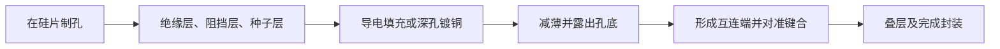
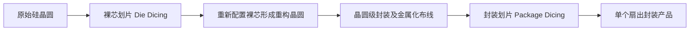

# 目录

**集成电路封装与测试｜完整复习稿（以当前已提供资料为范围）**

- [要点速背](#要点速背)
- [画图重点候选与练习方法](#04-画图重点候选与练习方法)
- [第 1 章 绪论](#第-1-章-绪论)
- [第 2 章 集成电路封装流程](#第-2-章-集成电路封装流程)
- [第 3 章 气密性与非气密性封装](#第-3-章-气密性与非气密性封装)
- [第 4 章 常规芯片封装技术](#第-4-章-常规芯片封装技术)
- [第 6 章 基板技术](#第-6-章-基板技术)
- [第 8 章 先进封装技术](#第-8-章-先进封装技术)
- [作业题：三次作业共16题](#作业题)
- [资料范围与校核说明](#资料范围与校核说明)

# 要点速背

## 0.1 关键概念

**封装与测试主线**

- 封装的四项核心功能：**信号分配、电源分配、热耗散、支撑与防护**；先进封装进一步实现性能和功能密度提升。本课主要讨论器件级封装。[第1章课件，PDF第3—5页](<ppt/Chapter 1 绪论.pdf#page=3>)
- 传统引线框架封装：**减薄 → 划片 → 贴片 → 引线键合 → 塑封 → 后处理 → 测试/检验与包装**。具体后处理含固化、去飞边、电镀、切筋成型、标识等，按产品工艺安排。[第2章课件，PDF第1—2、32—37页](<ppt/Chapter 2 集成电路封装流程.pdf#page=1>)
- 质量检测回答“现在是否达标”，可靠性评价回答“在后续使用条件下能否持续正常工作”。[第1章课件，PDF第9页](<ppt/Chapter 1 绪论.pdf#page=9>)

**工艺与材料**

| 关键词 | 可直接背诵的含义或区别 |
| --- | --- |
| 晶圆减薄 | 降低厚度、重量和热阻，并满足后续装配；研磨、CMP、湿法刻蚀、干法刻蚀要比较效率、损伤和表面质量 |
| 芯片贴装 | 芯片固定到承载体；四种方法为共晶、焊料、黏合剂（可导电或绝缘）、玻璃胶贴装 |
| WB / TAB / FC | WB用细金属线逐点互连；TAB用载带图形引线连接；FC使芯片正面向下、通过凸点连接 |
| 引线键合 | 按能量方式分热压、超声、热超声；按焊点形状分球焊、楔焊 |
| UBM | 焊盘与凸点之间的金属结构，承担黏附、扩散阻挡、润湿等功能；层数与功能分组须看具体结构 |
| 底部填充 | 分散热膨胀失配导致的应力、保护焊点和芯片；不是把材料本身的CTE“变成相同” |
| 气密封装 | 用低渗透材料、壳体及封接控制污染物进入；气密仍有测试条件和允许泄漏量 |
| 封装基板 | 芯片到PCB之间的承载与互连平台，兼顾绝缘、散热及高速信号控制 |

依据：[第2章课件，PDF第3—5、10—18、22、37—44、59页](<ppt/Chapter 2 集成电路封装流程.pdf#page=3>)；[第3章课件，PDF第1页](<ppt/Chapter 3 气密性与非气密性封装.pdf#page=1>)；[第6章课件，PDF第1页](<ppt/Chapter 6 基板技术.pdf#page=1>)。

**先进封装**

- **RDL**负责重新布置信号走线与I/O位置；**TSV**提供穿过硅的垂直通路；**Bump**负责相邻连接界面的金属接合。[第8章课件，PDF第7—10页](<ppt/Chapter 8 先进封装技术.pdf#page=7>)
- **2.5D**重在中介层连接多芯片；本课的**3D TSV集成**重在堆叠芯片间的直接垂直互连。两者都可能使用RDL、凸点与封装基板。[第8章课件，PDF第4—6页](<ppt/Chapter 8 先进封装技术.pdf#page=4>)
- **SoC**在芯片内实现系统集成；**SiP**在封装内组合不同芯片/器件；**Chiplet**强调可组合、可复用的功能裸芯，借助先进封装构建系统。[第8章课件，PDF第18、27页](<ppt/Chapter 8 先进封装技术.pdf#page=18>)
- **FIWLP与FOWLP**看布线和外部I/O能否扩展到裸芯轮廓之外；**CoWoS与InFO**的课件比较重点是是否采用硅中介层及其互连方式。[第8章课件，PDF第19、21—22页](<ppt/Chapter 8 先进封装技术.pdf#page=19>)

## 0.3 易混淆点

| 容易混淆 | 应如何区分 |
| --- | --- |
| 工艺方法、封装外形、系统架构 | WB/TAB/FC讲互连；DIP/QFP/BGA/CSP讲封装形式；SoC/SiP/Chiplet讲集成位置或组织方法，分类维度不同 |
| 引线键合的“三种”与“两种” | 三种按热/压力/超声作用方式；两种按球形或楔形焊点，不是互相矛盾的答案 |
| 芯片贴装与引线键合 | 前者固定芯片并形成相应界面；后者完成芯片焊盘到引脚/载体的细线互连 |
| UBM沉积与凸点制作 | 课件UBM三法为溅射、蒸镀、化学镀镍；电镀凸点在后续另讲，不能把两道工序混在一起 |
| 倒装焊四步 | 按课件是UBM → 凸点制作 → 组装 → 底填；若把前两步合并，便不是课件采用的同一划分 |
| 气密与可靠 | 气密是阻隔性能之一；非气密塑封也可达到特定可靠性要求 |
| 热导率与热膨胀系数 | 高热导利于散热；CTE匹配利于减小热应力，不能互相替代 |
| 有机基板与陶瓷基板 | 低介电、低成本与高导热、耐高温需要综合比较；不同材料的参数不能脱离组成与测试条件 |
| 物理堆叠与3D互连 | 只靠键合线绕到基板的堆叠，课件归为2D+；课件3D TSV强调芯片间直接垂直互连 |
| 2.5D与TSV | 2.5D有无TSV方案，不能用“有没有TSV”单独判定2.5D/3D |
| 数值与单位 | 时间h/min、厚度μm/mm、电流效率百分数/小数、延迟s/m与s必须分清 |

## 0.4 画图重点候选与练习方法

**选图依据。**据本次提供的教师题型线索，另两门课曾考浅沟槽隔离、双大马士革的工艺流程图，双阱CMOS结构和ENMOS转移特性曲线。因此本课优先练习“逐步工艺截面、层次结构、时间或温度曲线”。下列均为**画图重点候选**：作业明确涉及的结构/流程是较直接的依据，学长A4的取舍作为补充；这些材料不能证明本课程已考过相同画图题。

已查看[学长A4资料](<集成电路封装与测试A4纸.docx>)的文字和全部4张唯一内嵌图：TBGA、波峰焊时间、两种TAB凸块位置。其中TBGA图重复出现一次；文件未提供可确认的试卷年份或画图分值。以下“图中必须保留的内容”是练习检查项，不是教师评分表。

| 练习内容与跳转 | 图中必须保留的内容 |
| --- | --- |
| [TSV层次](#87-tsv结构25d3d-tsv与制孔时序)与[截面流程](#88-tsv制造总流程与硅通孔成形) | 硅、绝缘/阻挡/种子层、铜；盲孔→填充→背面减薄露出 |
| [FOWLP三条路线](#813-晶圆级封装扇入与扇出) | 初始朝向、塑封、RDL先后、露铜与脱载位置 |
| [倒装焊四步](#217-倒装芯片c4-与三种互连的比较) | UBM→凸点→翻转组装→底填 |
| [UBM局部剖面](#218-ubm-的功能层材料及结构要求) | 焊盘与钝化开口、功能金属层、凸点 |
| [2.5D与3D剖面](#84-中介层的作用类型与25d结构实例) | 并排/堆叠区别；TSV究竟在中介层还是芯片中 |
| [WB球焊与楔焊循环](#28-热压超声与热超声键合) | 工具、第一焊点、线弧、第二焊点及断线 |
| [转移成型装置与过程](#214-环氧塑封料与转移压缩成型) | 柱塞、转移罐、浇道、模腔、芯片框架和流向 |
| [电镀凸点逐步截面](#221-蒸镀与电镀凸点的工艺及质量控制) | UBM、光刻胶窗口、镀层、去胶/外露UBM刻蚀、回流 |
| [TAB两种凸块位置](#211-tab-凸点的形成形状与转移) | 凸块在载带端还是芯片焊区、金属引脚与载带 |
| [WB-PBGA及倒装BGA](#417-pbga引线键合-bga-与倒装-bga-流程) | 芯片、金线或凸点、封装基板、外焊球 |
| [TBGA剖面](#418-tbgacbga-与-mbga-的结构工艺) | TAB载带、芯片、散热/加固结构、焊球 |
| [波峰焊时间](#46-波峰焊参数桥联控制与缺陷)与[回流温度曲线](#413-回流焊温度曲线及其设定) | 波峰焊的接触/润湿/脱离事件；回流曲线的坐标、四阶段、液相线、峰值及TAL |

**练习顺序：**先画作业对应的TSV、FOWLP、倒装焊/UBM和2.5D/3D，再练其余候选。工艺题每一步都画截面，并在箭头上写“沉积、光刻、刻蚀、填充、减薄”等发生的变化；只写方框流程会漏掉层次关系。结构题先画大层次，再补互连并标名称；曲线题先标横纵轴、关键温度/时间及区段意义。最后遮住图重画，按本表检查遗漏。

**图像读法。**课件图和学长原图为结构示意，尺寸、层厚不按比例；原图保留的合金配比仅属示例。两张中文教学重绘图分别说明倒装焊四步与回流温度曲线，不替代原始工艺细节。FOWLP图另标课外来源；其他图的内容均回到课件核对。

# 第 1 章 绪论

## 1.1 封装的定义

**芯片封装**是把半导体芯片安装在基板或引线框架上，完成固定和电气连接，引出与外部相连的端子，再用外壳或封装介质保护，使其成为可以装配和使用的器件。

> 芯片（Chip/Die）＋基板/引线框架（Package）→ 经封装工艺（Packaging）→ 微电子器件（Device）。

## 1.2 封装的基本功能

| 基本功能 | 要解决的问题 |
| --- | --- |
| 信号分配 | 芯片与外部电路之间的信号连接 |
| 电源分配 | 电能传递、电压分配与导通 |
| 热耗散 | 把芯片工作时产生的热量传到外部 |
| 支撑与防护 | 芯片及互连易受机械、化学、电磁及环境因素影响 |
| 性能增强 | 先进封装中的互连与功能集成需求 |

## 1.4 按材料划分的金属、陶瓷与塑料封装

| 类型 | 主要优点 | 主要局限 |
| --- | --- | --- |
| 金属封装 | 气密性好，结构坚固 | 成本高，外形灵活性较小 |
| 陶瓷封装 | 可形成信号、地、电源多层结构；气密性和可靠性好；适于散热与较大功率需求 | 烧结收缩与尺寸公差控制困难；较高介电常数增加寄生电容；成本较高 |
| 塑料封装 | 材料与工艺较简单、适合自动化批量生产；成本低、体积小、重量轻；绝缘和耐化学腐蚀性能较好 | 导热与热失配、湿气进入、电磁屏蔽、老化等需要控制 |

## 1.5 封装技术的发展阶段与发展方向

发展阶段：插装、表面贴装、面阵列封装、堆叠封装

发展方向：高集成度、大芯片、高散热、高频、多引脚、薄型化。

# 第 2 章 集成电路封装流程

本章按工艺链整理晶圆减薄、划片、贴装、互连、塑封及后处理，并展开载带自动键合（TAB）和倒装芯片（FC）工艺。

## 2.1 芯片封装的前后端工艺链

**前端的任务是形成芯片与载体之间的机械连接和电气互连。**典型流程为：晶圆减薄（将晶圆背面研磨到所需要的厚度） → 晶圆切割（将减薄后的晶圆切成单个芯片） → 芯片贴装（将切割好的芯片固定到引线框架或基板上） → 引线键合（通过金属线将芯片焊盘与基板引脚连接，实现电气互连） 。[第2章课件，PDF第1—2页](<ppt/Chapter 2 集成电路封装流程.pdf#page=2>)

**后端的任务是保护芯片、完成外引脚和最终交付。**典型流程为： 塑封（用环氧模塑料将芯片和引线框架封装起来，提供物理保护和增强可靠性） → 去飞边毛刺（去除塑封后的余料边角料，保证精度） → 电镀（在引脚表面镀上锡或其他金属，提高导电性或可焊性）→ 切筋成型（将封装体分离为独立单元，并将引脚弯曲成标准形状） → 打标（在封装体上标注产品信息） → 成品测试与包装（对封装好的芯片进行功能测试，合格后进行包装出货）。[第2章课件，PDF第32页](<ppt/Chapter 2 集成电路封装流程.pdf#page=32>)

## 2.2 晶圆背面减薄及四种主要方法

**目的：**

① 降低封装高度与体积。适应封装要求。

② 改善散热效率。减薄后热量传导路径缩短，热阻降低，散热好。

③ 优化电气性能。减薄后可降低芯片的导通电阻和寄生电容，提高芯片的响应速度并降低功耗。

④ 支持 3D 集成与先进封装。在 3D 堆叠、硅通孔等工艺中，必须将晶圆减薄至 100 μm 以下甚至更薄，才能实现层间互连。

| 方法 | 去除材料的原理 | 特点与后续处理 |
| --- | --- | --- |
| 机械研磨 | 研磨盘、磨粒与硅片相对运动，利用摩擦去除背面材料 | 表面较粗糙，会产生损伤层和残余应力；常接 CMP、湿法或干法腐蚀以降低损伤、提高抗折强度 |
| 干法腐蚀 | 等离子体中的活性物种与硅表面反应，形成挥发性产物 SiF₄ 等而去除材料 | 去除效率高；课件指出表面质量均匀性较差、成本高 |
| 湿法腐蚀 | 化学溶液连续腐蚀硅片背面，课件示例为向旋转硅片喷洒混合酸液 | 效率高、表面粗糙度低；必须对正面电路进行特殊保护 |
| 化学机械抛光（CMP） | 化学反应先形成较软的表面反应膜，再由磨粒机械去除，反应成膜与机械去膜交替 | 表面质量高、成本高，常用于最后的精加工 |

四种方法应从“材料如何被去除—引入什么损伤—表面质量与成本”比较。[第2章课件，PDF第3—4页](<ppt/Chapter 2 集成电路封装流程.pdf#page=3>)

**TAIKO 减薄：**保留晶圆外围约 3 mm 的边缘支撑环，只将环内区域研薄。[第2章课件，PDF第4—5页](<ppt/Chapter 2 集成电路封装流程.pdf#page=4>)

## 2.3 晶圆划片、清洗与崩边检查

**基本流程：**晶圆安装（Wafer Mount）→ 切割（Wafer Saw）→ 清洗（Wafer Wash）。蓝膜使切开的芯片保持位置、避免散落；切割沿芯片之间的划片槽进行；清洗去除切割产生的硅屑和粉尘，便于后续拾片及贴装。[第2章课件，PDF第5页](<ppt/Chapter 2 集成电路封装流程.pdf#page=5>)

| 划片方式 | 原理 | 特点 |
| --- | --- | --- |
| 刀片切割（BD） | 微细金刚石磨轮高速转动，将硅磨成粉末，去离子水带走硅屑 | 质量受磨粒影响；晶圆越厚越难切割，背面崩裂较明显 |
| 激光全切割 | 聚焦激光在短时间内集中能量，使局部材料升华、蒸发 | 速度快、切割槽窄、材料损失少，能减少背面崩裂；受功率和束斑直径影响 |
| 激光开槽 + 刀片切割 | 先用短脉冲激光开两条细槽，再在中间用磨轮全切 | 减少热影响、崩裂和薄膜分层等问题 |

切割后通过显微镜进行第二道光学检查，重点识别崩边（Chipping Die）等外观缺陷。[第2章课件，PDF第6页](<ppt/Chapter 2 集成电路封装流程.pdf#page=6>)

## 2.4 引线框架与封装载板

**引线框架（Lead Frame，L/F）**是连接芯片内部接触点与外部导线的薄板金属结构，承担芯片支撑固定和电路引出功能，主要由芯片承载区（die paddle）和引脚（lead finger）构成。[第2章课件，PDF第7页](<ppt/Chapter 2 集成电路封装流程.pdf#page=7>)

**材料要求：**热膨胀匹配好，导热导电好，耐热、耐蚀、耐氧化且易电镀；具有足够强度、刚度和成形性；冲裁不易起毛刺，平整度好、残余应力小，同时成本适合批量生产。[第2章课件，PDF第7—8页](<ppt/Chapter 2 集成电路封装流程.pdf#page=8>)

| 制造方法 | 工艺与适用性 | 主要限制 |
| --- | --- | --- |
| 蚀刻型（Etch） | 贴膜制备 → 蚀刻成型；换型周期短、精度高，适合多品种小批量、多引脚和超薄产品 | 投资较大，不适合厚产品及有凸形结构的产品；低引脚大批量产品成本不占优 |
| 冲压型（Stamp） | 精密模具制作 → 高速带料精密冲制 → 选择性电镀、切断校平 | 依赖精密模具 |

**IC 载板材料：**包括铜箔、基板、干膜/湿膜光阻及其他金属材料。载板采用超薄、均匀的电解铜箔；ABF 用于倒装芯片等较高阶载板。[第2章课件，PDF第8—9页](<ppt/Chapter 2 集成电路封装流程.pdf#page=9>)

## 2.5 芯片贴装的四种方法

**芯片贴装（Die Attachment）**是把芯片固定在封装载板或引线框架承载区的过程，要求机械结合牢固、散热良好；采用倒装形式时，还与电连接直接相关。四种主要方法如下。[第2章课件，PDF第7、10—12页](<ppt/Chapter 2 集成电路封装流程.pdf#page=10>)

| 方法 | 原理、材料与过程 | 工艺条件及优缺点 |
| --- | --- | --- |
| 共晶贴装 | 共晶合金在共晶温度下在芯片和焊盘之间形成共晶体从而形成连接 | 导热导电好，但温度高、CTE 失配会引入热应力甚至开裂 |
| 焊接贴装 | 焊料与金属化表面发生冶金结合 | 导热导电好，但工艺较复杂、焊料易氧化 |
| 黏合剂贴装 | 利用高分子聚合物黏结剂的胶粘特性将硅芯片黏附在基座上 | 加 Ag 粉/颗粒可导电导热，加 Al₂O₃ 可用于绝缘需求。成本低、易自动化、温度低、应力小；剪切强度和热稳定性较低，可能吸湿或高温放气。 |
| 玻璃胶贴装 | 低熔点玻璃粉与有机溶剂/树脂制成浆料，涂覆后放芯片，分阶段加热，玻璃熔融后冷却连接 | 强度较高、适于自动化，但加热过程复杂、温度高，散热弱于共晶和焊料贴装 |

**拾片与贴装：**顶针从蓝膜下方顶起芯片 → 吸取头从上方吸起芯片 → 将芯片移至已点银胶的承载区 → 施加适当压力固定 → 固化。银胶兼有固定、散热和导电三种作用。[第2章课件，PDF第11—12页](<ppt/Chapter 2 集成电路封装流程.pdf#page=12>)

## 2.7 引线键合的原理、材料与焊点形状

**互连**是把芯片焊区与封装引脚或基板布线焊区连接，实现电信号传输。**常见方法**为引线键合（WB）、载带自动键合（TAB）和倒装键合（FCB）。**WB** 利用高纯度金属丝或窄带，把芯片焊盘与引线框架/基板连接点焊接起来。外部能量破坏氧化层和污染物，使接触金属塑性变形、紧密接触并发生界面原子扩散。[第2章课件，PDF第13—14页](<ppt/Chapter 2 集成电路封装流程.pdf#page=13>)

**按焊点形状分：**球形键合与楔形键合。常见球焊流程第一点是球形，第二点是楔形/鱼尾形；楔焊流程的两点均可为楔形。[第2章课件，PDF第14—17页](<ppt/Chapter 2 集成电路封装流程.pdf#page=14>)

**三种引线键合互连技术：** 热压、超声与热超声键合

| 方法 | 能量与原理 | 典型流程及焊点 | 主要特点 |
| --- | --- | --- | --- |
| 热压键合（T/C） | 温度 + 压力，促使金属塑性变形、接触和扩散 | 加热焊区 → 加压形成第一点 → 拉出线弧 → 形成第二点 | 温度和压力较高、时间较长，易氧化及损伤芯片；常见球—楔 |
| 超声键合（U/S） | 超声振动 + 压力，通常无需外加热；摩擦破膜并促使紧密接触 | 楔劈刀施压和超声形成第一点 → 抬刀送线拉弧 → 第二点键合 → 断线 | 通常可在室温进行，压力较低；常见楔—楔 |
| 热超声键合（T/S） | 热压基础上叠加超声能量 | EFO 烧球 → 第一焊区球形键合 → 抬刀送线形成线弧 → 第二焊区鱼尾形键合 → 断线 | 可降低热压温度、提高键合强度；常见球—楔 |

**画图重点候选：球焊与楔焊动作序列。**

**手绘要点：**球焊按“烧球→第一球形焊点→抬刀送线形成线弧→第二楔形焊点→断线”画；楔焊按“第一楔点→送线成弧→第二楔点→断线”画，标金属丝和劈刀。

**引线键合四要素：**压力（Force）、超声强度（USG Power）、时间（Time）、温度（Temperature）。[第2章课件，PDF第17—18页](<ppt/Chapter 2 集成电路封装流程.pdf#page=18>)

## 2.10 TAB 的结构、优势与材料

**载带自动键合（Tape Automated Bonding，TAB）**使用带金属引线图形的柔性载带，把芯片焊区与封装外壳或基板焊区连接。载带既承载芯片，又提供连接引线；齿孔驱动载带步进，使引线与芯片精确对准，可实现多点一次键合。常用结构由 PI 等有机膜和 Cu 箔构成。[第2章课件，PDF第20、23页](<ppt/Chapter 2 集成电路封装流程.pdf#page=20>)

**相对 WB 的主要优势([第2章课件，PDF第21页](<ppt/Chapter 2 集成电路封装流程.pdf#page=21>))：**

1. 高密度，细间距：结构轻薄，电极尺寸和节距较小，可容纳更多 I/O；
2. 电气性能好：互连电阻、电容、电感较小，有利于高频、高速信号传输；
3. 一致性、可靠性好：光刻精度高，铜箔导热导电及机械性能较好；
4. 便于测试与老化：可以在载带上进行老化、筛选和测试；
5. 生产效率高：适合载带尺寸标准化与自动化批量制造。

| 类型 | 结构 | 特点 |
| --- | --- | --- |
| 单层带 | Cu 箔 | 成本低、工艺简单、耐热好；课件指出不能用于载带上的老化筛选测试 |
| 双层带 | Cu-PI | 柔性、成本较低、可做精细图形和筛选测试；带过宽时尺寸稳定性下降 |
| 三层带 | Cu-黏结剂-PI | Cu 与 PI 黏结较好、可卷绕、适于批量生产和筛选测试；工艺较复杂、成本较高 |
| 双金属带 | Cu-PI-Cu | 用于改善高频信号特性 |

**材料要求：**基带需耐高温、与铜黏结及热匹配良好、收缩小、尺寸稳定、耐腐蚀、强度高、吸水率低，如 PI、PET、BCB。金属引线需导电好、强度和延展性好、表面平整、易光刻及电镀，通常采用 Cu 箔。[第2章课件，PDF第21—22页](<ppt/Chapter 2 集成电路封装流程.pdf#page=22>)

## 2.11 TAB 凸点的形成、形状与转移

**凸点作用：**越过钝化层高度，实现引线连接；提供所需金属化条件；避免引线与芯片短路，并提供受压变形的缓冲。TAB 凸点一般沿芯片周边均匀、对称布置。凸块可制作在芯片焊盘上，也可制作在载带内引线端；后者称凸块式载带 TAB，前者称凸块式芯片 TAB。[第2章课件，PDF第24—25页](<ppt/Chapter 2 集成电路封装流程.pdf#page=25>)

**典型金属凸点流程：**已钝化芯片 → 沉积黏附/阻挡/压焊金属层 → 涂光刻胶并开窗口 → 电镀凸点 → 去胶 → 去除凸点以外的金属层；对焊料凸点继续回流成形。[第2章课件，PDF第25页](<ppt/Chapter 2 集成电路封装流程.pdf#page=25>)

| 形状 | 形成原因 | 影响 |
| --- | --- | --- |
| 蘑菇状 | 光刻胶较薄，凸点长出胶面后继续横向生长 | 顶部及尺寸较难控制；受压横向变形后相邻点更易短路 |
| 柱状 | 厚胶限制侧向生长 | 同高度和顶面积下，底部接触面积较大、强度较高，顶面较平整 |

压力过大可使软金凸点变形过量而短路；压力过小又无法补偿高度差，影响结合。提高强度时可组合 Au、Ni、Cu 等金属。**凸点转移技术**先在玻璃载体上制作凸块并转移至载带内引线端，再把带凸点的载带键合到芯片，减少直接在芯片上制凸点的负担。[第2章课件，PDF第26—27页](<ppt/Chapter 2 集成电路封装流程.pdf#page=26>)

**画图重点候选：TAB凸块究竟位于哪一侧。**

**手绘要点：**两图都先画芯片、焊区与载带金属引脚，再分别画“载带引脚端凸块”和“芯片焊区凸块”；按原图标出载带及支撑关系，不给单层载带额外补画PI层。仅改变标题、却把两图凸块画在同一侧，就没有体现区别。

## 2.12 TAB 载带设计与制作

**设计对应关系：**内引线的指端位置、尺寸和节距应与芯片凸点一一对应；外引线焊区应与基板焊区一一对应。引线由内向外扇出并逐渐加宽，避免宽度突变引起较大热应力和机械应力。铜箔厚度要兼顾精细图形与机械强度：课件单层带示例为 50～70 μm，有 PI 支撑的载带可用 18～35 μm 或更薄铜箔。[第2章课件，PDF第27页](<ppt/Chapter 2 集成电路封装流程.pdf#page=27>)

**不同载带的制作要点：**

1. 单层 Cu 箔带：清洗 → 涂胶、光刻显影及背面保护 → 腐蚀引线图形 → 去胶 → 电镀 → 退火。
2. 双层带：将有机膜体系与金属箔结合，双面制图，一面形成金属引线、另一面形成 PI 图形及定位传送孔，再完成去胶、固化/亚胺化和表面电镀。
3. 三层带：制作模具 → 冲压 PI 定位传送孔与框架孔 → 涂黏结剂并覆 Cu 箔 → 加热加压黏覆 → 切割 → 制作引线图形。
4. 双金属带：PI 支撑框架两面形成铜层，双面光刻引线图形，并通过局部电镀的通孔实现上下金属互连。

## 2.13 TAB 内外引线焊接、封胶与筛选

**完整流程：**制备芯片凸点和载带 → 内引线键合（ILB）→ 芯片及焊点封胶保护 → 老化、筛选、测试 → 外引线键合（OLB）。ILB 连接“载带引线—芯片”，OLB 连接“载带引线—封装外壳或基板”；完成两者后芯片才与外部基板电路连通。[第2章课件，PDF第23—24、28页](<ppt/Chapter 2 集成电路封装流程.pdf#page=24>)

**内引线焊接：**对位 → 焊接（热压头下降、加热加压焊接） → 抬起（焊头抬起并卷带步进） → 芯片传送（供片系统传送下一颗良品）

**焊接方法：**①热压焊②热压回流焊（硬金属）。关键变量是温度 $T$、压力 $P$、时间 $t$，以及焊头平整度、平行度、凸点高度和引线厚度的一致性。。[第2章课件，PDF第29—30页](<ppt/Chapter 2 集成电路封装流程.pdf#page=29>)

**封胶：**内引线焊后涂覆环氧树脂或硅酮保护芯片和焊点，要求低黏度、流动性好、低应力、低离子及低 α 粒子含量，固化时避免气泡和预应力。

**外引线键合包含供片、冲压焊接和回位三个步骤**：通过筛选的载带芯片裁切、对准并贴装在基板，再用热压或热压回流焊连接外引线，固化黏结剂。[第2章课件，PDF第30页](<ppt/Chapter 2 集成电路封装流程.pdf#page=30>)

**筛选与测试：** **加热筛选**可在烘箱或 N₂ 保护设备内进行；**老化试验**前切断公共联接，使每颗芯片独立，再接电源总线和地线。[第2章课件，PDF第31页](<ppt/Chapter 2 集成电路封装流程.pdf#page=31>)

## 2.14 转移、压缩成型

**封装成型**将完成互连的芯片与框架/基板包裹起来，保护内部结构。以塑料封装中的**热固性聚合物的转移成型技术**为主。[第2章课件，PDF第32—33页](<ppt/Chapter 2 集成电路封装流程.pdf#page=32>)

**EMC 特性：**低温存储，使用前需先回温；其特性为：固化前为液态、或块状、颗粒状，在高温下先处于熔融状态，然后会逐渐硬化，最终成型。[第2章课件，PDF第33页](<ppt/Chapter 2 集成电路封装流程.pdf#page=33>)

**转移成型流程（[第2章课件，PDF第33—34页](<ppt/Chapter 2 集成电路封装流程.pdf#page=33>)）：**

1. 上料：装入已贴片并完成互连的框架/基板
2. 预热：使得后续树脂能更好地填充模具
3. 合模：达到预设温度后，模具上下两部分将模具夹紧
4. 装载和材料转移：EMC进入转移罐，活塞加压，经浇口注入模腔，包裹芯片和引线
5. 固化：加热进一步固化
6. 脱模：打开模具，取出器件
7. 去溢料：去除多余的EMC

**转移成型的限制：**耗材利用率不高；用于固定引线框架；树脂流动可能冲歪甚至冲断金线；气孔难以完全消除。

**压缩成型：** 将产品浸入熔融状态树脂进行成形封装

**压缩成型优势：** 耗材利用率高、树脂横向流动较少，工序少。[第2章课件，PDF第34页](<ppt/Chapter 2 集成电路封装流程.pdf#page=34>)

**常见缺陷：**冲线、碰线、断线、孔洞、内部气泡、缺角、上下错位和溢胶。[第2章课件，PDF第34页](<ppt/Chapter 2 集成电路封装流程.pdf#page=34>)

**画图重点候选：转移成型装置与料流。**

## 2.15 模后固化、去飞边、电镀与镀后退火

**模后固化（PMC）**使塑封料继续固化并趋于稳定、消除内部应力。[第2章课件，PDF第34—35页](<ppt/Chapter 2 集成电路封装流程.pdf#page=35>)

**去毛边飞刺（De-flash）**去除管体周围、引脚之间溢出的塑封料，避免影响切筋成形。方法包括**介质去飞边毛刺**（高压气体携研磨料）、**水去毛边飞刺**（高压水冲洗）及**溶剂去毛边飞刺**（适合薄毛刺的溶剂处理）。[第2章课件，PDF第35页](<ppt/Chapter 2 集成电路封装流程.pdf#page=35>)

**外引脚电镀**用于保护引线框架表面、提高可焊性及导电性：

1. 无铅电镀：纯锡等镀层
2. 锡铅电镀。

**上焊锡：**在框架引脚上做保护性镀层，以增加其可焊性：

1. 浸锡：清洗 → 浸助焊剂 → 浸锡 → 清洗 → 烘干

2. 电镀：清洗 → 电镀 → 烘干

   [第2章课件，PDF第35页](<ppt/Chapter 2 集成电路封装流程.pdf#page=35>)

**镀后退火**：降低无铅锡镀层潜在的晶须生长风险。（晶须是可能从锡镀层长出的须状晶体，接触相邻引脚后可能造成短路）[第2章课件，PDF第36页](<ppt/Chapter 2 集成电路封装流程.pdf#page=36>)

## 2.16 分割、切筋成型、标识与终测

**分割（Singulation）：** 把包含多个器件的基板分成单颗；**切筋（Trim）**切除引线框架连筋，使单元分离；**成型（Form）**把外引脚弯成所需形状并放入料管或托盘。三者都可能涉及分离，但加工对象与目的不完全相同。[第2章课件，PDF第36页](<ppt/Chapter 2 集成电路封装流程.pdf#page=36>)

**打码（Marking）：**记录制造商、器件代码、名称、日期和批次等。**油墨印码**依靠光/热固化，表面要求较高、可能擦除；**激光打码**依靠表面加工形成标记。

**终测** 重点检查塑封、电镀和切筋成形缺陷；最终产品还需老化及测试。[第2章课件，PDF第37页](<ppt/Chapter 2 集成电路封装流程.pdf#page=37>)

包装时将器件放入包装带、料管或托盘及外包装，在搬运过程中避免物理和静电损伤。[第2章课件，PDF第37页](<ppt/Chapter 2 集成电路封装流程.pdf#page=37>)

## 2.17 倒装芯片、C4 与三种互连的比较

**倒装芯片键合（FCB）**使芯片有源面朝下，利用芯片凸点与基板对应焊区直接连接，可同时完成多点互连。[第2章课件，PDF第38页](<ppt/Chapter 2 集成电路封装流程.pdf#page=38>)

| 比较点 | WB | TAB | FCB |
| --- | --- | --- | --- |
| 连接介质 | 金属丝/窄带 | 图形化载带引线 | 芯片凸点 |
| 焊区分布 | 芯片周边 | 芯片周边 | 芯片表面 |
| 连接及装配特点 | 逐点拉线，线弧占空间 | 载带多点一次键合，需制作载带和凸点 | 芯片直接面朝下安装，互连短、占板面积小 |
| 相对趋势 | 安装密度较低 | 安装密度较高，便于载带测试 | 安装密度高，适合较多 I/O 与高速互连 |

**FCB 优点：**

1. 电气性能好：互连短，寄生电阻、电容、电感小；
2. 可面阵排布、占板面积小
3. 安装和互连同时完成，适合自动化；
4. 背面暴露结构便于从背面冷却。

**缺点：[第2章课件，PDF第39—40页](<ppt/Chapter 2 集成电路封装流程.pdf#page=39>)**

1. 凸点制作增加工艺与成本
2. 焊点检查困难
3. 底填需要固化时间
4. 材料热膨胀失配引起应力。

**C4（Controlled Collapse Chip Connection，可控塌陷芯片连接）**：利用焊料回流形成连接。熔化焊料可补偿一定的凸点高度差或基板不平，并通过表面张力产生自对准作用、降低所需压力。自对准受凸点数量和尺寸、芯片大小、基板金属化、焊料组分及初始放置偏差等影响，不能等同于“不需要对准”。[第2章课件，PDF第40、56、59页](<ppt/Chapter 2 集成电路封装流程.pdf#page=40>)

**四步总流程：**① UBM 制作；② 芯片凸点制作；③ 已制凸点的芯片与基板组装互连；④ 底部填充与固化。对准及回流等是第三步的展开。[第2章课件，PDF第40页](<ppt/Chapter 2 集成电路封装流程.pdf#page=40>)

**画图重点候选：倒装焊四步截面。**

**来源：**依据第2章PDF第40页四步划分，以及第41、56、59页结构与操作重绘；这是教学简图，非课件原图，省略钝化层及UBM内部细层。[四步依据](<ppt/Chapter 2 集成电路封装流程.pdf#page=40>)；[底填依据](<ppt/Chapter 2 集成电路封装流程.pdf#page=59>)。

**手绘要点：**前两步画焊盘上UBM和凸点；第三步将有源面翻向基板，使凸点与基板焊盘相连；第四步在已形成的连接点周围填胶。UBM不是大焊球，底填料也不是代替凸点的导电通路。具体连接可采用正文所列多种方法，不把回流写成所有倒装方案必经的步骤。

## 2.18 UBM 的功能层、材料及结构要求

**凸点下金属化（Under Bump Metallurgy，UBM）**是芯片焊盘与凸点之间的多层金属结构，用于黏附、扩散阻挡、润湿/导电以及防氧化。第41页图片按功能分成三层：

| 从焊盘向上 | 作用 | 课件材料示例 |
| --- | --- | --- |
| 黏附层 | 与 Al 焊盘及周围钝化层结合，保持低接触电阻和合适的热匹配 | Cr、Ti、TiW 等 |
| 扩散阻挡层 | 抑制凸点金属与 Al、Si 相互扩散，避免形成不利的金属间化合物 | Ti、TiW、Ni、Cu、Pd、Pt 等 |
| 润湿层 | 使焊料/凸点材料能良好润湿和连接，并可作为电镀种子层 | Au、Ni、Cu 等 |

**另一种分层口径：**同页右下将“黏附 + 扩散阻挡”合为第一层，第二层为焊料润湿层，第三层为 Au 氧化阻挡层。两种分法强调的功能分组不同，不能因此把防氧化功能漏掉；实物层数由金属组合决定，并非固定只有三片金属。课件举 Ti/Cu/Au、TiW/Cu/Au、Cr/Cu/Au、Ni/Au 等组合。[第2章课件，PDF第41—42页](<ppt/Chapter 2 集成电路封装流程.pdf#page=41>)

**要求：**与焊盘及钝化层结合牢固；与焊盘形成良好欧姆接触，因此沉积前需去除 Al 表面氧化物；能够阻挡不利扩散；表面易润湿并抗氧化；对硅片引入的应力小，避免底部开裂和凹陷。不同层次组合影响 UBM 自身及其两侧界面的可靠性。[第2章课件，PDF第42页](<ppt/Chapter 2 集成电路封装流程.pdf#page=42>)

**画图重点候选：UBM功能层与凸点局部剖面。**

**来源：**第2章课件PDF第41页右上、右下，保留功能说明和剖面；没有采用该页待核实的毫米厚度值。[原页](<ppt/Chapter 2 集成电路封装流程.pdf#page=41>)

**手绘要点：**先画Si芯片、Al焊盘和两侧钝化层开口，再画UBM及上方凸点。按题目口径标“黏附→阻挡→润湿”，或注明采用“黏附/阻挡合层→润湿→防氧化”的功能分组。原图B合并黏附与阻挡，不能据图中颜色块数否定正文另一种分法；画图应写出层的作用，勿按示意厚度背数值。

## 2.19 UBM 沉积、化学镀镍与铝焊盘预处理

**课件列举的三种 UBM 沉积方法：**

1. **溅射：**逐层沉积薄膜，再通过光刻和刻蚀形成 UBM 图样。
2. **蒸镀：**通过掩模逐层选择性沉积，掩模可用于对应凸点的形成。
3. **化学镀镍：**在适当处理后的 Al 焊盘上选择性沉积 Ni，无需真空和图样刻蚀设备，成本较低；Ni 兼有连接、扩散阻挡和可润湿表面的作用。

化学镀镍与后续“电镀凸点”不是同一概念。课件 Ni UBM 厚度示例为 1～15 μm，随后覆盖 0.05～0.1 μm Au 以防氧化、保持可焊性。[第2章课件，PDF第43页](<ppt/Chapter 2 集成电路封装流程.pdf#page=43>)

**为何预处理：**Al 表面氧化物妨碍镀层黏附。课件列锌酸盐处理、钯活化、镍置换和直接镀镍四种方法。锌酸盐法通过清洗 → 去除表面氧化物 → 浸锌，在铝表面形成 Zn 层，既抑制再氧化又为镀镍建立中间层；首次浸锌可能粗糙，去除第一次 Zn 后二次浸锌可使表面更薄、更均匀，但也消耗 Al。化学镀镍前需保护晶圆背面，防止在裸硅上形成易脱落的 Ni 并导致短路。[第2章课件，PDF第43—45页](<ppt/Chapter 2 集成电路封装流程.pdf#page=44>)

**锌酸盐处理中的反应式（按课件图示整理）：**

$$
\mathrm{Al_2O_3+2NaOH\rightarrow 2NaAlO_2+H_2O}
$$

$$
\mathrm{3ZnO_2^{2-}+2Al+2H_2O\rightarrow3Zn+4OH^-+2AlO_2^-}
$$

第一式说明碱性体系去除氧化铝；第二式说明 Al 被氧化、Zn 被还原并沉积的置换过程。它们适用于课件所述碱性锌酸盐预处理语境。[第2章课件，PDF第43页图示](<ppt/Chapter 2 集成电路封装流程.pdf#page=43>)

**其他路线：**钯活化先在清洁的 Al 上选择性沉积 Pd，再化学镀 Ni；镍置换以 Ni 离子置换 Al 后继续化学镀；直接镀镍则在清洁后用活性剂除氧化物，并立即进入镀槽。化学镀的共同原理是在还原剂作用下将金属离子还原并沉积。[第2章课件，PDF第45、53页](<ppt/Chapter 2 集成电路封装流程.pdf#page=45>)

## 2.20 倒装凸点的类型与选择

**按材料：**Au、Ni-Au、Au-Sn、Cu、Cu-Pb-Sn、In、Pb-Sn 及聚合物凸点等。**按形状：**蘑菇状、柱状、球形和叠层。**按布局：**周边分布和面阵分布。应同时辨认材料、外形及布局，三种分类互不替代。[第2章课件，PDF第45页](<ppt/Chapter 2 集成电路封装流程.pdf#page=45>)

焊料回流可利用表面张力形成球形凸点并产生自中心作用；熔化及塌落能补偿部分共面性差异。凸点制作需兼顾 I/O 数、节距、高度一致性、材料兼容性、批量与成本。课件实际展开蒸镀、电镀、焊膏印刷、钉头、置球、转移/移置、化学镀、激光、柔性、叠层和喷射等路线。[第2章课件，PDF第45—55页](<ppt/Chapter 2 集成电路封装流程.pdf#page=46>)

## 2.21 蒸镀与电镀凸点的工艺及质量控制

**蒸镀/溅射凸点：**清洗并去除氧化物 → 对准金属掩模（或厚光刻胶掩模）→ 沉积 UBM → 沉积凸点金属 → 去掩模/剥离 → 焊料回流成球。课件 C4 示例采用 Cr/Cr-Cu/Cu/Au UBM，再沉积 Pb/Sn。其优点是工艺成熟、与 IC 工艺兼容；限制是专用掩模灵活性差、较高凸点需要较长沉积时间、设备费用高，较适合 I/O 较少、焊区较大等情形。[第2章课件，PDF第46—47页](<ppt/Chapter 2 集成电路封装流程.pdf#page=47>)

**电镀凸点：**清洗 → 沉积 UBM/导电种子层 → 涂厚光刻胶、曝光显影出凸点窗口 → 电镀所需金属 → 去胶 → 去除凸点外种子层及 UBM → 按材料需要回流。厚光刻胶充当电镀模具，导电种子层为电镀提供电流路径。课件分别展示 Cu/Au 基底加焊料的路线，以及 Ti-W-Au 多层金属化、闪溅种子层后电镀 Au 的路线。[第2章课件，PDF第48页](<ppt/Chapter 2 集成电路封装流程.pdf#page=48>)

**关键控制：**窗口残胶会影响沉积；厚胶的涂覆、曝光和显影较难；镀液流动、电源形式及电流密度影响颗粒、均匀性和高度一致性；去种子层时既要完全去除避免短路，也要限制对凸点的过度腐蚀。电镀适于批量制作多类凸点，但电流分布不均会造成高度差，也可能引入晶圆应力。[第2章课件，PDF第48—49、55页](<ppt/Chapter 2 集成电路封装流程.pdf#page=49>)

**画图重点候选：电镀凸点的逐步截面。**

**来源：**第2章课件PDF第48页左上(a)—(f)工艺实例；A4文字也列出该路线。此处是先镀Cu/Au、再镀焊料的一种具体流程。[原页](<ppt/Chapter 2 集成电路封装流程.pdf#page=48>)

**手绘顺序：**(a)连续UBM/种子层；(b)光刻胶开窗；(c)在窗口内镀Cu/Au；(d)第二层胶开窗并镀焊料；(e)去胶、刻蚀凸点外露UBM；(f)回流成球。每幅保留相同的芯片焊盘和钝化开口作参照，只改变当步加工的层。不能漏画电镀时的导电层，也不能在刻蚀后把所有凸点继续画成被连续金属短接。

## 2.22 电镀厚度与时间的计算

课件第49页左上公式以图片嵌入，表达镀层厚度与电流密度、时间及电流效率之间的关系。为避免百分数代入混乱，统一写成：

$$
\delta\,[\mu\mathrm m]
=\frac{100\,D_k\,t\,\eta\,k}{\rho}
$$

其中 $D_k$ 为电流密度，单位 A/dm²；$t$ 为电镀时间，单位 h；$\eta$ 为电流效率的小数值（95% 代入 0.95）；$k$ 为金属的电化学当量，单位 g/(A·h)；$\rho$ 为镀层金属密度，单位 g/cm³。系数 100 来自单位换算：$1\,\mathrm{cm^3/dm^2}=100\,\mu\mathrm m$。本式是课件公式统一效率记号后的等价形式。[第2章课件，PDF第49页图示](<ppt/Chapter 2 集成电路封装流程.pdf#page=49>)

课件原式为 $\delta=D_k t\eta k/d$，并要求在厚度以 μm 表示时把 $\eta$ 写成不带百分号的数值，如 95% 代入 95；原式 $d$ 即这里的 $\rho$。**两种记法不能交叉使用**，否则会差 100 倍。

**条件与结论：**在材料、有效电流密度和效率保持不变时，厚度与电镀时间成正比；目标厚度相同时，时间与电流密度、效率成反比。由课件关系可得，若 $t_0$ 是同电流密度下、效率 100% 时镀 10 μm 的时间，则镀 $x$ μm 的时间为：

$$
t=t_0\frac{x}{10\,\mu\mathrm m}\frac{1}{\eta}.
$$

课件表中以 Au 为例，$D_k=1\,\mathrm{A/dm^2}$、效率 100% 时镀 10 μm 约需 15.7 min。公式用于平均厚度估算；晶圆上电流密度不均会使局部高度偏离平均值。[第2章课件，PDF第49页](<ppt/Chapter 2 集成电路封装流程.pdf#page=49>)

## 2.23 印刷、钉头、置球及其他凸点方法

| 方法 | 原理与主要流程 | 适用性和限制 |
| --- | --- | --- |
| 焊膏印刷 | 清洗并制备图形化 UBM → 对准模板 → 刮印焊膏 → 回流成球 | 工艺较简单、可批量生产；模板与印刷厚度一致性重要 |
| 钉头/打球 | 用球焊机烧球并压焊到焊盘 → 立即断丝 → 对全部凸点整平；必要时进一步整形 | 可用于单芯片、成本较低；逐点制作效率低、高度一致性需处理，固态钉头本身不提供焊料回流的自对准作用 |
| 置球 | UBM 制作 → 用掩模定位焊料球 → 保护气氛下回流 → 冷却、去掩模 | 焊料球和定位模板的一致性重要；课件还举放球同时用激光脉冲回流的设备 |
| 焊料转移 | 在对焊料不润湿的临时载体上先制凸点 → 与目标焊盘对准 → 回流使焊料转移到 UBM | 图样必须与焊盘对应，利用载体与焊盘润湿性差异完成转移 |
| 移置凸点 | 芯片重新布线形成新焊区 → 在可重复使用框架上制对应凸点 → 对准、加热润湿并转移 | 适于重新布线后的新焊区，移置框架可重复使用 |
| 化学镀凸点 | 焊盘清洁/调理 → 浸锌建立中间层 → 用还原剂化学沉积 Ni/Au 等凸点 | 无需外加电极，也可不采用光刻；适于单芯片，但高度受限 |
| 激光凸点 | 激光加热局部焊区并分解金属有机前驱体，沉积 Au 凸点 | 适于多品种小批量、单芯片制作；需控制激光能量、温度及沉积时间，费用较高 |
| 柔性凸点 | 先制作有弹性的聚合物芯子，再以化学镀、蒸镀/溅射或电镀包覆金属 | 可补偿一定的凸点高度差、基板不平及热失配，课件说明特定材料体系可返修；需兼顾强度、热稳定性和界面可靠性 |
| 叠层凸点 | 通过打球、整平及重复叠加，或焊料叠层，使凸点达到需要的高度 | 用于改善过低凸点导致的剪切应力问题；Au 打球叠层较简便，焊料叠层较复杂 |
| 喷射凸点 | 喷射头将熔融 Pb-Sn 焊料逐点送至金属化焊区 | 制作灵活；N₂ 压力、压电激励幅度/频率及气流共同决定一致性 |

以上方法的流程、特点及比较来自课件第50—55页；“不需 UBM”“可返修”等结论均应限定在课件对应材料和工艺条件下。[第2章课件，PDF第50—55页](<ppt/Chapter 2 集成电路封装流程.pdf#page=50>)

## 2.24 倒装芯片的四类组装互连与导电胶

组装首先要求基板顶层焊区与芯片凸点位置一一对应，并与凸点金属具有合适的压焊或焊料润湿条件。[第2章课件，PDF第56页](<ppt/Chapter 2 集成电路封装流程.pdf#page=56>)

| 互连方法 | 原理和步骤 | 关键条件及限制 |
| --- | --- | --- |
| 焊料焊接 | 在基板焊区施加焊膏/焊剂，对准凸点后回流，再清洗和测试 | 充分润湿、避免残留；传统不可返修底填应在测试之后进行 |
| 热压焊接 | 加热与加压使凸点和对应金属表面形成连接 | 金凸点课件示例温度约 300 ℃；芯片与基板平行度直接影响各点变形及强度 |
| 热声焊接 | 在热压基础上从芯片背面向连接区施加超声 | 可降温、减压、缩短时间；超声过强可能在硅片形成凹坑或损伤 |
| 导电胶连接 | 在凸点/焊盘之间通过导电胶形成连接并固化 | 工艺简单、固化温度低、连接后通常无需清洗；课件指出其电和热性能通常弱于 Pb-Sn 焊料 |

来源：[第2章课件，PDF第56—57页](<ppt/Chapter 2 集成电路封装流程.pdf#page=57>)。

**ICA 与 ACA：**各向同性导电胶（ICA）通常由树脂和导电颗粒组成，各方向均可导电；各向异性导电胶（ACA）含适量金属颗粒或金属包覆聚合物颗粒，连接后在垂直方向建立导电接触而保持横向绝缘。课件举 ACA 用于芯片与玻璃基板连接的 COG 技术；节距缩小或颗粒过多时横向短路风险增加，可设置绝缘坝限制颗粒位置。[第2章课件，PDF第58页](<ppt/Chapter 2 集成电路封装流程.pdf#page=58>)

**光固化连接示例：**基板涂光敏树脂 → 芯片凸点与基板金属焊区对位 → 施压并紫外光固化，利用固化后的结构保持微凸点接触。这是课件列举的专门工艺，需与焊料回流或导电颗粒形成导电路径区分。[第2章课件，PDF第58页](<ppt/Chapter 2 集成电路封装流程.pdf#page=58>)

## 2.25 底部填充的作用、材料与工艺顺序

**目的：**芯片与基板 CTE 不同，温度变化时产生差异变形和焊点热应力。底部填充把部分集中于焊点的应力分散到更大的结构范围，抑制焊料蠕变，提高连接强度、刚度及抗振动冲击能力，并阻隔湿气和离子污染。课件例举 Si 的 CTE 为 2.8 ppm/℃、FR-4 为 15.8 ppm/℃；底填是缓解失配引起的应力，不会把两种原材料的 CTE 变成相同。[第2章课件，PDF第59页](<ppt/Chapter 2 集成电路封装流程.pdf#page=59>)

**材料要求：**低挥发、低杂质离子、敏感器件用低 α 放射材料；填料粒径小于填充间隙，在填充温度下流动性好；适当 CTE、较高玻璃转化温度及合适的弹性模量/强度；固化温度不能造成 PCB 变形；高温高湿下仍应保持较高绝缘电阻。普通塑封环氧不一定满足粒径、黏度及放射性要求，不能直接替用。[第2章课件，PDF第59—60页](<ppt/Chapter 2 集成电路封装流程.pdf#page=59>)

| 顺序 | 流程 | 关键点 |
| --- | --- | --- |
| 焊后底填 | 对准 → 焊料回流 → 清洗、测试 → 边缘点胶并靠毛细流动充填 → 固化 | 需控制填充量、温度、流动路径和气孔；课件示例填充时加热至 70～75 ℃，再在约 130 ℃ 固化 3～4 h |
| 焊前底填（No-flow Underfill） | 基板预置兼具焊剂与底填功能的材料 → 芯片对准贴装 → 回流与固化 | 将焊接、填充和固化结合，流程顺序与传统焊后填充不同 |

**质量控制：**填充不足会留下空隙、影响应力支撑，过量会溢流；温度改变流动性；单侧进胶路径长，多侧进胶的汇合可能困气。流动路径与材料、几何结构必须共同设计。传统课件示例中的环氧固化后难以拆下芯片，因此应在底填前测试；这一限制不应覆盖前文专门介绍的可返修柔性凸点体系。[第2章课件，PDF第56、60—61页](<ppt/Chapter 2 集成电路封装流程.pdf#page=60>)

## 2.26 倒装焊点的热疲劳与可靠性边界

**主要失效：**热循环引起焊点疲劳，腐蚀或原子迁移导致短路/断路；底填若将自身变形过度传给芯片，也可能造成芯片开裂。热疲劳取决于焊料性能、芯片与基板 CTE、焊点高度、焊点距结构中心的距离及温度循环范围。评价可采用有限元分析、经验模型和仿真；苛刻条件仍需加速试验验证。[第2章课件，PDF第61页](<ppt/Chapter 2 集成电路封装流程.pdf#page=61>)

课件在“其他条件相同”的前提下给出以下焊料相对疲劳寿命，用于说明材料差异；它们不是具有统一单位的绝对寿命，也不是不受环境影响的材料排名。

| 焊料 | 相对疲劳寿命 |
| --- | ---: |
| 40Pb60Sn | 1 |
| 95Pb5Sn | 3 |
| 50In50Pb | 6 |
| 5In95Pb | 10 |
| In | 60 |

课件同时指出铟基焊料虽有较好的热疲劳表现，但高湿条件下可靠性较差。适当底填能减小焊点热变形，使疲劳与焊点至结构中心距离的关联减弱；底填材料选错或界面质量不佳仍可能造成新的失效。[第2章课件，PDF第61页图表](<ppt/Chapter 2 集成电路封装流程.pdf#page=61>)

# 第 3 章 气密性与非气密性封装

## 3.1 气密性封装的目的、判据与材料

**定义与目的：**气密性封装用低透气、防水的结构与壳体隔离芯片和外界环境，降低液体、固体、气体污染物的侵入与腐蚀，以获得长期可靠性。课件同时强调：**没有材料能对水汽做到真正永久密封**，所以“气密”应结合规定的测试条件和允许泄漏量理解，不能理解为绝对零渗透。水汽会促进金属间电解反应和腐蚀，进而导致短路、断路和芯片损坏，故控制水汽是保护有源器件可靠性的关键。[第3章课件，PDF第1页](<ppt/Chapter 3 气密性与非气密性封装.pdf#page=1>)

**测试思路：**在封装内充入一定氦气，检测氦气泄漏率是否低于规定值。课件引用的内部水汽含量限值为 **5000 ppm**；它是本课件引用的指标，资料未给出完整标准版本，不能替代具体产品的检验规范。课件第3页的泄漏测试表还按内腔体积区分加压压力、加压时间和允许泄漏率，说明泄漏指标必须连同测试条件使用。[第3章课件，PDF第1页](<ppt/Chapter 3 气密性与非气密性封装.pdf#page=1>)；[PDF第3页](<ppt/Chapter 3 气密性与非气密性封装.pdf#page=3>)

按壳体材料，气密性封装分为**金属、陶瓷、玻璃**三类。金属、陶瓷和玻璃的水汽渗透率比塑料低若干数量级；第1页渗透率图用于比较材料阻隔能力，不能把不同厚度、不同材料的渗透时间直接混用。塑料封装则属于非气密性封装。[第3章课件，PDF第1—2页](<ppt/Chapter 3 气密性与非气密性封装.pdf#page=1>)

## 3.2 金属气密性封装的特点与选材

金属封装主要用于分立元器件及高可靠性军事应用。选材要同时满足：与芯片或陶瓷基板的热膨胀匹配、良好导热性、加工成形性、水汽阻隔能力、可镀覆性、可焊性、耐腐蚀性以及 EMI/RFI 屏蔽能力。**热膨胀匹配用于减轻热应力，导热性用于把热量导出，两者不能相互替代。**[第3章课件，PDF第2页](<ppt/Chapter 3 气密性与非气密性封装.pdf#page=2>)

| 材料 | 主要优势与用途 | 主要限制 |
| --- | --- | --- |
| Kovar（可伐，铁镍钴合金） | 与玻璃接合良好，用于罐体、引脚、壳体或盖板 | 课件给出的具体成分式疑有漏字，见本章待核实项 |
| Cu | 高导热、高导电需求；可加少量 Al、Ag 改善机械性能 | 强度不足 |
| Al | 微波混合电路、航空电子产品 | 强度不足、热膨胀系数高；课件不推荐用于高功率混合电路 |
| Mo、W | 低热膨胀、高导热，适合中高功率密度封装；与有关芯片、陶瓷材料匹配 | Mo 平面度较差；W 加工和焊接困难、价格高、密度大 |
| Cu/W、Cu/Mo | 结合 Cu 的导电导热性与 W、Mo 的低热膨胀、高硬度 | 需综合权衡复合材料性能 |

材料依据：[第3章课件，PDF第2页](<ppt/Chapter 3 气密性与非气密性封装.pdf#page=2>)。第4页示例基台包括圆罐式、扁平式、凹立式与平台式，可结合图识别“金属基座—绝缘引脚—金属盖板”的构造。[第3章课件，PDF第4页](<ppt/Chapter 3 气密性与非气密性封装.pdf#page=4>)

## 3.3 金属气密性封装流程与水汽控制

**基本结构：**金属基座常镀 Ni 或 Au；基座表面可设 Mo 金属缓冲层，缓和 Si 与金属之间的热膨胀失配并改善散热。针状引脚用玻璃绝缘材料固定、密封在基座孔内；芯片贴装后用金属引线完成互连，最后连接金属封盖。[第3章课件，PDF第3页](<ppt/Chapter 3 气密性与非气密性封装.pdf#page=3>)

**关键流程：**芯片贴装 → 引脚在基座钻孔内固定并密封 → 引线键合 → 金属封盖与基座密封焊接。芯片可采用硬焊或焊锡接合；盖板接合可采用钎焊或熔焊。钎焊使用焊片或焊料薄膜，如 Au-20Sn；熔焊不另加焊料，依靠外加热源实现接合。

课件给出的封口操作及条件为：

1. 外壳和盖板清洗 → 烘干 → 组装 → 封口。
2. 焊接温度 **300～330 ℃**，保温 **3～5 min**，盖板与外壳间施加一定压力。
3. 炉内氮气气氛：氧含量不大于 **50 ppm**，水汽含量不大于 **100 ppm**。
4. 控制内部水汽时，封帽/封盖环境水汽不大于 **100 ppmv**；腔体所充氮气水汽不大于 **10 ppmv**；在几百 Pa 真空度下烘烤，去除材料吸附水汽。

以上是课件所列工艺条件，不能脱离焊料与封装结构推广为所有金属封装的统一参数。[第3章课件，PDF第3页](<ppt/Chapter 3 气密性与非气密性封装.pdf#page=3>)

## 3.4 陶瓷气密性封装的结构与材料

陶瓷气密封装利用玻璃与陶瓷、Kovar 或 Alloy42 合金引脚架形成紧密接合。典型陶瓷 DIP 由陶瓷基座、芯片、互连线、引脚、陶瓷盖和玻璃密封区域组成。常用于航空航天、军事工程等高可靠性场合，以及高频、耐高温、高功率产品。[第3章课件，PDF第4页](<ppt/Chapter 3 气密性与非气密性封装.pdf#page=4>)

陶瓷由高纯、微细、人工合成的无机原料，经受控温度烧结制成。其共性是绝缘性好、耐高温、化学稳定、耐腐蚀、吸湿性极低、线膨胀系数较低；但不能一概认为所有陶瓷都具有相同的导热性或介电常数。课件举出的高压绝缘范围为 1～110 kV、许多陶瓷熔点约在 2000 ℃，均需结合具体材料理解。

| 陶瓷 | 适用特点 | 限制 |
| --- | --- | --- |
| Al₂O₃ | 成本低，课件中为使用广泛的基片材料 | 热导率限制大功率应用 |
| SiC | 高导热、较低热膨胀 | 介电常数偏高，课件强调低密度封装适用性 |
| AlN | 高导热、热膨胀低于 Al₂O₃，适合高功率 | 制备复杂、成本高 |
| BeO | 高导热，适合高频及航空航天用途 | 加工工艺涉及毒性、成本高 |

课件材料参数表（示例范围，热膨胀系数单位为 10⁻⁶/K，热导率单位为 W/(m·K)，介电常数测于 1 MHz）：

| 材料 | 热膨胀系数 | 热导率 | 相对介电常数 | 密度（g/cm³） |
| --- | ---: | ---: | ---: | ---: |
| Al₂O₃ | 6.5～7.2 | 22～40 | 8.5～10 | 3.75～4 |
| AlN | 2.7～4.6 | 100～260 | 8.5～10 | 3.2 |
| SiC | 2.8～4.6 | 70～270 | 未列 | 3.0～3.2 |
| BeO | 6.3～9.0 | 260～300 | 6.5～8.9 | 2.95 |
| Si（对照） | 2.6 | 120～150 | 12 | 2.33 |

材料比较与参数依据：[第3章课件，PDF第4—5页](<ppt/Chapter 3 气密性与非气密性封装.pdf#page=4>)。参数随材料组成和测试条件变化，不能把范围表转换成唯一常数。

## 3.5 陶瓷金属化与芯片贴装

**为什么要金属化：**多数金属与陶瓷热失配较大，受热后接合处容易形成残余应力，削弱结合强度；陶瓷表面对金属润湿性较差，也不易直接形成可靠焊接。陶瓷金属化是在陶瓷表面牢固形成一层或多层金属层，为后续焊接和电连接创造条件。[第3章课件，PDF第5页](<ppt/Chapter 3 气密性与非气密性封装.pdf#page=5>)

| 方法 | 形成金属层的方式 | 工艺要点 |
| --- | --- | --- |
| 高温钼锰法 | 在还原气氛下，高温烧结 Mo、Mo-Mn、Mo-Ti 等金属粉末 | 表面再镀 Ni、Au、Ag 等，提高导电性与可焊性 |
| 薄膜法 | 磁控溅射等方法沉积金属层 | 原子轰击有助于增强附着 |
| 活性金属法 | 利用含 Ti、Ag、Cr、Cu、V 等的合金在一定条件下与陶瓷反应 | 课件示例为 Ti-Ag-Cu/Sn 膏/浆料，丝网印刷，采用高真空或保护气氛 |
| 厚膜法 | 金属粉、粘结剂、有机载体配成浆料后印刷，或热压覆金属箔 | 在还原或真空气氛下烧结 |

课件另示 **AlN 的 Cu 厚膜金属化**：厚度 300～500 μm，1000～1100 ℃烧结 30 min，并列出 80% N₂＋20% H₂、600 ℃、30 min 的还原处理。图示还展示表面氧化、覆铜、加热和冷却的结合过程。这些参数应作为该示例的条件记忆，资料没有充分说明各处理步骤的全部衔接细节。[第3章课件，PDF第5—6页](<ppt/Chapter 3 气密性与非气密性封装.pdf#page=5>)

**芯片贴装：**课件列共晶贴装和黏着贴装；共晶材料原文写为“Au-2%Si”，但指定资料中未解释该比例，复习时保留其原述并列为待核实，不将其当作已核实的通用共晶配比。黏着方式旁标注“非高气密陶瓷封装”，提示材料和封接方式共同决定实际气密等级。[第3章课件，PDF第6页](<ppt/Chapter 3 气密性与非气密性封装.pdf#page=6>)

## 3.6 陶瓷封装的组装、互连与封盖

课件流程图可归纳为：**陶瓷基底与封盖制备 → 芯片贴装 → 引脚与基底组装/焊接 → 引线键合 → 封盖与基座焊接 → 引脚成型**。其中四个核心环节是芯片贴装、引脚与陶瓷基底连接、芯片与引脚互连、陶瓷盖与基底封接。[第3章课件，PDF第5页](<ppt/Chapter 3 气密性与非气密性封装.pdf#page=5>)

- **引脚与基底：**采用直接覆铜，或先金属化后焊接；目的在于同时实现结构固定与电路引出。
- **芯片与引脚：**采用 Au、Al、Cu 等引线进行键合。
- **盖板与基座：**可用低温玻璃焊料（含铅或无铅玻璃）、黏结剂，或金属化后用 Au-20Sn 钎焊。回答“高气密陶瓷封装”时，应同时交代所用封接材料，不能仅凭壳体是陶瓷就认定高气密。

依据：[第3章课件，PDF第6—7页](<ppt/Chapter 3 气密性与非气密性封装.pdf#page=6>)。

## 3.7 玻璃气密性封装与玻璃—金属接合

玻璃具有化学稳定、抗氧化、电绝缘和致密等特点，且可调整成分以适应不同热性能要求，是电子器件的重要密封材料。玻璃与陶瓷黏着性较好；玻璃与金属的黏着性一般较差，因此**控制玻璃在金属表面的润湿性是稳定接合的关键**。课件采用“界面饱和氧化理论”说明：玻璃中溶解的金属氧化物达到饱和时，润湿能力最佳。[第3章课件，PDF第7页](<ppt/Chapter 3 气密性与非气密性封装.pdf#page=7>)

课件另列的热性能对照如下。此表与前述陶瓷参数表的材料组成/条件并不完全相同，尤其 Si 的热膨胀系数不同，引用时应标明表来源。

| 材料 | 热膨胀系数（10⁻⁶/℃） | 热导率（W/(m·K)） |
| --- | ---: | ---: |
| Si | 4.1 | 150 |
| 硼硅酸玻璃 | 4.3～5.4 | 7 |
| 可伐合金 | 5.8 | 17.0 |
| 92% Al₂O₃ 陶瓷 | 6.0 | 18 |
| 环氧树脂 | 6.0～15.8 | 0.2 |

**读表重点：**热膨胀匹配与导热能力是不同指标；有机材料导热弱，即使部分热膨胀范围接近，也不能视为散热性能等同。[第3章课件，PDF第7页](<ppt/Chapter 3 气密性与非气密性封装.pdf#page=7>)

## 3.8 塑料非气密性封装

塑料和引线之间的结合不能完全阻止气体、液体渗入，因此属于**非气密封装**。其优势是重量轻、尺寸小、适合薄型化且成本较低；插装产品可将引脚插入 PCB 金属孔焊盘后钎焊连接。[第3章课件，PDF第8页](<ppt/Chapter 3 气密性与非气密性封装.pdf#page=8>)

课件历史示例给出的比较包括：重量约为陶瓷封装的 1/2，成本约为陶瓷封装的 55%，另称比气密封装器件低 12%；失效率从 1978 年的 100 ppm 降至 1990 年的 0.05 ppm。**这些数字是课件中的历史/条件未完整列明的比较，不是当前行业通用值。**它们用于说明塑封可靠性能够随材料和工艺改善而提高；“非气密”不等于“必然不可靠”，但不能据此取消特定产品的筛选或可靠性验证。

## 3.9 本章易混淆点与资料待核实处

- **气密性与可靠性：**气密性是污染物阻隔与泄漏性能；可靠性还受热、机械、电气等因素影响。塑封非气密，也可能满足相应应用可靠性要求。
- **材料与封接工艺：**使用陶瓷或金属不自动保证气密；引脚穿通处、盖板接缝和内部含水量同样重要。
- **热匹配与高导热：**前者减轻温度变化引起的应力，后者降低散热障碍。
- **原件疑点：**第2页把 ASTM F15 可伐合金写成 Fe54-Ni29-Co7；第6页把共晶写成 Au-2%Si；第1页“缺点”列表未标明针对哪类材料。这些内容未由指定资料内部充分核实，不据此背诵精确成分或武断归类。第4页与第7页的 Si 热膨胀系数分别为 2.6 与 4.1（对应表中单位），条件未说明，使用时保留出处。

疑点位置：[第3章课件，PDF第1—2页](<ppt/Chapter 3 气密性与非气密性封装.pdf#page=1>)、[PDF第4页](<ppt/Chapter 3 气密性与非气密性封装.pdf#page=4>)、[PDF第6—7页](<ppt/Chapter 3 气密性与非气密性封装.pdf#page=6>)。

# 第 4 章 常规芯片封装技术

> 依据本章课件全部 36 个 PDF 物理页整理。课件中的年代、市场占比、性能改善比例和示例工艺参数均保留其资料语境，不作为当前产业统计或所有产品的统一规范。

## 4.1 封装形式分类与封装效率

封装形式可以从不同维度分类，不能把不同维度的名称当作相互排斥的类别。

| 分类依据 | 主要类别 | 理解要点 |
| --- | --- | --- |
| 一个封装内的芯片数 | SCP（单芯片封装）；MCP（多芯片封装，课件包含 MCM） | 回答“装几颗芯片” |
| 与 PCB 的互连方式 | THT/PTH（通孔插装）；SMT（表面贴装） | 回答“器件怎样装到板上” |
| 引脚的分布 | 单边、双边、四边、底部阵列 | 从周边引脚向面阵列发展，可提高同面积内的 I/O 数 |
| 外形/结构 | SIP、DIP、SOP、QFP、PGA、BGA、QFN、CSP 等 | CSP 主要按尺寸范围定义，不能与某一种具体结构完全等同 |

常见缩写：QFN 为四方无引脚扁平封装；SOIC 为小外形 IC；TSSOP 为薄小外形封装；QFP 为四边引脚扁平封装；BGA 为球栅阵列；CSP 为芯片尺寸级封装。课件还以外形图对照 DIP、SIP、TSOP、LCC、PLCC、TAB 等。[第4章课件，PDF第1—2页](<ppt/Chapter 4 常规芯片封装技术.pdf#page=1>)

**决定封装形式的两个关键因素是封装效率和引脚数。**封装效率为

$$
\eta_{\mathrm{pkg}}=\frac{A_{\mathrm{die}}}{A_{\mathrm{pkg}}}.
$$

其中，$A_{\mathrm{die}}$ 为芯片面积，$A_{\mathrm{pkg}}$ 为封装占用面积，两者必须使用相同面积单位；比值无量纲，可写为百分数。该值越接近 1，表示面积利用率越高。引脚数增加则通常要求更复杂的互连与制造工艺。课件第1页用 CSP 的“1∶1”说明小型化目标；第30页又给出封装面积不大于芯片面积 120% 的定义，**不能把所有 CSP 都写成封装效率等于 100%**，详见 4.22。[第4章课件，PDF第1页](<ppt/Chapter 4 常规芯片封装技术.pdf#page=1>)；[PDF第30页](<ppt/Chapter 4 常规芯片封装技术.pdf#page=30>)

## 4.2 DIP 的结构、材料与陶瓷外壳制造

**DIP（Dual In-line Package，双列直插式封装）**的引脚从封装两侧引出，属于插装型封装。课件给出引脚数 4～64，I/O 引脚节距 2.54 mm 或 1.78 mm；产品系列化、标准化程度高。[第4章课件，PDF第2页](<ppt/Chapter 4 常规芯片封装技术.pdf#page=2>)

- **PDIP（塑封 DIP）：**结构图包括引线框架、芯片承载焊盘、固晶银浆、金线和环氧树脂模塑料。芯片固定在焊盘上，再以金线把芯片电极连接到引线框架，最后塑封保护。
- **CerDIP（陶瓷熔封 DIP）：**采用低熔点玻璃密封；课件称陶瓷无需先金属化，封接温度低于 500 ℃。
- **多层陶瓷 CDIP：**生瓷片由流延法制得，经多层陶瓷和金属化加工形成封装外壳，再进行芯片安装与封盖。[第4章课件，PDF第3页](<ppt/Chapter 4 常规芯片封装技术.pdf#page=3>)

第3页图把**外壳制造**与**后道封装**分开：

1. 外壳制造：生瓷料制备 → 流延制膜 → 冲片、冲腔 → 冲孔并填充金属化 → 金属化印刷 → 叠片、层压 → 热切 → 侧面金属化印刷 → 排胶、烧结 → 电镀或化学镀 Ni → 钎焊封口环和外引线 → 电镀 Ni/Au → 外壳检漏、电测试。
2. 后道封装：IC 芯片安装 → 引线键合 → IC 芯片检测 → 封盖 → 检漏 → 成品测试 → 打印、包装。

**识图要点：**外壳检漏发生在装芯片之前，成品还要再次检漏；陶瓷外壳制造不等于完成整个器件封装。[第4章课件，PDF第3页流程图](<ppt/Chapter 4 常规芯片封装技术.pdf#page=3>)

## 4.3 SOP、SOJ 与 QFP 的结构和工艺

**SOP（Small Outline Package，小外形封装）**可理解为 DIP 向表面贴装发展的形式：两侧引脚向外弯折约 90°，直接焊在 PCB 表面，无须插孔，尺寸与重量较 DIP 小。课件示例将引脚节距由 DIP 的 2.54 mm 缩小到 1.77 mm，并列出 SSOP、TSOP 等改进型；**SOJ** 则采用 J 型引脚。两边出脚仍受周长限制，适用于引脚数要求不高的情形。[第4章课件，PDF第3页](<ppt/Chapter 4 常规芯片封装技术.pdf#page=3>)

**QFP（Quad Flat Package，四边引脚扁平封装）**从四边引脚增加可容纳的 I/O 数，较短引脚有助于减小电感。第3页列举节距 1.00、0.65、0.50 mm，并称引脚数可达 500；第19页的“I/O＜208”对应课件描述的早期主流产品背景，不能当成 QFP 的统一上限。QFP 通常画成翼形引脚，QFJ/PLCC 图中为 J 形引脚。[第4章课件，PDF第3—4页](<ppt/Chapter 4 常规芯片封装技术.pdf#page=3>)；[PDF第19页](<ppt/Chapter 4 常规芯片封装技术.pdf#page=19>)

| 类型 | 课件特征与示例参数 |
| --- | --- |
| PQFP / Plastic QFP | 塑料封装，成本低、应用广；节距 1.0、0.8、0.65 mm |
| Ceramic QFP | 气密性好，用于军事通信及航空航天等；节距 1.27、1.0、0.8、0.635 mm |
| TQFP / Thin QFP | 薄型，课件列厚度 1.4 mm 或更薄；节距 0.5、0.4、0.3 mm；第4页例表还给出 1.20 mm 本体厚度实例 |
| LQFP | 低外形 QFP；第4页例表本体厚度 1.4 mm、节距 0.5 mm |
| FQFP | 强调窄节距与精细工艺，课件给出共面性误差小于 0.1 mm |
| BQFP | 四角设凸出的缓冲保护垫，保护引脚 |

**塑封引线框架器件流程：**晶圆 → 划片 → 在引线框架上粘接芯片、固化 → WB/TAB 内互连 → 装模具 → 预热塑料 → 塑料加热加压 → 固化后开模 → 切筋、打弯、去溢 → 引线电镀 → 老化筛选 → 测试、分选 → 打印、包装。模具制作是进入装模环节的配套支路。应把“芯片内部互连”与后续“封装外引脚整形/电镀”区分开。[第4章课件，PDF第20页](<ppt/Chapter 4 常规芯片封装技术.pdf#page=20>)

## 4.4 PGA 的面阵列结构与制造流程

**PGA（Pin Grid Array，针栅阵列封装）**将针状引脚从封装底面阵列引出，使 I/O 数不再只受封装周长约束。课件在 2.54 mm 或约 1.77 mm 节距下举出 500～600 引脚，后页又说明可扩展到数百乃至上千 I/O；这些是不同产品层级的例子。多层陶瓷 PGA 适合高可靠性要求，短引脚形式可演化为表面贴装结构。[第4章课件，PDF第4—5页](<ppt/Chapter 4 常规芯片封装技术.pdf#page=4>)

第4页截面图示出 AlN 基板、金属布线层、PI 绝缘层、通孔、Ni 微引脚、TAB 互连、盖板及 AlN 散热件等。其制造示例为：

**AlN 基板清洗 → 第一层金属溅射（Ti/Mo/Ni）→ 第一层图形化 → 烧结 → Ni 引脚钎焊 → Ni 烧结 → PI 层图形化 → 第二层金属溅射（Cr/Cu/Ni）→ 第二层图形化 → 镀 Au → 覆盖 PI 并图形化 → 基板切割 → 后道封装。**

该流程说明电连接图形、绝缘层与外引脚需协调加工。塑料包封成本低，陶瓷包封气密性高但成本较高；具体选择还取决于散热、电性能和可靠性要求。[第4章课件，PDF第4页](<ppt/Chapter 4 常规芯片封装技术.pdf#page=4>)

## 4.5 波峰焊的原理、工位与焊点形成

**波峰焊（Wave Solder）**利用泵使熔融焊料形成特定形状的焊料波，已插装元器件的 PCB 在传送链上以规定角度、浸入深度通过波峰，使引脚与焊盘形成焊点。课件设备包括助焊剂喷涂、预热、焊料槽与泵、传送导轨、冷却、排风及控制系统。[第4章课件，PDF第5页](<ppt/Chapter 4 常规芯片封装技术.pdf#page=5>)

**工位顺序：**装板 → 涂布助焊剂 → 预热 → 波峰焊接 → 热风刀 → 冷却 → 卸板。助焊剂与预热有利于后续润湿；焊接区提供熔融焊料，冷却使焊点凝固。

**焊点形成过程：**

1. PCB 进入波峰前端，基板和引脚受热，接触处的表面氧化皮破裂。
2. 接触波峰期间，相邻焊区暂时被连续焊料连接。
3. PCB 离开波峰尾部时，润湿力使少量焊料留在焊盘和引脚上；表面张力促使液态焊料收缩形成焊点。
4. 多余焊料在重力作用下回落焊料槽；若相邻焊点间焊料未能分离，则可能留下桥联。

第5页 A—B1—B2 示意图用于理解“接触加热—离开波峰—焊料分离成形”，不能将整段接触状态误认为最终焊点状态。[第4章课件，PDF第5页](<ppt/Chapter 4 常规芯片封装技术.pdf#page=5>)

## 4.6 波峰焊参数、桥联控制与缺陷

**润湿时间**是焊点接触焊料后至开始润湿的时间；**停留/焊接时间**是某一焊点从接触波峰面至离开波峰面的时间。若沿运行方向的有效波峰宽度为 $w$、PCB 运行速度为 $v$，则

$$
t=\frac{w}{v}.
$$

$w$ 用 mm、$v$ 用 mm/s 时，$t$ 的单位为 s；使用前需统一单位。该式计算的是通过有效焊接接触区的时间，不能用整台设备长度代替波峰宽度。[第4章课件，PDF第6页](<ppt/Chapter 4 常规芯片封装技术.pdf#page=6>)

**预热温度**指 PCB 接触波峰前达到的温度。课件表中的例值为：单面板通孔/混装 90～100 ℃，双面板混装 100～110 ℃，多层板混装 115～125 ℃。**焊接温度**示例为比焊料熔点 183 ℃高 50～60 ℃，通常指焊锡炉温度；PCB 吸热后，实际焊点温度低于炉温。这组数值处于课件的 183 ℃熔点焊料语境，不能套用于所有合金。[第4章课件，PDF第6页](<ppt/Chapter 4 常规芯片封装技术.pdf#page=6>)

**防止桥联的思路：**选用可焊性好的元器件和 PCB；提高助焊剂活性；适当提高 PCB 预热温度与焊料温度以改善润湿；去除有害杂质，利于相邻焊点间多余焊料分离。调温仍应满足器件和材料允许条件。

课件列出九类波峰焊缺陷：沾锡不良、冷焊/焊点不亮、焊点破裂、焊锡量过多、锡尖（冰柱）、防焊绿漆上残锡、白色/深色/绿色残余物、针孔/气孔、短路。复习时要区分**外观异常、焊点内部/连接异常、相邻导体短路**，不把所有不良都称为“虚焊”。[第4章课件，PDF第6页](<ppt/Chapter 4 常规芯片封装技术.pdf#page=6>)

**画图重点候选：波峰焊的时间定义。**

**来源：**学长A4收录了同图，这里采用第4章课件PDF第6页左上较清晰的原图。[原页](<ppt/Chapter 4 常规芯片封装技术.pdf#page=6>)

**手绘要点：**沿时间轴依次标“接触焊料、达到润湿、脱离焊料、开始凝固、凝固结束”；润湿时间是接触至开始润湿，停留时间是接触至离开波峰。将停留时间与上文宽度/速度关系对应。**它是事件时间图，纵向高度不代表温度**；需要温度曲线时应另画4.13的回流曲线。

## 4.7 SMT 的基本特征与优缺点

**SMT（Surface Mount Technology，表面贴装技术）**把无引线或短引线元器件直接装在 PCB 表面，元器件主体与焊点位于板的同一侧。其发展与半导体集成度提高、元器件和封装小型化有关；课件以片式电阻、电容、电感及小型 IC 的尺寸变化说明这一驱动力。[第4章课件，PDF第7页](<ppt/Chapter 4 常规芯片封装技术.pdf#page=7>)

| 主要优势 | 主要限制 |
| --- | --- |
| 高组装密度，产品体积和重量减小 | 发热密度高，清洗和目视检测困难 |
| 短互连有利于高频性能，减小电磁和射频干扰 | 热膨胀系数匹配较难，存在热应力问题 |
| 易于自动化，提高生产效率，节约材料与人力 | 手工返修较难，机械载荷下的可靠性要单独评价 |
| 合适条件下抗振、焊点良率和可靠性较好 | 不能仅凭“采用 SMT”就断言所有工况均更可靠 |

第8页列举片式元件约为传统插装元件体积/重量的 1/10、产品体积减小 40%～60%、重量减轻 60%～80%、成本降低 30%～50% 等，均为课件概括性比较。该页同时列“可靠性高、抗震能力强”和“机械可靠性低”，所以应结合结构、载荷和失效模式理解，不能互相替代为无条件结论。[第4章课件，PDF第8页](<ppt/Chapter 4 常规芯片封装技术.pdf#page=8>)

## 4.8 SMT 单面、双面与混装流程

**主线是先印刷/点胶，再贴片，最后焊接或固化。**课件第8页单面及双面 TOP 面、第9页双面混装 TOP 面的文字流程把“回流焊接”写在“贴片”之前；这与第9页右下流程图、第13—14页详细流程矛盾。以下依照后者明确的工序顺序整理，并保留该处勘误说明。[第4章课件，PDF第8—9页](<ppt/Chapter 4 常规芯片封装技术.pdf#page=8>)；[PDF第13—14页](<ppt/Chapter 4 常规芯片封装技术.pdf#page=13>)

1. **单面表面组装：**来料检查 → 印刷焊膏或点贴片胶 → 贴片 → 按工艺要求烘干/固化 → 回流焊 → 清洗 → 检测 → 返修。
2. **双面均回流：**A 面印刷、贴片、回流、清洗 → 翻板 → B 面印刷、贴片、回流、清洗 → 检测返修。课件将其用于两面均有 PLCC 等较大 SMD 的情形，并提示第二次加热尽量针对 B 面。
3. **A 面回流、B 面波峰：**A 面印刷、贴片、回流、清洗 → 翻板 → B 面点胶、贴片、固化 → B 面波峰焊 → 清洗、检测、返修。课件给出的适用条件是 B 面仅有 SOT 或 28 引脚以下 SOIC 等器件。
4. **含通孔器件的双面混装：**TOP 面印刷、贴片、回流 → 翻板 → BOT 面点胶、贴片、固化 → 翻板、插件 → BOT 面波峰焊 → 检测返修。点胶固化用于使下表面器件在后续装配、焊接前保持位置。[第4章课件，PDF第9页](<ppt/Chapter 4 常规芯片封装技术.pdf#page=9>)；[PDF第13页](<ppt/Chapter 4 常规芯片封装技术.pdf#page=13>)

**检验位置：**第9、14页图在焊膏印刷后、贴片后和再流焊后安排检查，说明质量控制应覆盖中间过程，不能只依赖成品检验。采用焊膏和采用贴片胶是不同支路，固化贴片胶本身不等于焊点已完成电连接。

## 4.9 焊膏印刷原理与工艺参数

**印刷原理：**钢网开口与 PCB 焊盘对准，刮刀推动焊膏在模板上滚动并填满开口，模板脱离后，焊膏留在焊盘上。印刷质量取决于焊膏量、形状和位置能否满足后续贴装、回流要求。[第4章课件，PDF第9页](<ppt/Chapter 4 常规芯片封装技术.pdf#page=9>)

| 影响因素 | 课件列出的控制项目 |
| --- | --- |
| 设备 | 精度、工艺能力；半自动或全自动丝印机 |
| 工艺参数 | 刮刀压力、速度、角度；脱模速度；清洗间隔 |
| 焊膏 | 颗粒度、金属含量、黏度及相应物理性能 |
| 钢网 | 开孔、加工方式、厚度、材质 |
| 环境与管理 | 温度、湿度、储存和使用条件 |

**刮刀材料：**课件比较聚氨酯/橡胶刮刀与不锈钢刮刀，图中软刮刀的变形可能使开口中的焊膏受到挖取，因而材料刚度也影响最终印刷形状。压力不足会使填充不良；压力、速度、钢网间隙不匹配还可能造成渗漏和桥连。[第4章课件，PDF第10—12页](<ppt/Chapter 4 常规芯片封装技术.pdf#page=10>)

**速度与脱模：**课件给出印刷速度范围 12.7～203.2 mm/s，但明确要求结合刮刀压力和焊膏物理性能选择；焊膏不滚动、开口填充不足会造成漏印/缺损。脱模示例比较 0.2 与 0.8 mm/s，说明分离速度影响焊膏形貌；印刷不全时列出的措施之一是减慢脱模速度。不能仅把“越快”当成生产效率优化。[第4章课件，PDF第11页](<ppt/Chapter 4 常规芯片封装技术.pdf#page=11>)

## 4.10 刮刀压力模型、符号与使用边界

第10页原图给出的模型按原式记录为：

$$
P_{\mathrm{squeegee}}
=\int\mathrm{d}P_{\mathrm{squeegee}}
=\left[\frac{2\alpha\sin\alpha}{\alpha^2\cdot\sin^2\alpha}\right]\frac{\eta V}{r}
=f(\alpha)\frac{\eta V}{r},
$$

$$
F_{\mathrm{lift}}
=\int P_{\mathrm{squeegee}}\,\mathrm{d}r
=f(\alpha)f(Q)\eta V.
$$

| 符号 | 课件含义 | 使用时应明确的单位或条件 |
| --- | --- | --- |
| $r$ | 与刮刀—模板接触点的距离 | SI 制可用 m；式中不能直接令 $r=0$ |
| $\alpha$ | 刮刀角度 | 三角函数运算及角度系数需使用一致角度约定 |
| $V$ | 刮刀速度 | SI 制用 m/s |
| $\eta$ | 焊膏黏度 | 按动力黏度理解时用 Pa·s；本符号不等于封装效率 |
| $Q$ | 焊膏量 | 课件未给出其单位和 $f(Q)$ 的具体形式 |
| $f(\alpha)$ | 主要取决于刮刀角度的压力系数 | 角度固定时，课件将其视为常数 |

**可用的定性关系：**在角度、距离及其他条件固定时，模型表达压力随黏度和刮刀速度增加；这不意味着印刷速度可以无限提高，因为充填、滚动、漏印等仍限制工艺窗口。[第4章课件，PDF第10—11页](<ppt/Chapter 4 常规芯片封装技术.pdf#page=10>)

**待核实与量纲检查：**分母原图确实印成 $\alpha^2\cdot\sin^2\alpha$，这里没有擅自换成其他符号；角度项的原始公式仍待教材/教师核实。若采用上述 SI 单位，$\eta V/r$ 的量纲是 Pa，而 $\int P\,\mathrm{d}r$ 为 N/m，即单位刮刀宽度上的力。课件未给积分界限、刮刀宽度和 $f(Q)$，不能直接用它计算总刮刀力。另一页写“压力 3～5 kg”，图的横轴却用 N；kg 不是压强单位，应保留为设备载荷示例的原写法，具体力值及单位解释待核实。[第4章课件，PDF第10页](<ppt/Chapter 4 常规芯片封装技术.pdf#page=10>)

## 4.11 焊膏印刷缺陷及防止措施

| 缺陷 | 主要原因 | 课件给出的防止思路 |
| --- | --- | --- |
| 印刷不全 | 模板清洗不足、孔内残留焊膏；钢网上焊膏量不足；激光切割孔未完全分离；金属粉末过大堵塞细孔；黏度不合适使脱模时焊膏不能留在焊盘上；刮刀磨损导致局部压力不足 | 选择合适黏度和粒度的焊膏；清洁模板；更换不满足要求的设备/刮刀；减慢脱模速度 |
| 印刷偏移 | 初始对准不良、PCB 变化；设备定位精度或支撑重复性不足；刮刀摩擦产生侧拉力；PCB 尺寸或钢网制造误差 | 对准开口与焊盘并固定；采用高精度印刷机 |
| 锡膏桥连 | 钢网与 PCB 间隙加上较高压力/速度导致背面渗漏；开口相对焊盘过大；贴装压力不当使焊膏扩展；搅拌过度或原始黏度过低 | 钢网与 PCB 在尽量小的压力下紧密接触；调整刮刀压力和速度；课件还列出适当增大焊膏颗粒直径的措施，但须与开口可通过性共同考虑 |
| 印刷污染 | 钢网背面污染；较大间隙配合高压力/速度引起渗漏；焊膏流变性差而坍塌；金属含量低、黏度低；操作不慎 | 课件此项只明确列原因；可据原因检查清洁、间隙与焊膏状态，不把推导出的处理步骤当成课件原文 |

印刷不全常对应“焊料量不够或形状不完整”，印刷偏移对应“位置不对”，桥连对应“相邻焊膏相连”，污染则是焊膏出现在非目标区域。排查时先识别现象，再查设备—参数—材料—环境，不宜只改变一个参数后就认定问题已解决。[第4章课件，PDF第11—12页](<ppt/Chapter 4 常规芯片封装技术.pdf#page=11>)

## 4.12 回流焊的作用、方式与润湿过程

**回流焊（Reflow）**使预先印在焊盘上的焊膏熔化、润湿并凝固，将表面组装元器件与 PCB 形成牢固电连接。课件列出红外式、气相式、热风式三种加热方式。[第4章课件，PDF第12页](<ppt/Chapter 4 常规芯片封装技术.pdf#page=12>)

**热风回流的材料变化顺序：**溶剂挥发 → 助焊剂清除焊件表面氧化物 → 焊料熔融 → 再流动、润湿 → 冷却凝固。加热既要保证焊料熔化，也要给挥发、活化与润湿留下合适的时间；仅达到某一峰值温度不代表焊点一定合格。

课件提出可用氮气等惰性气体减少氧化，改善表面张力相关的成形条件、增加焊点表面光洁度并减少薄型材料变色，尤其用于精细间距器件。第13页倒装芯片装配图还示出：**蘸涂/点涂助焊剂 → 芯片贴装 → 整体回流 → 去除助焊剂 → 底部填充 → 填料固化**；这是带底部填充的倒装芯片例子，不能把底填写成所有 SMT 器件都必有的步骤。[第4章课件，PDF第13页](<ppt/Chapter 4 常规芯片封装技术.pdf#page=13>)

## 4.13 回流焊温度曲线及其设定

**温度曲线指 PCB 上某一焊点的温度随时间变化，不能直接用炉区设定温度代替。**设定前应确认元器件允许的温度和升温速度、PCB 尺寸与重量、难加热元件、焊膏性质，再进行试焊验证。第14页比较 Sn-Pb 与 Sn-Ag-Cu 的示意图强调：焊料熔点和器件允许最高温度共同限制工艺窗口，较高熔点体系更需要控制温差。[第4章课件，PDF第14—15页](<ppt/Chapter 4 常规芯片封装技术.pdf#page=14>)

| 区段 | 目的 | 时间/温度及过度、不足的后果 |
| --- | --- | --- |
| 预热区 | 使 PCB 与器件由室温升温，温和去除水分、溶剂，减轻热冲击 | 课件文字推荐约 2 ℃/s、一般最大 4 ℃/s、时间不超过 2 min；过快会损伤器件、陶瓷电容开裂、焊料飞溅或助焊剂爆喷；应保证溶剂有充分挥发时间 |
| 保温/活性区 | 继续干燥，活化助焊剂，去除焊盘、引脚和焊粉氧化物，使板上温度趋于均匀 | 课件给出约 60～120 s，随焊料和 PCB 而变；不能只保持平均温度而忽略不同位置温差 |
| 回流区 | 焊料熔化并润湿焊盘和元器件金属表面 | 课件称一般比熔点高约 20 ℃以保证润湿，示例熔融/润湿时间 60～90 s；温度过高损伤 PCB 与器件，时间过短易残留杂质，过长会使 IMC 过度生长、焊点变脆 |
| 冷却区 | 使焊料凝固并形成稳定焊点 | 课件要求控制冷却速率，量级与预热相当；过慢使更多基体金属溶入焊点、表面粗糙暗淡，过快产生热应力并损伤板或器件 |

第15页示例图还标有预热 1～3 ℃/s、保温 140～170 ℃/60～120 s、峰值 225±5 ℃、高温段 60～90 s。图示值与正文的通用说明应区别：**它是一条课件示例曲线，不是一套不区分焊料、板型和器件的固定配方。**[第4章课件，PDF第15—16页](<ppt/Chapter 4 常规芯片封装技术.pdf#page=15>)

**是否需要明显保温平台：**板较大、助焊剂活性不佳时，课件建议较长回流过程并采用明显浸泡/保温区；焊膏活性好、热风速度较缓、各器件温差不大时，可采用无明显浸泡区的曲线以缩短时间。因此应把工艺窗口与实测焊点曲线匹配，而不是机械照搬曲线形状。[第4章课件，PDF第16页](<ppt/Chapter 4 常规芯片封装技术.pdf#page=16>)

**画图重点候选：回流焊温度—时间曲线。**

**来源：**依据第4章课件PDF第14—16页重绘，保留四阶段及温度/时间关系，不把某种焊料的示例参数固定到通用曲线。[曲线原页](<ppt/Chapter 4 常规芯片封装技术.pdf#page=15>)

**手绘顺序：**横轴时间、纵轴焊点温度→预热上升→保温/活性缓升→回流峰值→冷却下降；补液相线温度$T_L$、峰值$T_p$及曲线高于$T_L$的时间TAL（Time Above Liquidus）。液相线对应加热时焊料完全液化的温度边界，实际数值由焊料体系确定。只在题目指定材料和参数时填写具体温度、斜率和时间，不能把整个回流区宽度都等同于TAL。

## 4.14 回流焊影响因素、锡球与立片

课件将影响焊接的因素分为四组：

- **前处理与加工历史：**焊前清洁/处理方法，以及处理后到焊接前是否又加热、剪切或加工。
- **结构设计：**焊盘尺寸和间隙、布线形状与导热性/热容量、元器件方向位置、压力与贴合状态。
- **焊接条件：**温度、时间、预热、升降温速率、加热方式和热源传热特点。
- **材料：**助焊剂成分和活性；焊料成分、组织与杂质；母材组织和导热性；焊膏黏度、比重与触变性；基板材料及表面金属层。[第4章课件，PDF第16页](<ppt/Chapter 4 常规芯片封装技术.pdf#page=16>)

**锡球：**可出现在片式元件两端之间的侧面或细间距引脚之间。课件解释为：焊料对焊盘和引脚润湿不良 → 熔融焊料收缩、焊缝填充不足 → 部分焊料颗粒不能聚合进正常焊点、从焊缝流出 → 形成小锡球。处理思路应围绕润湿性及前述材料/温度条件核查，不把锡球视为只有“锡膏过多”一个原因。[第4章课件，PDF第17页](<ppt/Chapter 4 常规芯片封装技术.pdf#page=17>)

**立片/曼哈顿现象：**矩形片式元件一端焊在焊盘上，另一端翘起。主要因两端受热不均，焊膏先后熔化；先熔化端的液态表面张力大于另一端尚未熔融时的黏接作用，形成不平衡力矩。课件以一端达到 183 ℃、另一端尚未达到来说明该特定焊料情境。控制两端同时进入熔融/润湿状态，使两端表面张力平衡，是防止立片的核心。[第4章课件，PDF第17页](<ppt/Chapter 4 常规芯片封装技术.pdf#page=17>)

## 4.15 SMT 生产设备与测试方法

| 设备 | 功能 |
| --- | --- |
| 送板机 | 按设定间隔及印刷机信号，将空白 PCB 逐一送入印刷机 |
| 印刷机 | 刮刀推动焊膏，通过钢网开孔印到 PCB 焊盘上 |
| 高速贴片机 | 吸嘴吸取带装电阻、电容等 Chip 元件，旋转到指定角度后高速贴装 |
| 泛用贴片机 | 用吸嘴或夹具处理较大 IC、盘装器件及异形元件 |
| 回流焊炉 | 使已贴装电路板按加热、回流、冷却曲线通过，完成焊点形成 |

设备应按送板—印刷—贴装—回流—检验组成生产线，并将工艺与检验数据用于控制；课件第18页同时画出生产线和数据连接。[第4章课件，PDF第17—18页](<ppt/Chapter 4 常规芯片封装技术.pdf#page=17>)

**裸板测试**在 PCB 制造后进行，主要检查开路、短路、网表导通；**加载测试**在装配元器件后进行，检查对象更多。组装测试方法如下：

| 方法 | 能检查什么 | 主要限制或代价 |
| --- | --- | --- |
| AOI 自动光学检测 | 漏贴、位置错误/偏斜、引脚弯曲/折起、可见焊料量异常、桥接或虚焊外观 | 不能据外观判断所有电路错误；不能检查被封装遮挡的不可见焊点 |
| ICT 在线测试 | 针床接触焊点，以课件所列数百 mV、10 mA 以内信号隔离测试；可查漏装、错装、元件参数偏差、连焊、开短路并定位 | 速度快，适合单一品种大批量；针床夹具制作调试周期长、成本高；高密度板可能受可接触性与精度限制 |
| FCT 功能测试 | 向被测功能体提供输入，按设计要求检查输出，验证应用功能 | 课件认为方法简单、投资少，但不能自动定位全部故障原因 |
| 自动 X 射线检查 | 通过材料对 X 射线吸收差异观察内部焊点；透射及断层方式可检查 BGA 隐藏焊点 | 与 AOI 互补；课件以含铅焊点吸收为例，不应据此写成只有含铅焊点才能检测 |

3D X 射线可检查双面组装板，对 BGA 连接处顶部、中部、底部分层观察，也可检查通孔焊点内焊料是否充实。**“看得到外观”“测得到连接”“验证功能”是不同层次，AOI、ICT、FCT 和 X 射线不能互相完全替代。**[第4章课件，PDF第18—19页](<ppt/Chapter 4 常规芯片封装技术.pdf#page=18>)

## 4.16 BGA 的结构、特点与分类

**BGA（Ball Grid Array，球栅阵列封装）**在陶瓷或有机基板上安装芯片，芯片可通过 WB 或 C4/倒装芯片工艺与基板互连；外部焊球在基板底部形成面阵列，再通过 SMT 与 PCB 相连。识图时应分清**芯片—封装基板内部连接**与**封装基板—PCB 外部焊球连接**。[第4章课件，PDF第20页](<ppt/Chapter 4 常规芯片封装技术.pdf#page=20>)

**相对 QFP/PGA 的改进：**周边出脚的 QFP 增加 I/O 往往要缩小节距；PGA 虽可面阵列出脚，但插装孔占用 PCB 布线空间。BGA 保留底部面阵列的优势，又将针脚改成短焊球，减少通孔插装对布线的限制及引脚寄生参数。课件列出焊球不易弯曲、共面性较好、再流时有自对准作用、散热较好、适合 MCM 等特点。典型焊点节距例为 1.5、1.27、0.8 mm。[第4章课件，PDF第20—21页](<ppt/Chapter 4 常规芯片封装技术.pdf#page=20>)

| 类别 | 基板/结构及优点 | 主要限制 |
| --- | --- | --- |
| PBGA | 有机多层 PCB/BT 树脂基板，常配模塑包封；与板级基材热匹配较好、成本低 | 对湿气敏感 |
| CBGA | 多层陶瓷基板，可靠性高、对湿气不敏感；可用 WB 或 FC，并有不同封盖形式 | 与有机 PCB 的热匹配较差、成本高 |
| TBGA | PI/Cu 等载带结构，TAB 技术的延伸；轻薄、体积小，课件列 I/O 可达 700 的例子 | 对湿气和热敏感 |
| CPBGA | 凹腔塑料球栅阵列；第21页结构图单独示出 | 课件未展开其独立工艺条件 |
| MBGA | 金属基板 BGA，详见 4.18 | 应按具体金属基板结构理解 |

**易混点：**PBGA/CBGA 主要按基板或包封体系区分，WB/FC 主要按芯片内互连方式区分；PBGA 不必然等于引线键合，课件第23页就有 FC-PBGA SRAM 示例。[第4章课件，PDF第21—24页](<ppt/Chapter 4 常规芯片封装技术.pdf#page=21>)

## 4.17 PBGA、引线键合 BGA 与倒装 BGA 流程

**PBGA 基本流程：**用银胶把芯片固定在 BT 基板焊盘上 → 金线连接芯片电极与基板金手指 → 环氧树脂模塑包封芯片与金线 → 标记、植球、成形。基板中的导线和金属化通孔把上表面互连转接到底部焊球。[第4章课件，PDF第22页](<ppt/Chapter 4 常规芯片封装技术.pdf#page=22>)

第22页完整流程图依次为：**晶圆减薄 → 划片 → 固晶 → 等离子处理 → 引线键合 → 模塑前烘烤 → 等离子处理 → 模塑 → 后固化 → 标记 → 植球 → 分离 → 功能测试 → 扫描检查 → 干燥包装 → 出货。**同页概括图将植球再细分为助焊剂涂布、放球、检查和回流，不应因为详细流程用一个“Ball Placement”方框就省略焊接成球连接的含义。

**两类内互连工艺对比：**

| 内互连方式 | 课件过程 | 关键区别 |
| --- | --- | --- |
| 引线键合 BGA | 基板准备 → 点固晶胶 → 芯片贴装 → 热固化 → 引线键合 → 模塑 | 芯片通常正面向上，电极通过金属线连接基板焊盘 |
| 倒装芯片 BGA | 装载 → 拾取并翻转芯片 → 对准贴装、回流 → 点底部填料 → 填料固化 → 标记、分离、包装 | 芯片有源面朝向基板，凸点直接连接；示例以氮气回流炉焊接 |

第22页 TI MicroStar BGA 例图用于 DSP，示出引线键合、单电气层 PI 挠性基板、通孔、焊球及包封料；第23页 SRAM 则示出 FC-PBGA，说明同为 BGA 可以采用不同内部路径。[第4章课件，PDF第22—25页](<ppt/Chapter 4 常规芯片封装技术.pdf#page=22>)

**画图重点候选：WB-PBGA与倒装BGA的互连路径。**

**来源：**第4章课件PDF第22页左下WB-PBGA、第23页右下FC-CBGA；A4另有PBGA工艺问答。[PBGA原页](<ppt/Chapter 4 常规芯片封装技术.pdf#page=22>)；[FC-CBGA原页](<ppt/Chapter 4 常规芯片封装技术.pdf#page=23>)。

**手绘要点：**WB-PBGA画“芯片面朝上→金线→有机基板→外焊球”，同时标黏接层和塑封；倒装示例画“芯片面朝下→C4凸点→陶瓷基板→外焊球”，并区分封装基板与下面的PCB。两幅还存在有机/陶瓷材料差异，只用来识别连接路径，不据图把全部性能差异归因于WB或FC。图内焊料成分仅属课件实例。

## 4.18 TBGA、CBGA 与 MBGA 的结构工艺

**TBGA：**载带可由 PI、黏接层和 Cu 构成；截面图含双面金属 TAB 基板、Au 热压键合、环氧包封、Cu 加固板、Cu 散热片和导热黏接剂。第23页工艺图为：

**PI 载带制作（冲孔 → 孔电镀 → 铜金属化、镀 Ni/Au）→ 载带上焊接 Sn/Pb＝10/90 的焊球 → 外引线区粘加固环 → 芯片安装。**芯片连接分面阵列 C4 和周边热压两种图示路线，不应把 TBGA 只等同于一种固定内互连。[第4章课件，PDF第21、23页](<ppt/Chapter 4 常规芯片封装技术.pdf#page=23>)

**CBGA：**课件介绍源于 C4 倒装芯片的双焊料结构，亦称 SBC（焊球连接）。示意图使用 **10Sn/90Pb 高铅焊球与 63Sn/37Pb 连接焊料**；两种成分承担的结构角色不同。流程示例为五层陶瓷基板（信号、电源与地层）→ C4 倒装芯片连接 → 填充导热树脂 → 陶瓷盖板密封连接。课件同时列有带盖密封、点胶密封及裸芯片非密封结构，因此**陶瓷基板材料本身不自动保证整个器件是气密封装**。[第4章课件，PDF第23—24页](<ppt/Chapter 4 常规芯片封装技术.pdf#page=23>)

**MBGA：**采用表面阳极氧化铝基板，以单层或双层薄膜金属实现封装内部互连；截面还示出芯片粘接层、封盖、阻焊膜和共晶焊球。金属基板、表面绝缘处理与金属布线是其结构要点。[第4章课件，PDF第24页](<ppt/Chapter 4 常规芯片封装技术.pdf#page=24>)

**画图重点候选：学长A4保留的TBGA剖面。**

**来源：**[学长A4资料](<集成电路封装与测试A4纸.docx>)内嵌TBGA图，已与第4章课件PDF第23页左下逐标签核对。原图等比放大以便阅读，没有增加原始细节；顶部手写波浪记号不是结构层。[课件对应页](<ppt/Chapter 4 常规芯片封装技术.pdf#page=23>)

**手绘要点：**先画芯片与双面金属TAB载带，再画Au连接、外焊球及散热/加固部分，标导热黏接层与包封区。比较PBGA时，重点说明载带转接以及该例散热/支撑构件，不能把每一种TBGA都画成必须采用相同盖板、焊料配比的结构。

## 4.19 BGA 焊球布局、植球、材料与质量检测

**焊球布局**有全阵列和部分阵列；部分阵列可保留中央空区，也可在中央配置一组焊球。第25页示例：27 mm 封装中，1.5 mm 节距的 16×16 全阵列为 256 球；1.27 mm 节距的 20×20 外阵列扣除 12×12 中央空区也为 256 球。布局要兼顾 I/O、布线与应力分布，不能只凭“球多”判断优劣。[第4章课件，PDF第25页](<ppt/Chapter 4 常规芯片封装技术.pdf#page=25>)

**植球工艺：**真空吸取焊球 → 蘸助焊剂 → 把焊球放到基板对应焊区 → 氮气回流 → 助焊剂清洗、分离、标记。第22页的另一示例是先在基板涂助焊剂，再放球、检查、回流；两者都是让焊球可靠连接到底部焊区。[第4章课件，PDF第22页](<ppt/Chapter 4 常规芯片封装技术.pdf#page=22>)；[PDF第25页](<ppt/Chapter 4 常规芯片封装技术.pdf#page=25>)

**焊料材料示例：**课件列 IBM 95Pb/5Sn，Motorola 97Pb/3Sn，MCNC 90Pb/10Sn，Sandia 95Pb/5Sn 与 40Pb/60Sn，Philip、Sharp、Toshiba 37Pb/63Sn；还列无铅 CASTIN 系列，但没有给其配方。这些是课件的材料比较例，不代表所列公司现行产品都采用该焊料。

**安装与检测：**BGA 在 PCB 上经贴装、再流形成板级连接；质量控制包括工艺过程检测，以及 X 射线透射、断层检测。第26页球结构图区分器件侧界面、焊球、PCB 侧界面和焊接高度，帮助定位问题出现在焊球内部还是上下连接界面。[第4章课件，PDF第25—26页](<ppt/Chapter 4 常规芯片封装技术.pdf#page=25>)

## 4.20 BGA 七类焊球连接缺陷与可靠性

| 缺陷 | 图示识别与课件原因/影响 |
| --- | --- |
| 桥连 | 相邻焊球之间有连续焊料；焊料过量，虽较少见但后果严重 |
| 连接不充分 | 焊球与焊区连接范围不足；焊料过少，可能导致早期失效 |
| 空洞 | 焊球/焊点内存在空腔；污染或焊膏问题，削弱连接强度；原图标题写作“空间”，按图意理解为空洞 |
| 断开 | 焊球与焊区之间存在间隙，未形成连接；课件列基板过分翘曲、焊料不足 |
| 润湿性差 | 焊料在很小区域聚集，未充分铺展；焊区或焊料润湿性差 |
| 焊料小球 | 再流时逸出的焊料形成散落小球，存在潜在短路风险 |
| 误对准 | 焊球中心偏离焊区中心，偏差超过可接受范围；自对准作用不能保证纠正任意偏移 |

以上七项均来自课件图内文字；其中“连接不充分”与完全“断开”、“焊料小球”与封装设计的正常“焊球”要分清。[第4章课件，PDF第26—27页](<ppt/Chapter 4 常规芯片封装技术.pdf#page=26>)

**可靠性载荷：**运输振动、工作热应力和机械应力可使焊点弯曲、扭曲并失效。课件列焊点热循环疲劳试验、温度循环寿命模型以及芯片—基板间填充材料研究；机械评价包括三点弯曲、四点扭曲和振动试验。[第4章课件，PDF第26—28页](<ppt/Chapter 4 常规芯片封装技术.pdf#page=26>)

**PBGA 热应力示例：**225 球全阵列、芯片 10.5 mm×10.5 mm、温度范围 0～80 ℃时，图中最大应力/应变出现在芯片边缘下方，芯片四角下焊点影响尤为明显。课件据此提出把焊球布在较小应力/应变位置、避免芯片四角下的不利位置。这个结论属于给定结构的图例，不能误记成“离封装中心最远的焊球永远最危险”或“任何 BGA 都必须取消四角焊球”。[第4章课件，PDF第27—28页](<ppt/Chapter 4 常规芯片封装技术.pdf#page=27>)

## 4.21 BGA 与周边引脚封装的比较

第28页从多 I/O 适应能力、厚度、引脚刚性、焊接方式适应性、自对准、检测、清洗和面积利用率比较鸥翼型、J 引线、I 引线与 BGA。BGA 的突出优势是多 I/O、较薄、焊球刚性、自对准与有效面积利用率；但焊后检测与清洗并非全面占优，隐藏焊点仍需相应检测手段。[第4章课件，PDF第28页](<ppt/Chapter 4 常规芯片封装技术.pdf#page=28>)

**相同外尺寸下的 I/O 比较：**下表所有封装外尺寸均为 32.5 mm×32.5 mm。

| 封装形式 | 焊区中心距/mm | I/O 数 |
| --- | --- | --- |
| BGA | 1.27 | 625 |
| FPD（窄节距 QFP） | 0.50 | 240 |
| UFPD（超窄节距 QFP） | 0.40 | 296 |
| UFPD | 0.30 | 408 |
| TCP | 0.25 | 480 |
| TCP | 0.20 | 600 |

这组数据说明：**面阵列可在较大节距下容纳较多 I/O，周边出脚若达到相近 I/O 往往需要很小节距。**第28页另一组尺寸图展示 BGA 625 引脚、1.27 mm 节距、约 32 mm 外形；TAB 608 引脚、0.25 mm 节距和更大外形；PQFP 304 引脚、0.5 mm 节距、约 48 mm 外形。不同图中的 32 与 32.5 mm 属各自示例，不混成同一器件参数。[第4章课件，PDF第28—29页](<ppt/Chapter 4 常规芯片封装技术.pdf#page=28>)

**表面安装缺陷率示例：**

| 数据口径 | QFP 0.5 mm | QFP 0.4 mm | QFP 0.3 mm | BGA 1.27 mm |
| --- | --- | --- | --- | --- |
| 课件“工业”数据 | 200 ppm | 600 ppm | 未列 | 0.5～3 ppm |
| 课件 IBM 数据 | 75 ppm | 600 ppm | 未列 | 0.5～3 ppm |
| IBM 实验室，仅桥连缺陷 | ＜10 ppm | ＜25 ppm | ＜30 ppm | ＜1 ppm |

这些数值的测试口径不同，不能把“仅桥连”数据当成全部失效率，也不能视为当前所有 BGA/QFP 的保证指标。第29页 1997—2012 年 BGA 参数表按普通、手持、成本性能、高性能、汽车类别列出尺寸、节距和 I/O 的历史变化：总体展示节距缩小和可容纳 I/O 增加的趋势，各产品类别的尺寸并非同步缩小。[第4章课件，PDF第29页](<ppt/Chapter 4 常规芯片封装技术.pdf#page=29>)

## 4.22 CSP 的尺寸定义、封装效率与优势

**CSP（Chip Scale/Size Package，芯片尺寸级封装）是按封装尺寸接近裸芯片来界定的一组小型封装，不是单一结构。**课件将 μBGA、Mini-BGA、部分 FBGA 等列入其范围，主流实现途径包括倒装芯片与 BGA。[第4章课件，PDF第29—30页](<ppt/Chapter 4 常规芯片封装技术.pdf#page=29>)

**定义口径需要区分：**

- 第30页正文援引的 JEDEC 面积口径为：$A_{\mathrm{pkg}}\leq1.2A_{\mathrm{die}}$，即封装面积不大于芯片面积的 120%。按 4.1 的封装效率定义，**基于此条件可推得** $\eta_{\mathrm{pkg}}\geq1/1.2\approx83.3\%$。
- 同页还列日本松下的边长口径：封装每边宽度比芯片大 1.0 mm 以内。这是长度口径，与面积 120% 不能直接等同。
- 课件概述处同时出现 1.2、1.5、2 倍及“厚度＜1 mm”“阵列节距＜1 mm”等不同描述。复习定义题时应说明采用的口径，不把它们合并成同一个统一标准。
- 第1页的“1∶1”是小型化趋近裸芯片尺寸的描述，不应替代上述面积定义。课件写出的标准编号为“JSTK-012”，本地资料没有标准原文，编号准确性待核实。[第4章课件，PDF第1页](<ppt/Chapter 4 常规芯片封装技术.pdf#page=1>)；[PDF第30页](<ppt/Chapter 4 常规芯片封装技术.pdf#page=30>)

**优势及原因：**体积小、面积利用率高；同尺寸下可容纳较多 I/O；内布线短，寄生电容和信号延迟小；许多面朝下结构可通过芯片背面散热。课件示例中，相同 I/O 的 CSP 面积不到 0.5 mm 节距 QFP 的 1/10、约为 BGA 的 1/3～1/10，存取时间较 QFP/BGA 改善 15%～20%，开关噪声约为 DIP 的一半。这些比较依赖器件与封装结构，不能把比例当作所有 CSP 的固有常数。[第4章课件，PDF第30页](<ppt/Chapter 4 常规芯片封装技术.pdf#page=30>)

## 4.23 CSP 分类、柔性基板与刚性基板 CSP

**分类的三条线：**按载体可分有机 PCB 基板、陶瓷基板、载带基板、金属引线框架；按芯片朝向和典型内互连可分面朝上 WB 与面朝下 FC；按工艺还可分芯片切割后封装与晶圆级封装。第35页图进一步示出，同一种有机/陶瓷/载带材料可搭配不同芯片朝向，不能只凭基板材料判断内部连接。[第4章课件，PDF第31、35页](<ppt/Chapter 4 常规芯片封装技术.pdf#page=31>)

**柔性基板 CSP（课件称窄节距 BGA，FPBGA）：**由 LSI 芯片、PI/Cu 载带、黏接层和金属凸点等构成，课件举 NEC 利用 TAB 技术开发的产品。外部互连采用 63Sn/37Pb 共晶焊料；结构简单、可靠性较高且便于安装。图示柔性载带负责把芯片焊区转接到下面的阵列电极。[第4章课件，PDF第31页](<ppt/Chapter 4 常规芯片封装技术.pdf#page=31>)

**刚性基板 CSP / CSTP（Ceramic Substrate Thin Package）：**课件举东芝陶瓷薄型封装，由芯片、Al₂O₃ 或 AlN 基板、Au 凸点及树脂构成。工艺为**倒装连接 → 树脂填充 → 打印**。课件给出的厚度 0.5～0.6 mm，其中芯片约 0.3 mm、基板约 0.2 mm，约为其比较对象 TSOP 的一半；芯片/基板面积比可达 75% 以上，同尺寸 TQFP 示例不足 30%。这里原文用的是“芯片与基板面积之比”，且 75% 本身不能保证满足 120% 面积定义；它反映课件对 CSP 的多口径分类，不应改写成“所有 CSP 封装效率只需 75%”。[第4章课件，PDF第31页](<ppt/Chapter 4 常规芯片封装技术.pdf#page=31>)

## 4.24 LOC 与 LGA 型 CSP 的互连方式

**LOC（Lead Over Chip，芯片上引线）型 CSP**用引线框架直接承载/连接芯片，减小传统基板和封装边缘带来的尺寸开销。课件列 Tape-LOC 与 MF-LOC（Multi-frame LOC）两种，芯片面朝下，框架在芯片下方并向外暴露形成引脚；不需要另外制作复杂焊料凸点。第29页图以约 0.4～0.5 mm 的封装边缘到芯片距离说明紧凑结构。[第4章课件，PDF第29页](<ppt/Chapter 4 常规芯片封装技术.pdf#page=29>)；[PDF第31页](<ppt/Chapter 4 常规芯片封装技术.pdf#page=31>)

课件 LOC 示例的内布线约 0.1 mm；CSP-26 电感约为 TSOP-26 的 1/3，同条件热阻为 27 ℃/W，而 TSOP-26 为 36 ℃/W。其逻辑是**互连更短、结构更紧凑有利于电热性能**，不能将这些器件对比值推广到所有 LOC。

**LGA（Land Grid Array，焊区阵列）型 CSP**由芯片、陶瓷载体、填充环氧树脂及导电黏接剂组成。课件松下实例的工艺为：

1. 用金丝打球方法在芯片焊区形成 Au 凸点。
2. 在 PCB 或其他基板的对应焊区印导电胶。
3. 对准倒装芯片，对凸点施加适当压力并使导电胶固化，完成芯片—基板互连。

**特点：**底部面阵列使体积小而仍可保持相对较大节距；安装精度要求较细间距 QFP 低；短凸点连接使引脚电感、开关噪声和串扰减小；裸露芯片背面和较短传热路径有利于散热。课件列安装焊膏厚度约 0.1 mm，并比较 LGA 的重量约为同 I/O QFP 的 1/10。课件还指出在相同布置规则下，周边出脚 QFP 的安装面积随 I/O 数近似平方增长，面阵列 LGA 更接近线性增长；应保留相同节距/布置条件这一比较前提。[第4章课件，PDF第32页](<ppt/Chapter 4 常规芯片封装技术.pdf#page=32>)

## 4.25 微小模塑型 CSP 的再布线与凸点移置

**微小模塑型 CSP**以芯片、模塑树脂、再布线与凸点构成，不使用传统引线框架和焊丝。芯片原焊区通过表面的金属再布线连接到凸点，外部凸点可按需要重新分布，便于小型化和接口标准化。课件以三菱结构说明该工艺。[第4章课件，PDF第32—33页](<ppt/Chapter 4 常规芯片封装技术.pdf#page=32>)

**再布线过程与各层作用：**

1. 在完成制造、测试的芯片表面形成连接原焊区与外电极位置的金属图形；图中步骤包括金属化、光刻、腐蚀、去抗蚀剂。
2. 制作有利于 Pb-Sn 焊料润湿和耐腐蚀的凸点下金属层，课件举 TiN-Ni-Au 多层结构。
3. 制作并图形化 PI 缓冲/保护层，以缓和包封树脂传入的应力；图中包括光刻、PI 图形形成、去抗蚀剂及固化。
4. 在 PI 开口处通过蒸发、光刻等形成 Pb-Sn 层，为后续凸点连接准备界面。[第4章课件，PDF第33页](<ppt/Chapter 4 常规芯片封装技术.pdf#page=33>)

**凸点移置及包封步骤：**将再布线芯片倒装对准易移置金属凸点的框架，使凸点与焊区一一对应 → 加热、加压，Pb-Sn 熔化，将框架上的金属凸点（通常为 Cu）转移到芯片 → 模塑封装 → 脱模、去毛刺 → 形成外电极焊球。课件把最初的转移凸点称为“移置内凸点”。识图时要分清**芯片焊区—再布线—内凸点—外接焊球**，外接焊球并非直接长在原始芯片焊区上。[第4章课件，PDF第33页](<ppt/Chapter 4 常规芯片封装技术.pdf#page=33>)

## 4.26 WLCSP 与 CSP 的其他实现形式

**WLCSP（Wafer-Level Chip Scale Package，晶圆级芯片尺寸封装）**与常规芯片级封装的核心差别是工序先后：

- 常规 CSP：晶圆完成前道工艺 → 切割成单颗芯片 → 分别封装。
- WLCSP：晶圆完成前道工艺 → 在晶圆状态下利用半导体加工方法完成后道封装 → 再切割成单颗封装器件。

课件强调其可适配 SMT 设备，封装后的芯片可像其他成品一样测试，有助于处理优质裸芯片/已知良品的使用问题。不要把“晶圆级处理”误解为所有芯片在制造中必然都合格，测试仍是必需环节。[第4章课件，PDF第34页](<ppt/Chapter 4 常规芯片封装技术.pdf#page=34>)

课件还列 μBGA、堆叠 CSP、QFN 型 CSP、BCC（Bumping Chip Carrier）等，只要满足所采用的 CSP 尺寸定义即可归入。第35页工艺表把晶圆级实现进一步列成再布线型与基板型，说明 CSP 名称不能单独告诉读者其材料、内互连、包封和测试路线。[第4章课件，PDF第34—35页](<ppt/Chapter 4 常规芯片封装技术.pdf#page=34>)

## 4.27 μBGA、堆叠 CSP 与多芯片 CSP

**Tessera μBGA：**第34页结构图示出硅芯片、柔性电路带、镀金连接带、焊球、阻焊/覆盖层、低模量弹性体隔离结构及低模量密封料。另一截面用 Cu 互连、黏接层、PI 带和弹性体把芯片连接到外部焊球。柔性互连与低模量层是图中关键，而非只有“把 BGA 做小”。该示例用于 Flash 与 DRAM。[第4章课件，PDF第34页](<ppt/Chapter 4 常规芯片封装技术.pdf#page=34>)

截面图的尺寸示例包括 PI 带约 50 μm、焊球节距 0.75 mm、焊球直径名义值 0.35 mm、总厚度最大 1.00 mm。它们描述该图的 MicroBGA，不能替代全部 μBGA 的尺寸标准。

**堆叠 BGA/CSP：**芯片在垂直方向叠放，图中含上下芯片、弹性体、金线、基板、模塑料及外部焊球。课件同尺寸双芯片示例通过改变引线环路，采用“M”形低环，使线弧高度可控在 **4±1 mil**；若只画堆叠芯片而省略线弧/层间空间，就不能解释实际厚度控制。[第4章课件，PDF第34页](<ppt/Chapter 4 常规芯片封装技术.pdf#page=34>)

**Flip Chip CSP：**第36页图采用芯片凸点与基板直接相连，间隙填环氧底填料，外层模塑，基板下布焊球；局部凸点图含芯片焊盘、钝化层、凸点下金属和焊料凸点。**堆叠 CSP**图则显示多层芯片与层压基板组合，仍需安排各芯片到基板的互连。

**MCM-CSP：**第36页示意两颗芯片并排在刚性层压基板上，以 Au 线连接，外覆模塑料，基板具有镀铜导体、通孔、阻焊层与外焊球。它说明多芯片 CSP 可以采用平面并排，而堆叠 CSP 采用垂直扩展；二者不能简单当作同义词。[第4章课件，PDF第36页](<ppt/Chapter 4 常规芯片封装技术.pdf#page=36>)

## 4.28 CSP 互连比较与应用边界

第36页仅写“几种典型结构 CSP 的互连情况比较列于 P139 表5-6”，**该教材表并未随本章课件提供**。下表根据第31—36页已提供结构与流程归纳，属于资料内对照，不冒充教材原表。

| CSP 路线 | 芯片到载体/外电极的主要路径 | 结构或工艺重点 | 课件位置 |
| --- | --- | --- | --- |
| 有机、陶瓷或载带上的 WB 型 | 芯片焊盘 → 金属线 → 基板导体/通孔 → 外焊球 | 面朝上，需保护线弧并控制封装厚度 | PDF第35页分类图 |
| 刚性基板 FC/CSTP | 芯片焊区 → Au 等凸点 → 陶瓷基板电极 → 外接口 | 面朝下，倒装连接和树脂填充 | PDF第31页 |
| 柔性基板/载带 CSP | 芯片 → TAB/载带导体或其他内互连 → 底部阵列电极 | 柔性载带承担转接，可有不同朝向与连接形式 | PDF第31、34—35页 |
| LOC | 芯片 → 短内互连/框架 → 暴露引线框架引脚 | 取消传统承载基板带来的尺寸开销，不必另制复杂焊料凸点 | PDF第29、31页 |
| LGA 型 | 芯片 Au 凸点 → 导电胶 → 载体对应电极 | 打球成凸点、对准加压及导电胶固化 | PDF第32页 |
| 微小模塑型 | 原始芯片焊区 → 芯片表面再布线 → 移置内凸点 → 外焊球 | 不使用传统框架和焊丝；再布线、缓冲层及凸点移置 | PDF第33页 |
| WLCSP | 在晶圆状态完成再布线/凸点等封装互连后切割 | 定义差别是封装相对切割的先后，具体层结构仍取决于实现 | PDF第34—35页 |
| 堆叠或 MCM-CSP | 多颗芯片通过相应 WB/FC 路径接到共同封装基板 | 芯片空间配置、线弧与层间间隙、散热路径需共同考虑 | PDF第34、36页 |

比较依据：[第4章课件，PDF第31—36页](<ppt/Chapter 4 常规芯片封装技术.pdf#page=31>)。判断一种封装时应依次明确“**芯片数与排列 → 载体材料 → 内互连 → 外部接口 → 尺寸是否满足选定 CSP 定义**”。

**应用示例：**第35页从基本存储器（如 Flash，＜50 I/O、＜100 MHz、＜1 W），到较高性能存储器（如 RDRAM，50～100 I/O、至 1 GHz、1～3 W），再到基本逻辑芯片（微控制器、部分 DSP，100～200 I/O、100～200 MHz、1～3 W）及高性能 CPU（500 以上 I/O、至 1 GHz、20～100 W），说明 I/O、频率与功耗提升会改变封装需求。课件还展示 40 I/O 的 Intel Flash CSP 实物。这是该页的历史应用分组，不能当作当前器件分类上限。[第4章课件，PDF第35页](<ppt/Chapter 4 常规芯片封装技术.pdf#page=35>)

**CSP 所结合的两组优势：**第36页将倒装芯片侧的接近芯片尺寸、低电感、高 I/O 和直接散热路径，与 SMT 侧的标准化、包封保护、可测试、可表面贴装和可返修放在交集中。应理解为设计目标与可实现优势，并按具体 CSP 结构验证，不能据名称自动认定每一种 CSP 都完整具备所有性能。[第4章课件，PDF第36页](<ppt/Chapter 4 常规芯片封装技术.pdf#page=36>)

# 第 6 章 基板技术

> 本章按原文件名“Chapter 6 基板技术.pdf”保留第6章编号。PDF 内部标题写作“Chapter 7 微电子封装的基板技术”，小节还混有 7.x、4.x 编号；以下引用一律使用该文件的 PDF 物理页码。

## 6.1 封装基板的作用与发展要求

**封装基板（Substrate）**是在一级封装中搭载芯片和元器件、实现其功能化与组件化的平台，也是芯片到 PCB 之间的桥梁。其材料可为金属、合金、陶瓷、塑料、玻璃及复合材料。[第6章课件，PDF第1页](<ppt/Chapter 6 基板技术.pdf#page=1>)

四项主要功能是：

1. **机械支撑与安装互连：**承载裸芯片或封装芯片。
2. **电绝缘：**作为导体图形和无源元件的绝缘介质。
3. **热传导：**把芯片产生的热量导出。
4. **信号控制：**控制高速电路的特性阻抗、串扰及传输延迟。

发展要求来自芯片大面积化、引脚阵列化和细间距化，元器件无引线化、小型化、集成化及埋入式结构，MEMS 所需的高密度布线、精细层间互连与三维结构，以及具体应用环境。设计应联动考虑材料参数、电参数、热参数和结构参数，不能只以“能布线”判断基板是否合适。[第6章课件，PDF第1页](<ppt/Chapter 6 基板技术.pdf#page=1>)

## 6.2 基板的电性能与信号延迟

**绝缘要求：**绝缘电阻应高，并在高温、高湿等环境下稳定。课件指出，陶瓷在这类环境中的绝缘电阻通常较稳定；聚合物基板则可能下降几个数量级，需结合环境使用。[第6章课件，PDF第2页](<ppt/Chapter 6 基板技术.pdf#page=2>)

**介电性能：**高频、高性能 MCM 关注介电常数与损耗因子。较低介电常数有助于降低电容、减小信号延迟并控制阻抗；课件对相关高速应用提出低介电常数（如小于4）要求。高纯聚合物，如 PI、BCB、碳氟化合物及部分环氧树脂，介电常数可处于2～3的课件示例范围，适合 MCM-L 基板。

课件图示关系可写为：

$$
T_{pd}=\frac{\sqrt{\varepsilon_r}}{c},\qquad C\propto\varepsilon_r
$$

- $\varepsilon_r$：相对介电常数，无量纲。
- $c$：光速；若以 m/s 表示，$T_{pd}$ 的量纲为 **s/m，即单位长度传播延迟**。第2页图的纵轴实际标为 **ps/cm**，不能把这一式直接当作某条任意长度连线的总延迟。
- $C$：电容。比较介电常数对电容的影响时，应保持相关结构尺寸等条件相同。
- 课件以简化关系讨论材料对延迟的作用，没有给出特定布线截面或频段的详细修正模型。

**据公式推导：**长度为 $L$ 的均匀连线，总延迟为 $t_d=L T_{pd}=L\sqrt{\varepsilon_r}/c$。若 $T_{pd}$ 用 ps/cm、$L$ 用 cm，结果就是 ps；例如设 $T_{pd}=100\,\mathrm{ps/cm}$、$L=2\,\mathrm{cm}$，则 $t_d=200\,\mathrm{ps}=0.2\,\mathrm{ns}$。这是演示单位的推导例，不是原课件例题。相同长度及该简化关系下，介电常数从4变为9，延迟变为原来的 $\sqrt{9/4}=1.5$ 倍。[第6章课件，PDF第2—3页](<ppt/Chapter 6 基板技术.pdf#page=2>)

**布线设计措施：**缩短互连以降低寄生 L、C、R；匹配系统特性阻抗；避免信号线过近或长距离平行布置，以抑制串扰；选用低介电常数材料，并在电路图形设计中考虑信号发射噪声。最终体现为精细布线、小孔径层间互连、多层布线缩短路径，以及阻抗与噪声控制。[第6章课件，PDF第3页](<ppt/Chapter 6 基板技术.pdf#page=3>)

## 6.3 基板的热、化学与机械性能

| 性能维度 | 要求 | 原因与设计含义 |
| --- | --- | --- |
| 热稳定性 | 加工和筛选时不分解、不漏气、尺寸稳定、不开裂 | 陶瓷能承受较高烧结温度，适合厚膜/薄膜电路；聚合物适合较低温工艺，课件举125～175 ℃处理的叠层材料例 |
| 热匹配 | 基板与 Si、导体、其他层材料的热膨胀相匹配 | 降低热应力；材料导热好不代表热膨胀一定匹配 |
| 导热性 | 热量应有连续导出通道 | 大电流/大功率可选金属、BeO、AlN、金刚石薄膜或加散热片；可设置热通道/热墙，把热传至底部散热片 |
| 化学稳定性 | 耐刻蚀、去胶、电镀过程中相关化学物质 | 课件例：用于刻蚀 TaN 电阻的 HF 也会腐蚀 Al₂O₃ 基板，尤其含玻璃较多的组织 |
| 表面状态 | 薄膜电路要求平整；厚膜电阻可需要一定粗糙度 | 前者关系到细线和薄膜精度，后者有助于机械附着 |
| 机械强度 | 随尺寸和复杂性增加，仍能承受应力 | 拐角、边缘裂缝处容易集中应力；陶瓷增加玻璃含量会影响抗弯强度和脆性 |

聚合物常有低介电常数，但导热性通常不如陶瓷；因此应根据应用在电、热、机械与工艺之间综合选择。[第6章课件，PDF第2—3页](<ppt/Chapter 6 基板技术.pdf#page=2>)

## 6.4 基板分类与有机基板

PCB 可按绝缘材料及软硬程度、导体材料、导体层数和 Z 方向连接方式分类。按基体材料，课件分为：

- **有机基板：**纸基、玻璃布基、环氧树脂类、聚酯树脂类、耐热塑性基板及有关复合材料、多层板。
- **无机基板：**金属、陶瓷、玻璃、硅、金刚石基板。
- **复合基板：**功能复合、结构复合和材料复合基板。

**有机基板**是在有机绝缘材料表面制造金属导线图形，为芯片与器件提供电连接或电磁屏蔽。优点是介电常数低、工艺简单、成本低；课件所列材料有 FR-4 环氧玻璃、BT 环氧树脂、PI、氰酸酯类材料。[第6章课件，PDF第3—4页](<ppt/Chapter 6 基板技术.pdf#page=3>)

基板制造一般采用 PCB 工艺；课件把未装元器件与芯片的裸线路板称为 **PWB（Printed Wiring Board，印刷线路板）**，并说明封装专业中也采用该称呼。复习中重点区分“基板/裸板”与“已装元器件的组件”，不把名称差异误当作完全不同的制造原理。[第6章课件，PDF第4页](<ppt/Chapter 6 基板技术.pdf#page=4>)

## 6.5 PWB 的加成法、减成法与电镀流程

**加成法：**在绝缘板表面添加导电材料形成电路图形，分全加成、半加成和部分加成。**减成法：**以预覆铜箔基材为起点，通过化学刻蚀去掉不需要的铜，形成线路。课件进一步介绍减成体系中的全面电镀和图形电镀。[第6章课件，PDF第4页](<ppt/Chapter 6 基板技术.pdf#page=4>)

**全面电镀法流程：**双面覆铜基板钻孔 → 表面触媒处理 → 孔壁化学镀铜实现上下导通 → 全面电镀增厚铜层 → 涂光刻胶 → 曝光、显影形成刻蚀掩膜 → 刻蚀不需保留的铜 → 去胶。第5页截面图显示：孔壁先导通，再与两面铜层形成连续导体；光刻后只保留目标图形，孔和线路的对应关系是读图重点。[第6章课件，PDF第5页](<ppt/Chapter 6 基板技术.pdf#page=5>)

**图形电镀法流程：**钻孔、触媒处理和孔壁化学镀铜 → 在不需电路区域形成光刻胶阻挡层 → 对裸露电路区域镀铜及保护金属 → 去胶 → 刻蚀去掉非线路部分的金属，形成 PWB 图形。[第6章课件，PDF第5—6页](<ppt/Chapter 6 基板技术.pdf#page=5>)

| 对比 | 全面电镀 | 图形电镀 |
| --- | --- | --- |
| 先后关系 | 先全面增厚铜，再光刻、刻蚀 | 先光刻限定位置，再在图形内增厚 |
| 光刻胶作用 | 刻蚀阻挡层 | 电镀阻挡层 |
| 优点 | 镀层分布均匀；无须随线路图形面积逐件调整镀电流；适合批量制造；对胶要求相对宽松 | 侧壁平直、线条规则，有利于精细图形 |
| 限制 | 需刻蚀的铜较厚，不易获得高分辨率图形 | 电流需配合图形/面积；同板镀层厚度一致性较差 |

第5页把“封盖时采用干燥氮气”列在全面电镀优点中，语义属于封盖水汽控制，不能作为全面电镀原理或优势；本稿将其列为课件疑似错置内容。[第6章课件，PDF第5页](<ppt/Chapter 6 基板技术.pdf#page=5>)

## 6.6 单面板、双面板、多层板及层间互连

| 类型 | 导体与结构 | 互连特点 | 课件材料/用途示例 |
| --- | --- | --- | --- |
| 单面板 | 仅一面有布线导体，图示器件与导线分居两面 | 同一布线面线路不能直接交叉，需绕行；图示通孔不电镀 | 酚醛纸、环氧树脂纸；VTR、电视、收音机等示例 |
| 双面板 | 两面均有金属布线 | 可用电镀通孔连接两面，布线更灵活；分类图也列出通孔不电镀的双面板 | 玻璃环氧树脂、环氧复合材料、玻璃PI；办公、通信、测量及消费设备示例 |
| 多层板 | 多片线路层间加入绝缘层并粘合，内部也有导体 | 层数指独立布线层数，课件说明通常为偶数；用通孔、盲孔、埋孔互连 | 玻璃环氧与玻璃PI；用于更高密度布线 |

**三类孔：**通孔贯穿板厚；课件描述的盲孔连接外层与相邻内层；埋孔连接内部线路层、不在外表面开口。复习时把“导体层数”和“孔是否贯穿”分别判断。[第6章课件，PDF第6—7页](<ppt/Chapter 6 基板技术.pdf#page=6>)

**尺寸与选材例：**以下为课件示例，不作为所有 PWB 的规格：

- 单面板以 1.6 mm 板厚为主体，纸基厚度下限示例为0.8 mm；低于0.8 mm时多采用玻璃环氧及其他环氧复合材料；铜箔通常35 μm，也有18 μm。课件同页“板厚 $10^{-1}～10^0$ mm”与1.6 mm叙述范围不一致，不能合并为统一范围。
- 双面板举0.4～0.8 mm薄板；制作多层板时可需要小于0.1 mm的双面芯板。铜箔示例从35 μm、18 μm到12 μm、9 μm，以适应图形细化。采用通孔电镀时需耐镀液、耐碱性材料。课件同页“厚常小于 $10^{-1}$ mm”与随后0.4～0.8 mm相冲突，保留后者为明确示例而不背诵前者。
- 多层板亚层厚度例可达0.06 mm；4～8层板的标准厚度示例为1.6 mm，另列小于0.8 mm薄型多层板、每层约0.1 mm、50层约7.5 mm等历史进展示例。
- 课件描述20层以下多使用环氧树脂系，超过12层尤其高多层可采用PI系；区间有重叠，说明是材料使用倾向，**不是互斥分界**。

依据：[第6章课件，PDF第7—8页](<ppt/Chapter 6 基板技术.pdf#page=7>)。

## 6.7 陶瓷基板的类型与性能要求

陶瓷基板是在陶瓷表面制备金属导线图形，用于器件和芯片电路连接或电磁屏蔽。相较有机基板，课件强调其耐热性好、导热性较好、热膨胀系数适当且易于微细布线，应用于 LSI 封装和混合电路。[第6章课件，PDF第8页](<ppt/Chapter 6 基板技术.pdf#page=8>)

按侧重性能分为：**低介电常数类**，如氧化铝、玻璃陶瓷，易于多层化、用于高速器件；**高散热类**，如 AlN、BeO，用于功率器件。这里的“低介电”是课件内部材料分类，不能据此说 Al₂O₃ 比所有聚合物的介电常数更低。

基本要求包括：低介电常数/损耗、高绝缘电阻和击穿电压、高温高湿稳定；高导热、热膨胀匹配、耐热；强度高、可加工、可精细化和多层化、表面光滑且无弯曲或微裂纹；化学稳定、易金属化、低吸湿、低成本，并尽量避免毒性与公害材料。这是性能目标，具体材料如 BeO 仍存在毒性限制，应结合第3章理解。[第6章课件，PDF第8页](<ppt/Chapter 6 基板技术.pdf#page=8>)；[第3章课件，PDF第5页](<ppt/Chapter 3 气密性与非气密性封装.pdf#page=5>)

## 6.8 陶瓷成型与流延法的三条路线

陶瓷成型方法包括粉末压制、挤压、流延及射出成型。**流延法**容易多层化且生产效率较高：原料粉末＋粘合剂＋塑化剂＋溶剂＋分散剂 → 球磨成均匀悬浮浆料 → 真空脱泡 → 在基带上经刮刀流延成厚度均匀的连续层 → 干燥形成柔软生瓷片 → 定尺寸裁片、冲定位孔等处理 → 排胶、烧结得到基片。[第6章课件，PDF第9页](<ppt/Chapter 6 基板技术.pdf#page=9>)

后续可采用三条路线：

1. **先烧基片、后做电路：**叠片 → 热压 → 脱脂 → 基片烧成 → 厚膜/薄膜形成电路 → 电路烧成。基片与电路分开烧成，参数选择灵活，导体可选熔点较低的贵金属，烧结气氛限制相对少。
2. **叠片后印图形再共烧：**叠片 → 印刷电路图形 → 热压 → 脱脂 → 共烧。若陶瓷需高温烧成，导体应选耐高温难熔金属，并用氮气保护或氢气等还原性气氛防氧化；其电阻率一般较高。
3. **先印各层电路再叠层共烧：**印刷电路图形 → 叠层 → 热压 → 脱脂 → 共烧。用于多层共烧基板；图中可见在生片制造层间互连孔、填导电浆料、印刷各层导线，再叠层、烧成，从而把层内布线和层间连接一并做入结构。

**区分要点：**路线1把陶瓷烧结和导体烧结分开；路线2、3共烧，其中路线3尤其适合内部多层布线。课件此处没有给出 LTCC/HTCC 的具体烧结温度划分，不额外补入。[第6章课件，PDF第9页](<ppt/Chapter 6 基板技术.pdf#page=9>)

## 6.9 陶瓷基板的厚膜、薄膜与共烧金属化

金属化是在表面或内部形成电路图形，以连接器件、芯片、输入输出端子和外引脚。[第6章课件，PDF第10页](<ppt/Chapter 6 基板技术.pdf#page=10>)

| 方法 | 工艺及材料 | 要点 |
| --- | --- | --- |
| 厚膜法 | 丝网印刷导体、电阻等浆料后烧结 | 金属粉粒度示例1～5 μm，加少量玻璃粘结剂及有机载体，经球磨混炼；有机载体含溶剂、增稠剂、表面活性剂等 |
| 薄膜法 | 真空蒸镀、离子镀、溅射等真空镀膜 | 与陶瓷接触层选反应性、附着力较强的Ti、Mo、W等；上层选Cu、Au、Ag等导电性和延展性较好的金属，以实现连接并缓和热应力 |
| 共烧法 | 在生瓷片上印刷Mo、W等难熔金属厚膜浆料，与陶瓷一起脱脂、烧成 | 陶瓷和导体形成一体；烧后金属部位常镀Ni等，以利于引线键合、引脚/微球焊接 |

**共烧法的特点：**可形成精细导线并实现高密度多层布线；绝缘体与导体一体化有利于气密封装；可通过成分、成型压力和烧结温度控制烧结收缩率。共烧法需要同时满足陶瓷与导体的烧成条件，因此选材自由度与“先烧陶瓷后金属化”不同。[第6章课件，PDF第9—10页](<ppt/Chapter 6 基板技术.pdf#page=9>)

## 6.10 氧化铝与氮化铝基板

**Al₂O₃：**成本较低、综合性能较好、气密性和可靠性较好，用于厚膜/薄膜电路、MCM、多层及复合基板，常采用叠层成型。课件示例热导率为 **0.2 W/(cm·K)**，换算为 **20 W/(m·K)**；相对介电常数约10。高密度、大功率应用需注意其散热与介电性能限制。[第6章课件，PDF第11页](<ppt/Chapter 6 基板技术.pdf#page=11>)

**组成和表面质量的影响：**薄膜要求较高 Al₂O₃ 含量和高平整度，以获得细线分辨率与精度；厚膜可利用一定粗糙度及较低 Al₂O₃ 含量改善浆料附着。玻璃组分主要含 SiO₂ 和其他氧化物；玻璃增多一般使热导率下降，也使介电常数下降。因此，“降低介电常数”和“提高散热”可能产生取舍。

第11页图中，Al₂O₃ 含量50%、85%、95%、100%的热导率示例分别为2、15、20、40 W/(m·K)；介电常数图（1 kHz）从50%含量时约7.5，增加到99.9%时约9.9。它们说明性能依赖组成，不能把“氧化铝陶瓷”当作一个固定常数材料。

**AlN：**热导率高，热膨胀与 Si 较接近，兼有较好电绝缘/介电性能、机械性能、较低密度，并可流延和常压烧结；适合高密度、大功率及 MCM，成本相对较高，课件注明无毒性。第12页曲线显示热导率和介电常数还随温度变化，介电常数的温度变化与测试频率有关，不应忽略测试条件。[第6章课件，PDF第11—12页](<ppt/Chapter 6 基板技术.pdf#page=11>)

**资料边界：**本章将 AlN 热导率描述为 Al₂O₃ 的10倍以上，第3章则写5倍以上；两处没有统一材料纯度、温度等条件。可以确定课程强调“AlN 导热明显优于 Al₂O₃”，不能把倍数作为条件无关的精确常数。[第3章课件，PDF第5页](<ppt/Chapter 3 气密性与非气密性封装.pdf#page=5>)

## 6.11 莫来石、SiC 与 BeO 基板的适用性

| 材料 | 优点 | 限制及适用方向 |
| --- | --- | --- |
| 莫来石（3Al₂O₃·2SiO₂） | Al₂O₃-SiO₂ 系中稳定晶相之一；化学和热稳定、高频电特性好、质量轻；介电常数低于 Al₂O₃，热膨胀低且与Mo/W较接近 | 机械强度、热导率低于 Al₂O₃；适合关注信号速度与热匹配的场合，共烧应力较低 |
| SiC | 强共价键、高硬度，耐磨、耐化学腐蚀；热扩散能力强，热膨胀与 Si 接近 | 课件示例介电常数在1 MHz为40、1 GHz为15；耐压性差，所述材料在数百V/cm以上可能丧失绝缘性；用于耐压要求不高的低压电路及VLSI高散热基板 |
| BeO | 高导热、绝缘/介电/机械性能较好，介电常数较低、介质损耗低 | 可用于高频、大功率、微波与航空航天等；结合第3章须记工艺毒性和成本限制 |

依据：[第6章课件，PDF第12—13页](<ppt/Chapter 6 基板技术.pdf#page=12>)；[第3章课件，PDF第5页](<ppt/Chapter 3 气密性与非气密性封装.pdf#page=5>)。

**待核实：**第13页 BeO 段写“热导率是96%”，缺少物理单位和完整比较对象，不能作为有效热导率数值使用；“热导率最高”等绝对化表述也只按课件材料比较语境理解。本稿保留“高导热”的定性结论，不补造缺失数字。[第6章课件，PDF第13页](<ppt/Chapter 6 基板技术.pdf#page=13>)

# 第 8 章 先进封装技术

本章依据《Chapter 8 先进封装技术》全部 29 个 PDF 物理页整理；一页通常含四张课件，以下“PDF第N页”均指文件物理页。涉及产品性能、尺寸、年份和市场预测的数据按课件示例理解，不等同于当前产业的统一指标。

## 8.1 先进封装的定义、要求与发展方向

**定义：**先进封装（Advanced Package，又称 HDAP，High Density Advanced Package）采用先进的设计思路和集成工艺，对芯片进行封装级重构，有效提高系统功能密度。课件列举倒装焊（Flip Chip Bonding）、晶圆级封装（WLP）、2.5D 封装和 3D 封装。[第8章课件，PDF第1页](<ppt/Chapter 8 先进封装技术.pdf#page=1>)

其主要特点是封装体积缩小、集成度提高、内部互连缩短，并在单位体积内集成更多功能单元。微电子封装因此需要同时满足：更多 I/O、更好的电性能与热性能、更小更轻更薄、更便于安装使用和返修、更高可靠性以及更好的性能价格比。课件把“无引线键合”等作为典型特点，但第5页无 TSV 中介层方案仍使用键合线，因此不能把“绝无键合线”当成所有先进封装的必要条件。[第8章课件，PDF第1页](<ppt/Chapter 8 先进封装技术.pdf#page=1>)、[第5页](<ppt/Chapter 8 先进封装技术.pdf#page=5>)

**发展脉络：**课件按代表形式概括为通孔插装 → 表面贴装 → BGA/CSP/WLP → 多芯片及系统封装 → TSV、Fan-Out、3D 等更高密度集成。不同技术会并存，不能把这个次序理解为后一类完全取代前一类。[第8章课件，PDF第2页](<ppt/Chapter 8 先进封装技术.pdf#page=2>)

| 对比项目 | 传统封装 | Fan-Out WLP | 2.5D/3D |
| --- | --- | --- | --- |
| 系统内存带宽 | 低 | 中 | 高 |
| 芯片能耗比（课件表述） | 低 | 高 | 高 |
| 芯片厚度 | 高 | 低 | 中 |
| 芯片发热 | 中 | 低 | 高 |
| 封装成本 | 低 | 中 | 高 |
| 性能 | 低 | 中 | 高 |

上表是课件的定性比较，强调先进封装需要在性能、厚度、散热和成本之间权衡；不是对任意具体产品的绝对排序。传统封装主要承担保护和电气连接，先进封装进一步通过多芯片、异质集成与短距离互连提升功能密度。[第8章课件，PDF第2页](<ppt/Chapter 8 先进封装技术.pdf#page=2>)

## 8.2 集成电路的四类瓶颈与三个集成层次

| 瓶颈 | 课件指出的问题 | 先进封装对应的思路 |
| --- | --- | --- |
| 存储墙 | 算力增长快于存储带宽；课件示例为每2年分别增长约3.1倍与1.4倍 | 用超短互连把处理器与存储器放得更近，缩短数据搬运距离 |
| 面积墙 | 单次曝光面积受限；课件给出26 mm × 33 mm的曝光区域示例 | 以多颗芯片集成提高系统规模，避免仅依靠扩大单片面积 |
| 功耗墙 | GPU/CPU热设计功耗上升，散热负担加重 | 封装集成必须同时考虑更先进的冷却与散热 |
| 功能墙 | 单一芯片衬底能实现的功能有限 | 把计算、存储、传感等不同功能元件异质集成 |

这些是课件解释先进封装价值的四个角度。尤其“功耗墙”不能简单答成“堆叠就自动解决散热”，课件本身强调冷却技术需求。[第8章课件，PDF第3页](<ppt/Chapter 8 先进封装技术.pdf#page=3>)

电子系统可以在三个层次实现集成：**芯片上集成对应 SoC；封装内集成对应 SiP；PCB 板级集成对应 PCB/SoP/SoB。**判断封装是 2D、2.5D 还是 3D，应同时看物理摆放和电气互连，不能只看外形有没有上下堆叠。[第8章课件，PDF第3页](<ppt/Chapter 8 先进封装技术.pdf#page=3>)

## 8.3 2D、2D+、2.5D 与 3D 的结构和互连判据

| 类型 | 物理结构 | 主要电气互连路径 | 识别要点 |
| --- | --- | --- | --- |
| 2D | 芯片和无源器件在同一平面水平布置 | 经基板或相应布线层连接 | 以平面集成为主；课件列FOWLP、FOPLP |
| 2D+ | 芯片在空间上堆叠，部分不直接接触基板 | 通常先由键合线接到基板，再经基板相互连接 | 空间上堆叠，但未形成课件所指的穿芯片TSV直接互连 |
| 2.5D | 至少部分芯片安装在中介层上；中介层与封装基板形成两级布线结构 | 通过中介层互连芯片，再接入封装基板 | 核心是中介层，不要求所有方案都有TSV |
| 3D | 芯片上下堆叠 | 通过穿芯片的TSV及必要RDL直接连接上下层芯片 | 课件主要按3D TSV集成讲解 |

来源：[第8章课件，PDF第3页](<ppt/Chapter 8 先进封装技术.pdf#page=3>)、[第4页](<ppt/Chapter 8 先进封装技术.pdf#page=4>)、[第6页](<ppt/Chapter 8 先进封装技术.pdf#page=6>)。

**2D+为什么不能直接称为本课语境的3D？**它只改进了物理堆叠关系，电信号仍主要绕到基板；3D TSV则在堆叠芯片之间形成直接的垂直电连接。课件第4页的键合线堆叠图，读图时应沿“芯片焊盘 → 键合线 → 基板”追踪线路，而不是只数芯片层数。

**2.5D与3D的核心区别：**前者主要在中介层上布线和制孔，后者直接在芯片中制TSV并在芯片表面布线。二者都可缩短互连、提高集成密度，也都可能使用RDL、凸点及封装基板。[第8章课件，PDF第6页](<ppt/Chapter 8 先进封装技术.pdf#page=6>)

3D既可堆叠同类芯片，如DRAM Stack、Flash Stack；也可堆叠不同功能芯片。上下层TSV的位置不一致时，需要RDL完成局部转接，不能认为使用TSV后就不再需要水平布线。[第8章课件，PDF第6页](<ppt/Chapter 8 先进封装技术.pdf#page=6>)、[第20页](<ppt/Chapter 8 先进封装技术.pdf#page=20>)

## 8.4 中介层的作用、类型与2.5D结构实例

Interposer可译为中介层、转接板或插入层。**无源中介层**主要承担互连；**有源中介层**除了互连，还在硅中介层上实现有源电路及系统功能。课件给出的130 nm有源ATSI示例集成了ADC、DAC、PMU等功能。判断有源/无源，应看是否含有源功能区，而不是只看译名。[第8章课件，PDF第4页](<ppt/Chapter 8 先进封装技术.pdf#page=4>)

以带TSV的无源硅中介层为例，两条路径必须区分：

- **芯片之间的水平互连：**芯片 → 微凸点 → 中介层顶部RDL → 另一芯片。
- **芯片到封装基板的垂直互连：**芯片 → 微凸点 → TSV簇 → C4凸点 → 封装基板。

第4页结构图中，顶部多颗裸芯共用RDL，TSV位于它们下方的中介层，而不是因此穿过每颗顶部裸芯。这是识别2.5D的重要读图点。[第8章课件，PDF第4页](<ppt/Chapter 8 先进封装技术.pdf#page=4>)

| 据课件归纳的结构实例 | 结构与信号路径 | 依据 |
| --- | --- | --- |
| 有TSV的硅中介层结构 | 裸芯倒装在中介层上；RDL完成横向布线，TSV连接中介层上下表面，底部凸点连接基板；适合较大芯片规模和高引脚密度 | 第5页上右图 |
| 无TSV的硅中介层结构 | 基板上有较大裸芯，其上放中介层和多个小裸芯；小裸芯信号由RDL引到中介层边缘，再用键合线接基板 | 第5页下左图 |
| RDL中介层结构 | 用RDL作为中介层，课件对应CoWoS-R | 第5页下右文字 |
| Chiplet与RDL组合中介层结构 | 用小芯片与RDL共同构成中介层，课件对应CoWoS-L | 第5页下右文字 |

这四项是根据课件归纳的四个例子，**不是课件原文给出的统一、互斥四分类**。CoWoS-S采用Si衬底中介层；不同维度上还可区分有源/无源、硅/其他材料、有TSV/无TSV。玻璃转接板的贯穿孔称TGV，不能一概称为硅通孔。[第8章课件，PDF第4页](<ppt/Chapter 8 先进封装技术.pdf#page=4>)、[第5页](<ppt/Chapter 8 先进封装技术.pdf#page=5>)

课件还给出两种实例：

- **长电XDFOI：**采用多层布线和极窄节距凸块，可集成多颗芯片、HBM与无源器件；示例线宽或线距可达到2 μm。其性能、可靠性、成本优势属于课件对该方案的描述，不能外推到所有条件。
- **三星I-Cube：**逻辑芯片与HBM放在中介层上，再与基板连接，归为2.5D；课件另列X-Cube、R-Cube、H-Cube，但本页未展开后两者工艺。

来源：[第8章课件，PDF第6页](<ppt/Chapter 8 先进封装技术.pdf#page=6>)。

**画图重点候选：2.5D与3D的TSV位置。**

**来源：**第8章课件PDF第5页右上与第6页右下的典型剖面，裁取并增加类型标题。[2.5D原页](<ppt/Chapter 8 先进封装技术.pdf#page=5>)；[3D原页](<ppt/Chapter 8 先进封装技术.pdf#page=6>)。

**手绘要点：**2.5D先画并排芯片、下方中介层、再下方封装基板，并把TSV画在中介层内；3D先画上下堆叠芯片，再画穿过各硅层的垂直连接及层间连接。两图均补微凸点、外焊球和必要布线。这里只对比两种有TSV的示例，**2.5D并非必有TSV**；课件对3D的连续柱状简画也不表示一次钻穿整个封装堆叠。

## 8.5 凸块工艺与混合键合

先进封装的四个基础要素是**Bump、RDL、Wafer、TSV**，分别关联界面连接、水平布线、晶圆级批量加工与垂直互连。它们共同推动互连密集化、堆叠多样化和功能系统化。[第8章课件，PDF第7页](<ppt/Chapter 8 先进封装技术.pdf#page=7>)

**Bump（凸块）**是界面上的金属凸点，常见球状、柱状等形态，承担电气互连和应力缓冲。它是从引线键合转向倒装互连的重要基础。

| 凸块工艺 | 主要流程 | 特点与区别 |
| --- | --- | --- |
| 金凸块 | 溅镀金属层 → 涂胶、曝光显影开窗 → 电镀 → 去胶与刻蚀 | 通过光刻窗口规定凸块位置，去除窗口外的多余金属 |
| 铜柱凸块 | 再钝化 → 溅镀 → 光刻开窗 → 电镀 → 去胶、刻蚀 → 回流 | 再钝化保护芯片并提供结构支撑；回流形成焊料端部的光滑形貌 |
| 铜镍金凸块 | 基本流程与金凸块相似 | 表面积较大、可调整部分线路结构，键合较灵活；铜占比较高，有利于降低成本和导通电阻 |
| 锡凸块 | 基本流程与铜柱凸块相似；可电镀焊锡，也可植球 | 电镀焊锡尺寸较小；植球可增大元件与基板间距，缓冲热膨胀差异产生的应力 |

来源：[第8章课件，PDF第7页](<ppt/Chapter 8 先进封装技术.pdf#page=7>)、[第8页](<ppt/Chapter 8 先进封装技术.pdf#page=8>)。

课件称锡球“尺寸为铜柱凸块的3～5倍”，但同时混用了“球体体积”和“尺寸”的说法，未明确比较的是直径、体积还是具体产品尺寸；复习时保留“更大、可焊性更强”的定性比较，不据此作几何计算。[第8章课件，PDF第8页](<ppt/Chapter 8 先进封装技术.pdf#page=8>)

**发展趋势：**凸块尺寸与间距缩小；混合键合（Hybrid Bonding）进一步采用无突出凸点的结构。课件过程为：制备非常光滑的介质表面和略凹的铜接触区 → 室温贴合 → 升温退火 → 铜膨胀并形成牢固电连接。其优势是集成密度更高、电流负载能力更强、间距可扩展到小于1 μm，并具有较好的热性能。这里“无凸点”不等于“没有金属电连接”。[第8章课件，PDF第8页](<ppt/Chapter 8 先进封装技术.pdf#page=8>)

## 8.6 RDL重布线与Wafer的作用

**RDL（Redistribution Layer）**通过金属布线和介质层，在X-Y平面重新安排芯片I/O的位置。原焊盘常在芯片周边，RDL可把连接点转移到更宽松的区域、形成面阵，或向芯片外部扇出，为更多I/O的安排提供空间。它改变的是连接路径和端点布局，不凭空产生新的芯片功能端口。[第8章课件，PDF第9页](<ppt/Chapter 8 先进封装技术.pdf#page=9>)

**主要流程：**

1. 沉积绝缘层，在原Pad处开窗口，保留与芯片焊盘的电接触。
2. 溅射金属种子层，为后续电镀提供连续导电基础。
3. 光刻定义线路图形，电镀铜形成布线。
4. 去胶并刻蚀多余金属，得到第一层RDL。
5. 重复介质、开孔与金属布线步骤，得到多层RDL。

第9页图中要沿“原金属焊盘 → RDL走线 → 新凸块位置”理解重布线；不是把原芯片电路整体重新制造。[第8章课件，PDF第9页](<ppt/Chapter 8 先进封装技术.pdf#page=9>)

**Wafer的两种作用：**一是作为晶圆级加工/封装的批量载体，在晶圆或重构晶圆上完成封装后再分割；二是在晶圆上制作硅中介层，用于2.5D集成。与逐颗封装相比，批量加工有利于提高效率、降低成本。[第8章课件，PDF第9页](<ppt/Chapter 8 先进封装技术.pdf#page=9>)

**原文歧义：**第9页把“这对于Bond Wire方便，但不适合Flip Chip”放在RDL作用后，指代容易误解；结合前后文和面阵图，应把需要改善的对象理解为原周边焊盘布局，不能背成“RDL不适用于倒装”。

## 8.7 TSV结构、2.5D/3D TSV与制孔时序

**TSV（Through Silicon Via，硅通孔）**连接硅片两面，同时与硅衬底及其他通孔绝缘，是Z方向电气延伸与互连结构。它可位于硅中介层，也可穿过有源芯片。[第8章课件，PDF第5页](<ppt/Chapter 8 先进封装技术.pdf#page=5>)、[第9页](<ppt/Chapter 8 先进封装技术.pdf#page=9>)

**结构读图：**由孔壁向孔内，依次关注硅衬底、绝缘层、阻挡/黏附层、种子层、导电填充体；孔的上下端通过布线、金属凸点等与外部连接。第5页还画出钝化层和再布线层；第11页示意图标出SiO₂绝缘层、Cu/多晶硅/W填充、顶/背面凸块和表面Al布线。绝缘层负责隔离，导电填充体负责贯穿电连接，这两种功能不能混淆。[第8章课件，PDF第5页](<ppt/Chapter 8 先进封装技术.pdf#page=5>)、[第11页](<ppt/Chapter 8 先进封装技术.pdf#page=11>)

- **2.5D TSV：**位于Si中介层中，主要连通中介层上下表面。
- **3D TSV：**贯穿芯片体，连接上下层芯片。

**制孔时序按课件分类：**

| 类型 | TSV制作的位置/时机 | 第11页流程图对应顺序 |
| --- | --- | --- |
| Via-First之一 | 在CMOS之前完成TSV相关工序 | TSV → CMOS与后端互连 → 减薄 → 键合 |
| Via-First之二 | CMOS完成后、BEOL之前 | CMOS → TSV → BEOL → 减薄 → 键合 |
| Via-Last之一 | BEOL之后、键合之前 | CMOS与BEOL → TSV → 减薄 → 键合 |
| Via-Last之二 | 键合之后 | CMOS与BEOL → 键合 → 减薄 → TSV |

表中遵循本课把前两种都归入Via-First的口径。课件概括Via-First在晶圆制造阶段实施，Via-Last放在封装阶段，并指出后者可不改变既有集成电路流程和设计。[第8章课件，PDF第10页](<ppt/Chapter 8 先进封装技术.pdf#page=10>)、[第11页](<ppt/Chapter 8 先进封装技术.pdf#page=11>)

**尺寸要带语境：**第11页基础结构图示例为孔径5～30 μm、芯片厚度50 μm或更薄；第10页则给出不同技术下从小于1 μm到超过100 μm的广泛尺寸范围，并列出10万～100万个/mm²的高密度示例。这些不是同一工艺必须同时满足的条件。[第8章课件，PDF第10页](<ppt/Chapter 8 先进封装技术.pdf#page=10>)、[第11页](<ppt/Chapter 8 先进封装技术.pdf#page=11>)

**画图重点候选：TSV的局部层次结构。**

**来源：**第8章课件PDF第5页左上；第三次作业第3题要求结构，A4亦有对应内容。[原页](<ppt/Chapter 8 先进封装技术.pdf#page=5>)

**手绘要点：**从孔外硅衬底向内依次辨认绝缘层、黏附/扩散阻挡功能层、种子层和导电填充体；在两端补RDL或端接。薄膜厚度不按比例，功能层可依材料体系合并。最容易漏掉的是硅与导体之间的绝缘，不能只画一根铜柱穿硅。

## 8.8 TSV制造总流程与硅通孔成形

第11页总流程图可归纳为：

流程用于掌握关键环节；具体TSV先后顺序还取决于Via-First/Via-Last路线。不能把图里的“制孔”一律理解为一开始就完全穿透原始厚晶圆，CoWoS示例是先形成未贯穿孔，随后减薄露出。[第8章课件，PDF第11页](<ppt/Chapter 8 先进封装技术.pdf#page=11>)、[第21页](<ppt/Chapter 8 先进封装技术.pdf#page=21>)、[第23页](<ppt/Chapter 8 先进封装技术.pdf#page=23>)

| 制孔方法 | 原理与特点 | 局限/适用性 |
| --- | --- | --- |
| KOH湿法刻蚀 | 利用硅单晶各向异性腐蚀；温度和成本较低，适于批量 | 孔壁通常不垂直、孔宽较大，课件定位为中低引出脚封装 |
| 激光加工 | 依靠局部熔融硅制孔，可以不使用掩模 | 内壁粗糙和热损伤较高；大规模制孔有成本优势 |
| DRIE深反应离子刻蚀 | 形成小孔径、高纵深比的垂直孔；与IC工艺兼容 | 成本较高；课件文字强调孔壁较平滑、机械物理损伤小 |

来源：[第8章课件，PDF第12页](<ppt/Chapter 8 先进封装技术.pdf#page=12>)。

**典型DRIE循环：**SF₆快速刻蚀Si → C₄F₈在孔表面沉积保护层 → 去除孔底保护层并继续以SF₆刻蚀 → 重复，使孔向深处延伸而侧壁受到保护。第12页图中侧壁周期性轮廓对应反复刻蚀与保护过程。[第8章课件，PDF第12页](<ppt/Chapter 8 先进封装技术.pdf#page=12>)

第13页比较表另列湿法刻蚀速度1～11 μm/min、干法可达50 μm/min、激光2400孔/s，三者量纲不同，不能直接相除比较效率。表中“深宽比”按原图写成1:1～1:60、1:80、1:7，比值书写方向未解释；“通孔质量”把干法记为一般，与前页对其孔壁质量的优点描述也不完全一致。用于复习时以方法原理和定性取舍为主，数值与评价口径待教师核实。[第8章课件，PDF第13页](<ppt/Chapter 8 先进封装技术.pdf#page=13>)

**画图重点候选：TSV制造的连续截面。**

**来源：**第8章课件PDF第11页左下六阶段图；按左列1→2→3→4，再到右列5→6阅读。[原页](<ppt/Chapter 8 先进封装技术.pdf#page=11>)

**手绘顺序：**在硅中先画盲孔→在孔壁/孔底画绝缘、阻挡与种子层→填充金属→从背面减薄至露出导体端→画层间对准连接→完成封装。区分“去除正面过量金属”和“背面减薄露孔”，不要把两者画成同一侧操作。该图是概念流程；Via-first/last以及晶圆/芯片键合次序仍按8.7给定路线，不能套成唯一时序。

## 8.9 TSV薄膜沉积、导电填充与铜的超填充

制孔后，要依次形成绝缘、阻挡与种子层。课件的典型材料组合为**SiO₂绝缘层、TiN阻挡层、Cu种子层**；CoWoS实例还列出其他材料，说明该组合是工艺示例，并非所有TSV只能如此选择。[第8章课件，PDF第13页](<ppt/Chapter 8 先进封装技术.pdf#page=13>)、[第21页](<ppt/Chapter 8 先进封装技术.pdf#page=21>)

| 导电填充方法 | 课件列出的特点 |
| --- | --- |
| MOCVD填W | 成本高，适用于孔径不大于5 μm的示例 |
| LPCVD填多晶硅 | 导电能力有限，寄生干扰电容较大 |
| 填充导电胶 | 易产生气泡，工艺难度较高，导电性能较低 |
| 电镀Cu | 成本较低，适合批量生产，可以实现Super filling |

来源：[第8章课件，PDF第13页](<ppt/Chapter 8 先进封装技术.pdf#page=13>)。

**镀铜填充的三种模式：**

- **等厚生长（Conformal filling）：**孔壁各处同步增厚；课件图说明适合斜孔，不适合直接照搬到直孔，否则孔口先合拢可能留下内部空隙。
- **底部生长（Bottom-up filling）：**由底部向上填充；图示重点是使孔内从下到上逐步填满，避免上部过早封口。
- **混合生长：**结合生长模式，以提高填孔速度。

第13页图从空孔到填满连续展示了孔内填充演化，答题不能只写“镀铜”而忽略填充形貌。[第8章课件，PDF第13页](<ppt/Chapter 8 先进封装技术.pdf#page=13>)

**添加剂机制：**抑制剂S主要在孔表面和侧壁吸附，减慢Cu生长；加速剂A主要在孔底吸附，加快Cu生长。二者竞争吸附，使不同位置的沉积速度不同，从而有利于由底部向上填满。第14页图中的“表面抑制、底部加速”与上述填充模式应联系起来记忆。[第8章课件，PDF第14页](<ppt/Chapter 8 先进封装技术.pdf#page=14>)

## 8.10 晶圆减薄与TSV背面露出

TSV叠层常需把芯片减薄到50 μm甚至更薄。减薄后硅片更易变形和损伤，因此工艺不仅要达到厚度，还要减少损伤、内应力和翘曲。课件采用**机械研磨 → 湿法抛光 → 刻蚀去损伤层**的组合。[第8章课件，PDF第14页](<ppt/Chapter 8 先进封装技术.pdf#page=14>)

课件给出的具体工艺示例为：

1. 用粒径约9 μm的氧化铝粉研磨2 h，减薄至约70 μm。
2. 用粒径约0.3 μm的氧化铝粉抛光1 h，减薄至30～40 μm。
3. 旋转喷射刻蚀去掉损伤部分，释放研磨和抛光产生的内应力。
4. 此时孔底距硅片表面约3～5 μm，再经RIE露出孔底。
5. 经光刻和湿法刻蚀使孔底Cu暴露，为背面电连接准备接触端。

这些时间、粉末粒径和厚度属于本页示例，不是所有TSV产品的固定配方。[第8章课件，PDF第14页](<ppt/Chapter 8 先进封装技术.pdf#page=14>)、[第15页](<ppt/Chapter 8 先进封装技术.pdf#page=15>)

第15页产线示意还把保护胶带、减薄、应力释放、贴芯片黏附膜、贴切割胶带、去保护胶带、划片、探测和芯片键合连起来，说明超薄晶圆必须结合支撑、搬运和后续装配整体考虑。

## 8.11 F2F键合、TSV应用与产业关系

课件F2F部分列出的芯片连接方式包括焊球、各向异性导电胶、非导电胶黏接、合金连接和导电浆连接等。不同方案的互连尺寸、所需压力、电阻及成本不同；胶的导电性与金属接触方式不能混为同一个概念。[第8章课件，PDF第15页](<ppt/Chapter 8 先进封装技术.pdf#page=15>)

**三维封装的新要求：**更小键合尺寸与更高凸点精度；降低键合温度以减少应力；兼容前后道工艺；尽量避免助焊剂；简化流程、降低成本；凸点无铅化。课件展示电镀制备凸点、Cu-Cu低温键合以及插座式键合的研究图例。不能把该页针对凸点键合的“需要Bump”推广到第8页的无凸点混合键合。[第8章课件，PDF第16页](<ppt/Chapter 8 先进封装技术.pdf#page=16>)

**基于TSV的3D-SiP为什么有利于系统集成？**垂直连接可把芯片间线路缩短到接近芯片厚度，减小RC延迟及寄生影响，改善计算速度、噪声和能耗，并允许多类芯片组成复杂系统。课件“传输距离减少到千分之一”等表述属于其示例性说明，具体改善程度取决于比较对象。[第8章课件，PDF第10页](<ppt/Chapter 8 先进封装技术.pdf#page=10>)

**CIS示例：**传统打线式摄像头需为周边键合线保留空间；TSV式CIS将连接引到背面焊球，可缩小封装尺寸。进一步使用TSV硅转接板，还可集成DSP。第17页的剖面图应比较“周边打线”和“穿片后背面引出”两条路径。[第8章课件，PDF第17页](<ppt/Chapter 8 先进封装技术.pdf#page=17>)

第16～17页还展示RF-SiP、CIS、Flash、DRAM、MEMS和嵌入式逻辑的TSV市场预测，以及从板级系统向2D-SiP、3D-SiP与3D系统集成发展的产业示意。其趋势含义是晶圆制造、封装和基板领域逐渐交叉协作；图中2006～2012年的预测应作为历史课程材料，不能当成当前市场数据。[第8章课件，PDF第16页](<ppt/Chapter 8 先进封装技术.pdf#page=16>)、[第17页](<ppt/Chapter 8 先进封装技术.pdf#page=17>)

## 8.12 先进封装与SiP、SoC的关系

| 维度 | 先进封装HDAP | 系统级封装SiP |
| --- | --- | --- |
| 主要关注点 | 封装工艺与技术是否先进 | 能否在一个封装内实现系统功能 |
| 相对应概念 | 传统封装 | 单芯片封装 |
| 交集 | Flip Chip、InFO、2.5D、3D、嵌入式等 | 可利用这些先进技术实现系统 |
| 不重合的例子 | 单芯片FIWLP、FOWLP、FOPLP属于先进封装 | 单芯片封装不因工艺先进就自动成为SiP |

课件用户群的侧重点为：Foundry关注高密度、工艺难度高的2.5D/3D；OSAT从WLCSP到复杂SiP覆盖较广；系统用户更关注SiP。裸芯片供应链与芯片间接口标准，是课件指出仍需完善的环节。[第8章课件，PDF第18页](<ppt/Chapter 8 先进封装技术.pdf#page=18>)

**SoC与SiP：**SoC把系统功能集成在同一芯片上；SiP把不同芯片等元件集成在同一封装内。SiP可分别选择不同工艺节点和不同功能的芯片，部分模块可复用，因而有利于组合与定制。第27页比较图用SoC约3～4年、SiP约2～3年、Chiplet约1～2年的开发周期说明这一趋势；这些是课件示意，不能当作每个项目的工期保证。[第8章课件，PDF第3页](<ppt/Chapter 8 先进封装技术.pdf#page=3>)、[第27页](<ppt/Chapter 8 先进封装技术.pdf#page=27>)

## 8.13 晶圆级封装、扇入与扇出

**WLP（Wafer Level Packaging）**以晶圆级批量方式完成封装相关加工，再分割为单个产品；相对于先切成裸芯、逐颗封装的传统流程，可整合制造、封装和测试，具有小型化及批量加工优势。FOWLP包含原晶圆先划片、再重构晶圆的过程，因此“先封装后切割”指封装批次最终分割，不能误写成所有WLP都从未切过原晶圆。[第8章课件，PDF第19页](<ppt/Chapter 8 先进封装技术.pdf#page=19>)、[第28页](<ppt/Chapter 8 先进封装技术.pdf#page=28>)

| 项目 | FIWLP / Fan-In WLP | FOWLP / Fan-Out WLP |
| --- | --- | --- |
| I/O分布区域 | 主要在裸芯片占地范围内 | 可通过RDL扩展到裸芯片外围 |
| 结构图特征 | 凸点在芯片轮廓内，连接面积受裸芯大小限制 | 芯片外有模塑区域，RDL和凸点可延伸到该区域 |
| 课件适用描述 | 面积较小、引脚数量较少的芯片 | 芯片缩小而所需I/O无法全部放入芯片面积内的情形 |
| 核心取舍 | 封装紧凑，但可用I/O面积有限 | 扩大I/O布局空间，需要重构与相应布线加工 |

来源：[第8章课件，PDF第19页](<ppt/Chapter 8 先进封装技术.pdf#page=19>)、[第28页](<ppt/Chapter 8 先进封装技术.pdf#page=28>)、[第29页](<ppt/Chapter 8 先进封装技术.pdf#page=29>)。

**第19页FOWLP流程图：**

两次划片对象不同：第一次分出裸芯以重新安排间距，第二次把完成批量封装的重构晶圆分为产品；芯片外围新增区域使RDL能向外延伸。[第8章课件，PDF第19页](<ppt/Chapter 8 先进封装技术.pdf#page=19>)

**课外补充：按工艺顺序分类。**原课件未明确给出这一分类。依据外部原始文献，先按芯片装入与RDL制作的先后分为 **Chip-first（芯片优先／RDL-last）**与 **Chip-last（芯片后置／RDL-first）**；前者再按贴装朝向分为 **Face-down（有源面朝下）**和 **Face-up（有源面朝上）**，因此通常展开为三种典型路线。“两大类”和“三种路线”是分类层级不同，不是互相矛盾。利弊、流程及来源详见[题12的课外补充](#题-12-fowlp的工艺分类优缺点与流程)。分类依据：[Braun等，2019，第2节、图2—3](https://doi.org/10.3390/mi10050342)。

课件还列举不同厂商的扇出封装命名，如eWLB、SWIFT、M-Series、eSiFO、ECP、RCP、TPI-FO、InFO-WLP；这些是产品/技术名称，不应直接当作按工艺顺序的分类。[第8章课件，PDF第19页](<ppt/Chapter 8 先进封装技术.pdf#page=19>)

第29页强调RDL也能把多个不同功能芯片纳入紧凑SiP，适合空间受限的移动设备。WLP是加工与封装层级，第4章则按尺寸定义CSP；因此第8章第28页的“WLP也称CSP”应作为简化表述，不据此推成二者完全等价。[第8章课件，PDF第28页](<ppt/Chapter 8 先进封装技术.pdf#page=28>)、[第29页](<ppt/Chapter 8 先进封装技术.pdf#page=29>)、[第4章课件，PDF第30页](<ppt/Chapter 4 常规芯片封装技术.pdf#page=30>)

**画图重点候选：FOWLP三条路线的截面变化（课外补充）。**

**来源与授权：**Braun等，*Micromachines* 2019，10，342，PDF第3页图2—3。原文按[CC BY 4.0](https://creativecommons.org/licenses/by/4.0/)发布；本图仅裁取、组合并加中文标题，原图技术内容未改。[论文原文](https://doi.org/10.3390/mi10050342)。此图是题12既有课外补充的图示，不是课件原图。

**读图与手绘要点：**每列从上往下。左列画“面朝下贴片→塑封→脱载→RDL/外端接”；中列增加预制Cu柱，画“面朝上贴片→塑封→磨削露Cu→RDL→脱载”；右列先画载板上的RDL，再画倒装贴片、底填/塑封与脱载。终态翻转只是展示方式，不改变初始Face-up/down分类；若题目只要求选一种，画清其中一列即可。

图中Chip为芯片，EMC为环氧模塑料，Cu Pillar为铜柱，FC Bump为倒装连接凸点，UF为底填，RDL为重布线。三种终态要区分“直接金属通孔连接、铜柱加通孔、倒装接头加底填”；不要只改标题却把三列都画成相同顺序。具体脱载和端接时点存在工艺变体，正文题12已作限定。

## 8.14 InFO、FOPLP与EMIB

**InFO（Integrated Fan-Out）：**课件把它解释为FOWLP工艺上的多芯片集成。第19页剖面图依次展示FIWLP单芯片范围内布线、FOWLP向模塑区扇出、InFO用共同布线连接多颗芯片及无源元件。应用例包括射频/无线、处理器/基带、图形处理器/网络芯片组合。[第8章课件，PDF第19页](<ppt/Chapter 8 先进封装技术.pdf#page=19>)

**FOPLP（Fan-Out Panel Level Package）：**把扇出流程从圆形晶圆扩展到更大面积的方形面板，载板可用PCB或液晶面板用玻璃。课件以24 × 18 inch（约610 × 457 mm）面板对比12 inch晶圆，提出可产出约4倍封装产品的示例，意义是扩大单批加工面积；实际数量仍取决于产品排布，不能把“4倍”作为所有面板的固定结论。[第8章课件，PDF第20页](<ppt/Chapter 8 先进封装技术.pdf#page=20>)

**EMIB（Embedded Multi-Die Interconnect Bridge，嵌入式多芯片互连桥）：**在封装基板中嵌入局部硅桥，连接相邻芯片的高密度I/O。第20页图中桥只位于两颗芯片接近的边缘下方，其余连接仍由基板承担；它不采用贯穿硅桥的TSV，属于有基板方案。课件据此强调较简单的工艺与设计以及良率优势。[第8章课件，PDF第20页](<ppt/Chapter 8 先进封装技术.pdf#page=20>)

**分类需保留口径：**第4页把EMIB列作2.5D的代表；第25～26页又把它写为2D、与3D Foveros对照。复习应掌握“局部硅桥、横向连接、无TSV、嵌入基板”的实际结构，不用一个无说明的标签抹平课件内部差异。[第8章课件，PDF第4页](<ppt/Chapter 8 先进封装技术.pdf#page=4>)、[第25页](<ppt/Chapter 8 先进封装技术.pdf#page=25>)、[第26页](<ppt/Chapter 8 先进封装技术.pdf#page=26>)

## 8.15 X-Y水平延伸与Z方向延伸

| 维度 | X-Y水平延伸 | Z方向延伸 |
| --- | --- | --- |
| 主要手段 | RDL，典型方案无TSV | TSV，同时需要RDL进行局部转接 |
| 信号方向 | 在芯片或晶圆平面展开连接 | 在堆叠层间垂直传递信号 |
| 课件结构描述 | 许多方案在硅体或模塑体上布线、无独立基板，因而较薄 | 芯片可垂直堆叠，互连更短 |
| 典型理解 | Fan-Out通过面积扩展容纳I/O | 3D TSV缩短层间距离、减小延迟和寄生效应 |

“通常无基板”不是所有X-Y方案的定义，EMIB就是本章明确介绍的有基板例子。Z方向互连也不排斥X-Y布线：上下层TSV错位时，由RDL把端点接起来。[第8章课件，PDF第20页](<ppt/Chapter 8 先进封装技术.pdf#page=20>)

## 8.16 CoWoS结构与完整工艺链

**CoWoS（Chip-on-Wafer-on-Substrate）**把芯片装到中介层晶圆上，通过中介层高密度布线互连，再装到封装基板上。第21～23页重点讲带硅中介层的方案：逻辑芯片与HBM等位于无源硅中介层之上，RDL负责横向连接，TSV及底部C4凸点把I/O与电源接到基板。与InFO相比，课件中的这类CoWoS具有硅中介层，面向较大封装尺寸与更多连线的高端应用。[第8章课件，PDF第21页](<ppt/Chapter 8 先进封装技术.pdf#page=21>)

**第一段：制作硅中介层与TSV。**

1. 从空白硅晶圆开始，形成掩模并光刻定义孔的位置。
2. 以DRIE蚀刻出高深宽比孔，此时尚未贯穿整片晶圆。
3. 沉积绝缘层与阻挡层，再以PVD形成Cu种子层。
4. 电化学沉积Cu填孔，并去除多余金属、平坦化。

课件文字列出绝缘层SiOₓ/SiNₓ及Ti或Ta相关阻挡材料；流程图还画出沉积、铜填充、退火及CMP。该材料实例与第13页SiO₂/TiN/Cu组合不必写成冲突，它们是不同工艺配方。[第8章课件，PDF第21页](<ppt/Chapter 8 先进封装技术.pdf#page=21>)

**第二段：形成RDL和芯片连接凸点。**

1. 在顶部沉积介质，光刻并用RIE开出RDL连接孔与布线区域。
2. 溅射Ti/Cu并电镀铜，以CMP去除多余金属；重复得到多层RDL。
3. 在顶层RDL形成UBM（凸块下金属化）焊盘，光刻定义铜柱位置。
4. 电镀铜柱及焊料，去胶并刻蚀多余UBM，形成芯片与中介层之间的微凸块连接端。

课件提到采用低k介质降低电容，并把可能材料写为SiCOH；“可能”应保留，不能改成已经确认的固定材料。[第8章课件，PDF第22页](<ppt/Chapter 8 先进封装技术.pdf#page=22>)

**第三段：组装已知良品并完成背面与基板连接。**

1. 涂助焊剂，将已知良品逻辑芯片和HBM倒装到中介层晶圆上。
2. 回流形成连接，清洗助焊剂残留。
3. 在芯片与中介层间填入底部填充胶并固化，保护微凸点、缓冲机械应力。
4. 对顶部芯片进行模塑与表面平坦化。
5. 翻转后研磨、抛光中介层至约100 μm，露出背面TSV。
6. 背面金属化并形成C4凸点，将晶圆切割为单个组合体。
7. 再通过倒装把组合体接到增层封装基板上，完成封装。

来源：[第8章课件，PDF第22页](<ppt/Chapter 8 先进封装技术.pdf#page=22>)、[第23页](<ppt/Chapter 8 先进封装技术.pdf#page=23>)。

**剖面图识别顺序：**顶部芯片及微凸块 → 带RDL的硅中介层 → 穿过中介层的TSV → C4凸点 → 封装基板。课件A100实例中每个C4下面对应两个TSV，且仅中介层正面有RDL；这是该实例的结构，不代表所有CoWoS都是两个TSV对应一个凸点。课件用更复杂的MI300路由对比A100，说明系统组合复杂度会影响布线、成本与良率。[第8章课件，PDF第23页](<ppt/Chapter 8 先进封装技术.pdf#page=23>)

## 8.17 HBM、HMC与Wide-IO存储集成

| 技术 | 堆叠与连接结构 | 课件强调的特点 |
| --- | --- | --- |
| HBM，高带宽内存 | DRAM等内存芯片通过3D TSV堆叠；该堆叠体再经中介层及2.5D TSV与GPU互连 | 同一系统中同时包含3D堆叠和2.5D连接，面向高带宽需求 |
| HMC，混合存储立方体 | DRAM堆叠下方有内存控制器，通过3D TSV互连；整体直接装在基板上 | 与课件HBM图相比缺少中介层及2.5D TSV；使用高速串行接口，适于处理器与存储器距离较远的情况 |
| Wide-IO | Memory堆叠在Logic上，借助3D TSV与Logic及基板连接 | 用宽接口支撑存储带宽，强调内存与逻辑的紧密堆叠 |

来源：[第8章课件，PDF第23页](<ppt/Chapter 8 先进封装技术.pdf#page=23>)、[第24页](<ppt/Chapter 8 先进封装技术.pdf#page=24>)。

**图示关系：**HBM图里“存储堆栈内部的3D TSV”和“下方中介层里的2.5D TSV”是两套不同位置的垂直连接；HMC与Wide-IO图中则直接在堆叠体下方看到Substrate。不能因为HBM含有3D堆叠，就把整个系统的中介层连接也叫3D TSV。

**课件参数与待核实处：**HBM示例给出512 GB/s、1 TB/s等带宽，并称相较“DDR5”性能超过3倍、功耗降低50%，但未给明确产品及统一比较条件，因此只能作为课件示例。Wide-IO页列“最多512 bit、最高1 GHz、68 GB/s、对比34 GB/s的DDR4”；仅由前两项按每周期传输一次计算为64 GB/s，原文未说明有效传输率等条件，不能强行推成68 GB/s。第24页还在Wide-IO段重复了HMC与HBM语句，整理时按技术名称归位，不把它们当成Wide-IO的独有特点。[第8章课件，PDF第23页](<ppt/Chapter 8 先进封装技术.pdf#page=23>)、[第24页](<ppt/Chapter 8 先进封装技术.pdf#page=24>)

## 8.18 Foveros、Co-EMIB、SoIC与X-Cube

| 技术 | 课件定义/结构 | 主要记忆点 |
| --- | --- | --- |
| Foveros | Intel的三维面对面异构芯片堆叠，在有源底层上实现垂直集成 | 适合小尺寸或较高内存带宽需求；关注凸点间距缩小、密度增加与堆叠工艺 |
| Co-EMIB | 将Foveros与EMIB组合 | Foveros负责纵向堆叠，EMIB负责不同堆叠体之间的横向拼接 |
| SoIC | TSMC的System-on-Integrated-Chips；采用无凸点混合键合 | 包括CoW（Chip-on-Wafer）和WoW（Wafer-on-Wafer）两种形态，强调高连接密度 |
| X-Cube | Samsung的3D集成，利用TSV把SRAM等堆叠到逻辑单元上 | 缩小空间占用及信号距离，提高传输效率、降低功耗 |

来源：[第8章课件，PDF第25页](<ppt/Chapter 8 先进封装技术.pdf#page=25>)。

第25页Co-EMIB剖面图中，先辨认每组“顶部芯片 + 下层Foveros Die”的垂直结构，再看基板中的EMIB桥如何横向连接两组；这说明先进封装可以组合使用多种互连方向。第26页汇总把WLP、PLP、2.5D、3D及其组合并列，分类之间并非彼此完全隔绝。[第8章课件，PDF第26页](<ppt/Chapter 8 先进封装技术.pdf#page=26>)

## 8.19 同构集成、异构集成与异质集成

课件将同一材料上制作全部元件的单片集成作为同构集成的典型，并把广义的Heterogeneous Integration拆成两类：

| 概念 | 区分依据 | 课件示例 |
| --- | --- | --- |
| Hetero-Structure，异构集成 | 不同工艺节点、功能、厂商的芯片组合 | 将7 nm、10 nm、28 nm、45 nm的Si芯片封装在一起 |
| Hetero-Material，异质集成 | 不同半导体材料的器件组合 | 将Si、GaN、SiC、InP器件封装在一起 |

因此“来自不同厂商/不同节点”和“来自不同材料”是不同维度，回答时应说明区分依据。目标都是发挥各组件优势，使它们在同一封装内协作，获得尺寸、经济性、灵活性和系统性能方面的收益。[第8章课件，PDF第26页](<ppt/Chapter 8 先进封装技术.pdf#page=26>)、[第27页](<ppt/Chapter 8 先进封装技术.pdf#page=27>)

## 8.20 Chiplet与模块化系统集成

**Chiplet（小芯片）**先把复杂系统功能分解为存储、计算、信号处理、数据流管理等模块，再把具有特定功能、可模块化组合的裸芯通过先进集成技术组装起来。不同Chiplet不必使用同一制造工艺；课件指出较小裸芯较不易出现制造缺陷，并可选择适合该功能的工艺。[第8章课件，PDF第27页](<ppt/Chapter 8 先进封装技术.pdf#page=27>)

| 对比 | 单片SoC | 多芯片SiP | Chiplet组织方式 |
| --- | --- | --- | --- |
| 组合对象 | 单片内部功能 | 多颗功能芯片 | 更细粒度、具有独立IP的小芯片模块 |
| 课件验证层级 | SoC层面 | SiP层面 | Chiplet层面 |
| 复用描述 | 图中标为无法重复使用 | 部分可复用 | 大量可复用 |
| 系统定制方式 | 在同一单片设计内整合功能 | 将CPU、GPU、I/O等芯片封装组合 | 按需求重用、组合较小功能区块 |

该表记录课件图的比较语境，不能外推为“任何SoC的任何IP都不能复用”。Chiplet强调模块化拆分与复用，SiP强调封装内系统实现，二者可配合使用，不是互相替代的两种封装外形。[第8章课件，PDF第27页](<ppt/Chapter 8 先进封装技术.pdf#page=27>)

第28页的趋势图把“单芯片内继续提高集成度”与“芯片之间增加异构组合”联系起来：系统功能密度的提升不仅依赖单片晶体管数增加，也依赖封装空间内的多方式集成。[第8章课件，PDF第28页](<ppt/Chapter 8 先进封装技术.pdf#page=28>)

# 作业题

本节题1—4对应第一次作业，题5—11对应第二次作业，题12—16对应第三次作业。保留原题与原始来源，答案按已提供课程资料核对整理；资料不能完整回答的部分单独标明。

## 题 1 芯片封装的前后端工艺流程

**原题：**芯片封装的前后端工艺流程。

**来源：**第一次作业第1题，原图 [IMG_20261011_210320.jpg](<作业/IMG_20261011_210320.jpg>)；题目也见第2章课件 PDF 第38页。对应知识点：2.1、2.14—2.16。

**答：**

（1）**前端工艺：**晶圆减薄 → 晶圆安装在蓝膜上 → 晶圆切割 → 清洗与外观检查 → 芯片贴装 → 黏结剂固化 → 引线键合 → 外观检查。概括为“减薄、切割、贴装、互连”。减薄满足封装厚度要求；切割分离单颗芯片；贴装实现芯片与载体的机械固定；互连实现芯片与外电路的电气连接。[第2章课件，PDF第1—2页](<ppt/Chapter 2 集成电路封装流程.pdf#page=2>)

（2）**后端工艺：**塑封及模后固化 → 去毛边飞刺 → 外引脚电镀 → 镀后退火 → 切筋与引脚成型 → 标识、最终检验与测试 → 包装。塑封保护芯片及互连，电镀保护外引脚并改善可焊性，切筋成型使器件独立并满足装配形状，最终检查和测试筛选合格品。标识等步骤的具体位置随封装流程变化；课件 TSSOP/SOIC/QFP 示例把激光打字放在塑封之后、模后固化之前。[第2章课件，PDF第32、35—37页](<ppt/Chapter 2 集成电路封装流程.pdf#page=32>)

## 题 2 晶圆减薄的原因与四种工艺

**原题：**晶圆减薄的主要原因及四种主要工艺（含特点）。

**来源：**第一次作业第2题，原图 [IMG_20261011_210324.jpg](<作业/IMG_20261011_210324.jpg>)；题目也见第2章课件 PDF 第38页。对应知识点：2.2。

**答：**

**主要原因：**使厚度满足封装需要；使硅片更易划片；降低热阻、改善散热；减少装配热应力；减小器件厚度和重量；部分流程还需要在背面进行注入或金属沉积。[第2章课件，PDF第2、4页](<ppt/Chapter 2 集成电路封装流程.pdf#page=4>)

| 工艺 | 原理 | 特点 |
| --- | --- | --- |
| 机械研磨 | 研磨盘、磨粒与硅片相对运动，以摩擦去除背面材料 | 表面粗糙度较大，产生损伤层和残余应力，常需后续精加工 |
| 干法腐蚀 | 等离子体活性物种与硅反应形成挥发性产物而去除材料 | 去除效率高，但课件指出表面质量均匀性较差、加工成本高 |
| 湿法腐蚀 | 化学溶液腐蚀硅片背面 | 效率高、表面粗糙度低，需要特别保护正面电路 |
| 化学机械抛光（CMP） | 化学反应形成软膜，再由磨粒机械去除，成膜与去膜交替 | 表面质量高、成本高，通常用于最后的精加工 |

来源：[第2章课件，PDF第3—4页](<ppt/Chapter 2 集成电路封装流程.pdf#page=3>)。

**核对说明：**原作业中“粗磨 5 μm/s”“降低导通电阻和寄生电容”等内容，本题对应课件页未给出支持；这里按已核实的课程内容作答。

## 题 3 芯片贴装的四种主要工艺

**原题：**简述芯片贴装的四种主要工艺（原理、工艺温度范围、常用材料）。

**来源：**第一次作业第3题，原图 [IMG_20261011_210328.jpg](<作业/IMG_20261011_210328.jpg>)；题目也见第2章课件 PDF 第38页。对应知识点：2.5—2.6。

**答：**

| 工艺 | 原理与常用材料 | 课件给出的工艺温度/条件 |
| --- | --- | --- |
| 共晶贴装 | 共晶成分合金加热形成液相，再冷却凝固，使芯片与载体连接；材料包括 Au-Si、Au-Ge、Au-Sn | Au-Si 400～440 ℃、Au-Sn 340～380 ℃；通常需保护气氛以抑制氧化 |
| 焊接贴装 | 焊料熔融后与金属化表面形成冶金连接；材料为锡基、金基等焊料，课件举 63Sn-37Pb | 课件示例为 220～260 ℃；芯片背面需相应金属化，如 Ti/Ni/Au |
| 黏合剂贴装 | 基座点胶、放置芯片后固化；使用环氧树脂或聚酰亚胺，导电需求可填 Ag 粉，绝缘需求可填 Al₂O₃ | 资料中未明确提供所有胶体系的通用范围；银胶固化示例为 175 ℃、1 h、N₂ 环境 |
| 玻璃胶贴装 | 低熔点玻璃粉与有机组分制成浆料，涂覆、放芯片、分段加热，玻璃熔融后冷却连接；可掺 Ag 粉 | 课件示例为先 75 ℃ 保温 15 min 除溶剂，再升至 375 ℃ 以上烧除有机物；没有给出所有玻璃胶的统一贴装范围 |

来源：[第2章课件，PDF第10—12页](<ppt/Chapter 2 集成电路封装流程.pdf#page=10>)。

**作答注意：**工艺温度不等于材料共晶温度/熔点。原作业把 363 ℃、280 ℃ 的材料温度与泛化的工艺范围并列，容易混淆；本题按课件明确给出的工艺条件回答，未给通用范围的项目保留实际材料条件限制。

## 题 4 三种引线键合互连技术

**原题：**简述三种主要的引线键合互连技术（原理、工艺流程、键合点类型）。

**来源：**第一次作业第4题，原图 [IMG_20261011_210333.jpg](<作业/IMG_20261011_210333.jpg>)；题目也见第2章课件 PDF 第38页。对应知识点：2.7—2.9。

**答：**

（1）**热压键合：**依靠热和压力，使金属丝与焊盘发生塑性变形、紧密接触及界面扩散。流程为加热焊区、在第一焊区加压键合、抬刀送线形成线弧、在第二焊区键合并断线。课件所述金丝球焊形式通常为第一点球形、第二点楔形。特点是温度及压力较高、键合时间较长，可能氧化或损伤芯片。

（2）**超声键合：**依靠超声振动与压力，通常无需外加热；振动摩擦破坏氧化层，使金属塑性变形并形成紧密连接。流程为楔劈刀放置金属丝、施压和超声形成第一点、抬刀送线并形成线弧、在第二点重复键合、断丝。常见焊点组合为楔—楔。

（3）**热超声键合：**同时使用温度、压力和超声能量，可降低热压所需温度并提高结合强度。典型流程为 EFO 烧球、第一焊区球形键合、抬刀送线形成线弧、第二焊区鱼尾/楔形键合、断线。典型焊点组合为球—楔。

三种工艺按外部能量分类，“球焊/楔焊”按焊点形状分类，答题时应把分类依据说清。[第2章课件，PDF第15—20页](<ppt/Chapter 2 集成电路封装流程.pdf#page=16>)

**配套画图练习：**[WB动作图](#28-热压超声与热超声键合)。

## 题 5 按工艺特点划分引线键合

**原题：**根据工艺特点不同，引线键合有哪三种方法？

**来源：**第二次作业第1题，原图 [IMG_20261011_210200.jpg](<作业/IMG_20261011_210200.jpg>)。对应知识点：2.8。

**答：**热压键合（T/C）、超声键合（U/S）、热超声键合（T/S，又称热压超声键合）。它们的能量组合分别为“热 + 压力”“超声 + 压力”“热 + 超声 + 压力”。[第2章课件，PDF第15—16页](<ppt/Chapter 2 集成电路封装流程.pdf#page=15>)

## 题 6 按焊点形状划分引线键合

**原题：**按照焊点形状，引线键合可分为哪两种焊接类型？

**来源：**第二次作业第2题，原图 [IMG_20261011_210205.jpg](<作业/IMG_20261011_210205.jpg>)。对应知识点：2.7。

**答：**球形键合（球焊）和楔形键合（楔焊）。球焊通常先把金属丝末端烧成球，在芯片焊盘形成第一球形焊点，第二焊点常为楔形或鱼尾形；楔焊用楔形工具键合，典型流程的第一、第二焊点均为楔形。[第2章课件，PDF第14—17页](<ppt/Chapter 2 集成电路封装流程.pdf#page=14>)

**核对说明：**原作业写“球焊占全球市场 85% 以上”，课件对应内容未提供此项统计依据，且不是回答两种类型所必需，故不列为课程结论。

**配套画图练习：**[球焊/楔焊图](#28-热压超声与热超声键合)。

## 题 7 TAB 相对引线键合的优点

**原题：**简要描述载带自动焊相对引线键合的主要优点？

**来源：**第二次作业第3题，原图 [IMG_20261011_210208.jpg](<作业/IMG_20261011_210208.jpg>)。对应知识点：2.10—2.13。

**答：**

1. 结构轻、薄、短、小，电极尺寸与节距较小，能够容纳更多 I/O 引脚。
2. 引线的电阻、电容、电感较小，有利于高速、高频信号传输。
3. 使用铜箔引线，导热导电及机械性能较好，键合强度较高。
4. 可采用标准化卷带和多点一次键合，便于自动化与批量生产。
5. 合适的载带结构可在组装前进行芯片的电老化、筛选和测试。

**条件：**课件同时指出单层 Cu 箔 TAB 不能进行相同的载带老化筛选测试，不能把第5点无条件推广至全部载带结构。[第2章课件，PDF第21、23、31页](<ppt/Chapter 2 集成电路封装流程.pdf#page=21>)

**配套画图练习：**[TAB凸块位置图](#211-tab-凸点的形成形状与转移)。

## 题 8 转移成型的工艺流程

**原题：**简述转移成型的工艺流程。

**来源：**第二次作业第4题，原图 [IMG_20261011_210212.jpg](<作业/IMG_20261011_210212.jpg>)。对应知识点：2.14—2.15。

**答：**

1. 将已贴装芯片并完成互连的框架或基板装入带浇道系统的模具中，定位并合模。
2. 对热固性塑封料预成型块预热；课件示例预热温度为 90～95 ℃，使其便于流动、进入转移罐。
3. 活塞加压，使塑封料经浇道、浇口进入模腔，包裹芯片、引线和焊点；课件此流程示例中模腔维持在 170～175 ℃。
4. 保压并加热，使树脂交联固化至可脱模状态。
5. 开模，用顶杆顶出封装器件。
6. 按工艺要求进行模后固化和去溢料等后处理。

**要点：**塑封料是热固性材料，初步流动后发生交联固化；模内初步固化与脱模后的模后固化应区分。课件另页列有不同模塑参数，以上温度限定为第33页流程示例。[第2章课件，PDF第33—35页](<ppt/Chapter 2 集成电路封装流程.pdf#page=33>)

**配套画图练习：**[转移成型装置图](#214-环氧塑封料与转移压缩成型)。

## 题 9 倒装焊的四个主要步骤

**原题：**按顺序写出倒装焊的四个主要工艺步骤。

**来源：**第二次作业第5题，原图 [IMG_20261011_210215.jpg](<作业/IMG_20261011_210215.jpg>)。对应知识点：2.17—2.25。

**答：**

1. **凸点下金属化（UBM）：**在芯片焊盘上形成提供黏附、扩散阻挡及润湿等功能的金属层。
2. **芯片凸点制作：**在相应焊区形成所需材料、尺寸和分布的凸点。
3. **倒装芯片组装互连：**芯片有源面朝下，使凸点与基板焊区对准，并通过焊料回流、热压、热声或导电胶等完成连接。
4. **底部填充与固化：**填充芯片和基板之间的间隙，缓解 CTE 失配导致的热应力，保护焊点并提高机械可靠性。

**核对说明：**原作业把 UBM 与凸点合并为一步，再把对准与回流拆开；本题按课件第40页明确列出的四步回答。对准和回流属于第3步的具体操作，而不是所有倒装工艺都必须采用回流。[第2章课件，PDF第40、56、59页](<ppt/Chapter 2 集成电路封装流程.pdf#page=40>)

**配套画图练习：**[倒装焊四步截面](#217-倒装芯片c4-与三种互连的比较)。

## 题 10 UBM 的层次与各层作用

**原题：**从芯片表面焊盘往上，UBM 的结构分几层，分别起什么作用？

**来源：**第二次作业第6题，原图 [IMG_20261011_210220.jpg](<作业/IMG_20261011_210220.jpg>)。对应知识点：2.18。

**答：**按课件第41页“UBM 结构：材料要求”图的功能分法，从焊盘向上分为三层：

1. **黏附层：**与芯片焊盘及钝化层牢固结合，提供低接触电阻，防止凸点/金属层剥离；可用 Cr、Ti、TiW 等。
2. **扩散阻挡层：**阻止凸点金属与 Al、Si 发生不利的相互扩散，避免形成影响可靠性的金属间化合物；可用 Ti、TiW、Ni、Cu、Pd、Pt 等。
3. **润湿层：**使焊料或凸点材料良好润湿和连接，也可作为电镀种子层；可用 Au、Ni、Cu 等。

**课件另一种三层分法：**同页右下把黏附与扩散阻挡合为一层，随后是“焊料润湿层”和“氧化阻挡层（常用 Au）”。两种表述是功能合并方式不同；实际 UBM 可由不同金属组合构成，应同时说明其黏附、阻挡、润湿及防氧化作用，不能将不同分层口径简单判为互相否定。[第2章课件，PDF第41—42页](<ppt/Chapter 2 集成电路封装流程.pdf#page=41>)

**配套画图练习：**[UBM局部剖面](#218-ubm-的功能层材料及结构要求)。

## 题 11 UBM 的三种沉积方法

**原题：**列举三种 UBM 沉积方法。

**来源：**第二次作业第7题，原图 [IMG_20261011_210222.jpg](<作业/IMG_20261011_210222.jpg>)。对应知识点：2.19。

**答：**

1. **溅射：**逐层沉积金属薄膜，再用光刻、刻蚀形成 UBM 图样。
2. **蒸镀：**通过掩模逐层选择性沉积所需金属膜。
3. **化学镀镍：**在经清洗、除氧化物及适当活化/浸锌处理的 Al 焊盘上选择性沉积 Ni，之后可镀 Au 防氧化；无需真空及图样刻蚀设备。

**核对说明：**原作业第3项写“电镀沉积”，与本题对应课件的列举不一致；课件第43页明确为“化学镀镍”。后文确实介绍电镀凸点，但应与这里的 UBM 沉积方法问题区分。[第2章课件，PDF第43页](<ppt/Chapter 2 集成电路封装流程.pdf#page=43>)

## 题 12 FOWLP的工艺分类、优缺点与流程

**对应知识点：**第8章 8.13—8.14。

**原题：**“FOWLP根据工艺顺序可以分为哪几种？各有什么优缺点？选取一种FOWLP方式，简述其工艺流程。”

**来源：**第三次作业第1题，[作业PDF，第1页](<作业/IC Package第三次作业.pdf#page=1>)。该PDF只有题目。课件第19页提供扇出概念及通用重构流程，但未明确提供本题要求的分类与逐类利弊；以下标为“课外补充”的内容依据论文、厂商技术资料和专利技术说明补全，检索日期为2026-10-26，不作为教师标准答案。

**课内概念：**FOWLP利用裸芯片外围的模塑区域布置RDL和凸点，使外部I/O布局不再完全受裸芯片面积限制；原晶圆划片用于分出裸芯，重构后的最终划片用于分出封装产品。[第8章课件，PDF第19页](<ppt/Chapter 8 先进封装技术.pdf#page=19>)

**（一）分类——课外补充，可用于卷面作答**

按芯片装入与RDL制作的先后，分为 **Chip-first（芯片优先，亦称RDL-last）**和 **Chip-last（芯片后置，亦称RDL-first）**。对常见模塑型FOWLP，Chip-first也称Mold-first；它再按芯片有源面的朝向分为Face-down与Face-up。因此本题可列 **“Chip-first Face-down、Chip-first Face-up、Chip-last／RDL-first”三种典型路线**。Face-up/down指初始贴装时有源面相对载板的朝向，不指最终产品焊球朝向。[S1：Braun等，第2节、图2](https://doi.org/10.3390/mi10050342)；[S2：Lau等，2017，PDF第1—2页、图1](https://imapsjmep.org/article/39960.pdf#page=1)。

**（二）各类优缺点——课外补充**

| 典型路线 | 主要优点 | 主要局限与控制难点 |
| --- | --- | --- |
| **Chip-first Face-down** | 典型结构可由RDL金属直接接到芯片焊盘，无需预制芯片凸点；连接路径短，有利于高频互连。S1 | 芯片先进入塑封，贴装误差、塑封位移与翘曲会增加后续RDL对准难度；RDL失效还会连带损失已装入的良品芯片。S4 |
| **Chip-first Face-up** | 磨削露铜后可得到较平坦的加工表面，有利于制作细线RDL；这是专利技术说明提出的工艺优势，不代表性能全面优于其他路线。S3 | 增加预制铜接点及磨削露铜工序，需控制露出均匀性；实验曾出现铜拖尾／涂抹（Cu smearing）妨碍后续光刻。S2；仍受Chip-first共同的位移、翘曲及良品芯片损失风险影响。S4 |
| **Chip-last／RDL-first** | 可先检查RDL，再仅向合格位置装入良品芯片，降低布线缺陷造成的芯片浪费。S4；先在载板上制RDL，有利于细线及复杂布线。S5 | 典型方案增加芯片凸点、倒装连接与底填；底填空洞、填充效率需要控制。S6；临时释放层必须耐受RDL加工的热和化学条件，脱载也可能造成损失。S5 |

表中依据：[S1，第2—3节、图3](https://doi.org/10.3390/mi10050342)；[S2，PDF第4页“Cu Reveal”、图11—13](https://imapsjmep.org/article/39960.pdf#page=4)；[S3，BACKGROUND](https://patents.google.com/patent/US9985010B2/en)；[S4，PDF第3页，第III—IV节](https://imapsource.org/api/v1/articles/57260-chip-last-fan-out-as-an-alternative-to-chip-first.pdf#page=3)；[S5，“RDL-first/chip-last FOWLP”及释放材料要求](https://www.brewerscience.com/sacrificial-laser-release-materials-for-rdl-first-fan-out-packaging/)；[S6，PDF第1—2页](https://amkor.com/kr/wp-content/uploads/2022/03/Void-Free-Molded-Underfill-for-High-Density-WLFO-Packages-White-Paper.pdf#page=1)。

**比较边界：**RDL-first把主要布线加工移到装芯片之前，不等于后续装配“零翘曲、零失效”。表中比较的是工序取舍，不能直接推出三类方案固定的成本或良率排序；实际还取决于布线层数、芯片价值、材料及量产工艺。[S4，第III—IV节](https://imapsource.org/api/v1/articles/57260-chip-last-fan-out-as-an-alternative-to-chip-first.pdf#page=3)；[S5，释放材料要求及Laser debonding](https://www.brewerscience.com/sacrificial-laser-release-materials-for-rdl-first-fan-out-packaging/)。

**（三）三种典型流程对照——课外补充**

| 路线 | 典型工序顺序 | 区分要点 |
| --- | --- | --- |
| Chip-first Face-down | 良品裸芯有源面朝下贴临时载板 → 塑封／固化 → 脱载并露出焊盘面 → 制RDL → 形成外部端接 → 分割 | 先装芯片；典型流程在RDL前脱去初始载板。S1图2 |
| Chip-first Face-up | 芯片预制Cu接点并划片 → 有源面朝上贴载板 → 塑封／固化 → 磨削露Cu → 制RDL、植球 → 脱载 → 分割 | 露铜是关键；此处脱载时点按S2图1的具体实现，不是所有Face-up方案的定义要求 |
| Chip-last／RDL-first | 在带释放层的载板上制RDL并检查 → 良品凸点芯片倒装到合格RDL → 底填与塑封 → 脱载 → 形成外部端接并分割 | 先制RDL，再接芯片；底填与塑封也可用模塑底填工艺合并，依方案而定。S1、S4—S6 |

流程依据：[S1，第2节、图2](https://doi.org/10.3390/mi10050342)；[S2，图1及摘要](https://imapsjmep.org/article/39960.pdf#page=2)；[S4，第IV节](https://imapsource.org/api/v1/articles/57260-chip-last-fan-out-as-an-alternative-to-chip-first.pdf#page=3)；[S5，图2及相邻正文](https://www.brewerscience.com/sacrificial-laser-release-materials-for-rdl-first-fan-out-packaging/)；[S6，引言](https://amkor.com/kr/wp-content/uploads/2022/03/Void-Free-Molded-Underfill-for-High-Density-WLFO-Packages-White-Paper.pdf#page=1)。Face-up脱载时点存在变体，见[S3，BACKGROUND](https://patents.google.com/patent/US9985010B2/en)。

**（四）任选一种展开：Chip-first Face-down**

卷面可写为：**测试、划片并选取良品裸芯 → 在临时载板上按封装间距将有源面朝下贴装 → 模塑包封并固化成重构晶圆 → 脱去载板和临时胶、露出焊盘 → 在芯片及外围模塑区制作介质层和RDL → 形成外部焊盘／焊球 → 分割为单个封装。**其关键是先重构、后布线，RDL从芯片焊盘延伸至外围模塑区；具体端接可为焊盘或焊球。[S1，第2—3节、图2](https://doi.org/10.3390/mi10050342)；[S4，第II—III节、图5](https://imapsource.org/api/v1/articles/57260-chip-last-fan-out-as-an-alternative-to-chip-first.pdf#page=3)。

**课外补充来源清单（S1—S6）：**

- **S1：**T. Braun等，Fraunhofer IZM，*Fan-Out Wafer and Panel Level Packaging as Packaging Platform for Heterogeneous Integration*，Micromachines，2019，10(5)，342。主要定位：第2节、图2—3及第3节；用于分类、结构与流程。[原文及DOI](https://doi.org/10.3390/mi10050342)。
- **S2：**J. Lau等，*Fan-Out Wafer-Level Packaging (FOWLP) of Large Chip with Multiple Redistribution Layers (RDLs)*，Journal of Microelectronics and Electronic Packaging，2017，14：123—131，DOI：10.4071/imaps.522798。主要定位：图1、Cu Reveal小节及图11—13；为Face-up试制研究。[全文PDF](https://imapsjmep.org/article/39960.pdf)。
- **S3：**Qualcomm，*System, apparatus, and method for embedding a device in a faceup workpiece*，专利公开文本US9985010B2，2018。主要定位：Description的BACKGROUND；仅用其平坦化机制和流程变体说明，不据专利概括全面性能优越性。[专利技术说明](https://patents.google.com/patent/US9985010B2/en)。
- **S4：**S. Chen等，ASE Group，*Chip Last Fan Out as an Alternative to Chip First*，IMAPS，2015：245—250。主要定位：第III—IV节；用于良品芯片损失机制与先检查布线的收益。该论文的具体Chip-last实现采用面板，仅引用与工艺顺序相关的论证，不把面板尺寸优势当作FOWLP分类依据。[全文PDF](https://imapsource.org/api/v1/articles/57260-chip-last-fan-out-as-an-alternative-to-chip-first.pdf)。
- **S5：**Brewer Science，*Sacrificial Laser Release Materials for RDL-First Fan-out Packaging*，2018。主要定位：RDL-first/chip-last FOWLP、图2、Critical requirements及Laser debonding；为厂商材料与工艺技术资料。[厂商全文](https://www.brewerscience.com/sacrificial-laser-release-materials-for-rdl-first-fan-out-packaging/)。
- **S6：**I. Mok等，Amkor Technology Korea，*Wafer Level Void-Free Molded Underfill for High-Density Fan-out Packages*，IEEE EPTC，2020。主要定位：PDF第1页引言、第2页工艺；用于底填工序及其空洞、产能限制。[厂商提供的论文PDF](https://amkor.com/kr/wp-content/uploads/2022/03/Void-Free-Molded-Underfill-for-High-Density-WLFO-Packages-White-Paper.pdf)。

**配套画图练习：**[FOWLP三路线截面图](#813-晶圆级封装扇入与扇出)。

## 题 13 2.5D封装的定义及其与3D封装的异同

**对应知识点：**第8章 8.3—8.4、8.7。

**原题：**“简述2.5D封装的定义以及2.5D封装与3D封装的相似与不同之处。”

**来源：**第三次作业第2题，[作业PDF，第1页](<作业/IC Package第三次作业.pdf#page=1>)。作业PDF只有题目，以下答案按课件整理。

**卷面作答：**2.5D封装是在芯片与封装基板之间引入中介层，将至少一部分芯片安装到中介层上，并利用中介层布线实现芯片间电气连接的集成方式。其物理结构兼有平面集成与部分立体结构特征：基板上方有中介层布线和过孔，基板自身也有布线和过孔。中介层可采用硅或其他材料，也可以有TSV或无TSV。[第8章课件，PDF第4页](<ppt/Chapter 8 先进封装技术.pdf#page=4>)、[第5页](<ppt/Chapter 8 先进封装技术.pdf#page=5>)

| 比较项 | 2.5D | 3D |
| --- | --- | --- |
| 芯片布置 | 主要在中介层上配置多个芯片 | 芯片上下堆叠 |
| 制孔、布线位置 | 主要在中介层上 | 直接在芯片中制TSV并在芯片表面布线 |
| 互连方式 | 通过中介层RDL连接芯片；带TSV方案由TSV把中介层上下表面接通 | 通过穿过芯片的TSV与必要RDL直接连接上下层芯片 |
| TSV是否必需 | 课件给出有TSV和无TSV方案 | 本课主要讨论3D TSV集成 |

**相似点：**二者都属于先进封装，可集成多颗芯片，利用短互连提高系统集成密度；都可能用到RDL、微凸点、封装基板，并在适用方案中使用TSV。**关键区别是互连结构位于中介层还是直接穿过堆叠芯片，而不是只看外形是否有多层。**例如仅靠键合线和基板互连的传统叠片，在课件中称2D+，不能仅因物理堆叠就视为3D TSV。[第8章课件，PDF第3页](<ppt/Chapter 8 先进封装技术.pdf#page=3>)、[第6页](<ppt/Chapter 8 先进封装技术.pdf#page=6>)、[第9页](<ppt/Chapter 8 先进封装技术.pdf#page=9>)

**配套画图练习：**[2.5D/3D结构对照](#84-中介层的作用类型与25d结构实例)。

## 题 14 TSV的结构与主要制作流程

**对应知识点：**第8章 8.7—8.11。

**原题：**“简述TSV的结构以及制作的主要工艺流程。”

**来源：**第三次作业第3题，[作业PDF，第1页](<作业/IC Package第三次作业.pdf#page=1>)。作业PDF只有题目，以下答案依据课件结构图和工艺图整理。

**卷面作答：**TSV是贯穿硅体、连接硅片两面的垂直电互连结构。它包括硅孔、孔壁绝缘层、阻挡/黏附层、种子层、导电填充体以及上下端的布线或凸点；导电体必须与硅衬底和相邻通孔绝缘。课件典型材料为SiO₂绝缘层、TiN阻挡层和Cu种子层，孔内可填Cu、W或多晶硅。上下端还可通过RDL和凸点接到相邻芯片或封装结构。[第8章课件，PDF第5页](<ppt/Chapter 8 先进封装技术.pdf#page=5>)、[第11页](<ppt/Chapter 8 先进封装技术.pdf#page=11>)、[第13页](<ppt/Chapter 8 先进封装技术.pdf#page=13>)

**主要流程：**

1. **制孔：**用湿法刻蚀、激光加工或DRIE在硅片上形成孔。DRIE通过刻蚀与侧壁保护交替进行形成较深的垂直孔。
2. **沉积薄膜：**形成绝缘层、阻挡层和种子层，实现电隔离并为导电填充提供基础。
3. **导电填充：**以电镀Cu等方式填孔，形成垂直导体；镀铜时可用孔壁抑制、孔底加速的添加剂机制促进无空隙填充。
4. **晶圆减薄及孔底露出：**采用研磨、抛光和刻蚀，从背面减薄并露出导电孔底，为连接准备端点。
5. **互连与键合：**形成所需背面布线/凸点，对准并键合芯片或晶圆，完成叠层及后续封装。

来源：[第8章课件，PDF第11页](<ppt/Chapter 8 先进封装技术.pdf#page=11>)、[第12页](<ppt/Chapter 8 先进封装技术.pdf#page=12>)、[第14页](<ppt/Chapter 8 先进封装技术.pdf#page=14>)、[第15页](<ppt/Chapter 8 先进封装技术.pdf#page=15>)。

**说明：**以上为关键环节，不是所有TSV路线都固定使用同一先后顺序。课件按TSV在晶圆制造阶段或封装阶段制作，区分Via-First和Via-Last；部分流程先形成盲孔、后减薄露出，不必一开始就打穿整片晶圆。[第8章课件，PDF第10页](<ppt/Chapter 8 先进封装技术.pdf#page=10>)、[第11页](<ppt/Chapter 8 先进封装技术.pdf#page=11>)

**配套画图练习：**[TSV六阶段截面图](#88-tsv制造总流程与硅通孔成形)。

## 题 15 SiP封装相对于SoC的优势

**对应知识点：**第8章 8.12、8.19—8.20。

**原题：**“简述SIP封装与SOC的相对优势。”

**来源：**第三次作业第4题，[作业PDF，第1页](<作业/IC Package第三次作业.pdf#page=1>)。作业PDF只有题目，以下是基于课件比较图整理的答案；统一写作SiP、SoC。

**概念：**SoC是在单个芯片上集成系统功能；SiP是在一个封装中组合多颗芯片等元件以实现系统功能。二者的集成层级不同。[第8章课件，PDF第3页](<ppt/Chapter 8 先进封装技术.pdf#page=3>)、[第27页](<ppt/Chapter 8 先进封装技术.pdf#page=27>)

**SiP相对SoC的优势可答为：**

1. **工艺选择灵活。**不同功能芯片可分别使用不同工艺节点，不要求所有功能都在同一片、同一种工艺下制造；也可通过异质集成组合不同材料的器件。
2. **便于复用和定制。**可将CPU、GPU、I/O等功能芯片组合在一个封装内，部分已有芯片可重复使用；进一步采用Chiplet时，可重用更细粒度模块并按需求组合。
3. **有利于缩短开发周期。**课件比较图将SoC示例开发周期列为3～4年、SiP为2～3年，用以说明分别开发与组合现有功能芯片的优势。数值是课件示例，不是统一工期要求。
4. **可结合异构集成选择合适的制造方案。**基于课件关于不同工艺Chiplet及小裸芯较不易产生缺陷的说明，可归纳为：把不同功能分开制造后集成，有利于按功能和制造条件分别优化；这属于由课件作出的整理性归纳。

来源：[第8章课件，PDF第27页](<ppt/Chapter 8 先进封装技术.pdf#page=27>)、[第28页](<ppt/Chapter 8 先进封装技术.pdf#page=28>)。

**若按“二者各自优势”理解题意：**课件能明确支持的SoC特点是把系统集中在同一芯片上，在单片内部实现功能集成；SiP的明确比较优势是上述工艺组合、部分复用和开发灵活性。本章未提供一张完整的“SoC优点相对SiP”性能、功耗、成本定量比较表，不宜补写“SoC一定更省电、SiP一定更便宜”等绝对结论。

**边界：**SiP与先进封装不等同，前者关心系统功能，后者关心工艺先进性；SiP还需考虑裸芯供应链和芯片间接口标准。[第8章课件，PDF第18页](<ppt/Chapter 8 先进封装技术.pdf#page=18>)

## 题 16 四种2.5D封装结构实例

**对应知识点：**第8章 8.4。

**原题：**“列举四种2.5D封装结构。”

**来源：**第三次作业第5题，[作业PDF，第1页](<作业/IC Package第三次作业.pdf#page=1>)。作业PDF只有题目。以下四项依据课件结构图和相邻文字归纳，是四个结构实例，**不是课件原文统一列出的标准四分类**。

| 结构实例 | 可用于卷面说明的结构特征 |
| --- | --- |
| 有TSV的硅中介层结构 | 芯片通过微凸点安装在硅中介层上，RDL负责芯片间水平互连，TSV连接中介层上下表面，底部凸点连接封装基板；CoWoS-S属于采用Si中介层的例子 |
| 无TSV的硅中介层结构 | 多颗小裸芯位于中介层上，RDL把信号引到中介层边缘，再通过键合线连接基板；课件图中中介层下方还有较大裸芯 |
| RDL中介层结构 | 使用RDL作为中介层，对应课件中的CoWoS-R |
| Chiplet与RDL组合中介层结构 | 使用小芯片与RDL共同构成中介层，对应课件中的CoWoS-L |

来源：[第8章课件，PDF第5页](<ppt/Chapter 8 先进封装技术.pdf#page=5>)。前两项可直接由第5页上右、下左剖面图识别；后两项由同页下右的CoWoS分类文字确认，该页未单独给出其完整工艺剖面，不能擅自补绘内部细节。

**补充辨析：**课件另按有源/无源区分中介层，并介绍I-Cube、XDFOI等实例；这些属于其他分类维度或厂商方案。EMIB在课件部分页归2.5D，另一些页称2D，若列举它应注明口径。本题上述四例可避免直接依赖该分类冲突。[第8章课件，PDF第4页](<ppt/Chapter 8 先进封装技术.pdf#page=4>)、[第6页](<ppt/Chapter 8 先进封装技术.pdf#page=6>)、[第25页](<ppt/Chapter 8 先进封装技术.pdf#page=25>)

# 资料范围与校核说明

**覆盖范围。**本稿以课程目录实际提供的6份课件PDF、11张手写作业图片、第三次作业PDF及现有作业转写稿为依据。6份课件共158个PDF物理页，第三次作业另1页；完整整理时未发现独立的PPT/PPTX文件或课堂笔记文件。第5章没有单独材料；名为第6章的基板课件内部写作第7章，已在第6章开头说明。2026-10-26按用户要求，以题12所列S1—S6补充FOWLP工艺顺序分类、利弊与典型流程；该部分及8.13的分类摘要明确标为课外补充。后续补图参考学长《集成电路封装与测试A4纸.docx》，以课件核对技术内容，并结合本次提供的同一教师其他课程题型选取画图重点候选；A4不作为教师真题或标准答案。

| 来源文件 | 页数/题数 | 本稿对应内容 |
| --- | --- | --- |
| [Chapter 1 绪论.pdf](<ppt/Chapter 1 绪论.pdf>) | 11页 | 第1章：定义、功能、层次、材料分类、发展、质量与可靠性、产业背景 |
| [Chapter 2 集成电路封装流程.pdf](<ppt/Chapter 2 集成电路封装流程.pdf>) | 61页 | 第2章：前后端流程、减薄/划片/贴装、WB/TAB/FC、塑封后处理、UBM、凸点、底填与可靠性 |
| [Chapter 3 气密性与非气密性封装.pdf](<ppt/Chapter 3 气密性与非气密性封装.pdf>) | 8页 | 第3章：气密判据、金属/陶瓷/玻璃封接、材料、水汽控制与塑封 |
| [Chapter 4 常规芯片封装技术.pdf](<ppt/Chapter 4 常规芯片封装技术.pdf>) | 36页 | 第4章：插装/SMT、波峰焊/印刷/回流、常规封装、BGA与CSP及缺陷 |
| [Chapter 6 基板技术.pdf](<ppt/Chapter 6 基板技术.pdf>) | 13页 | 第6章：基板性能、有机板制造、多层互连、陶瓷成型/金属化与选材 |
| [Chapter 8 先进封装技术.pdf](<ppt/Chapter 8 先进封装技术.pdf>) | 29页 | 第8章：2D/2.5D/3D、RDL/TSV/凸块、WLP、SiP/SoC/Chiplet与典型方案 |
| 第一次作业原图：210320、210324、210328、210333 | 4题 | 题1—4，具体图片链接逐题列出 |
| 第二次作业原图：210200、210205、210208、210212、210215、210220、210222 | 7题 | 题5—11，具体图片链接逐题列出 |
| [IC Package第三次作业.pdf](<作业/IC Package第三次作业.pdf>) | 1页，5题 | 题12—16；原件仅含题目，题12另有明确标注的课外补充 |
| [集成电路封装与测试作业整理.md](<集成电路封装与测试作业整理.md>) | 三次作业转写 | 用于核对题目及原手写答案，不作为优先于课件的标准答案 |
| [集成电路封装与测试A4纸.docx](<集成电路封装与测试A4纸.docx>) | 学长复习资料，4张唯一内嵌图 | 用于选图；TBGA、TAB、波峰焊图已与课件核对，未据其推断必考或频次 |
| [FOWLP课外来源S1—S6](#题-12-fowlp的工艺分类优缺点与流程) | 6项原始论文、厂商技术资料或专利说明 | 8.13分类摘要及题12的分类、优缺点、典型流程；逐项给出原文链接及定位 |

**页码与图示。**文中页码均为PDF阅读器显示的物理页码，不是每页四张幻灯片的独立编号。正文中用表格、文字和流程图整理结构关系，并提供原PDF定位链接；流程图属于依据课件的重述。关键公式图、结构图和作业原图已作视觉核对，未把文字提取结果中错序的公式直接照搬。新增14张配图分布于相应知识点，0.4提供练图索引；包括课件/A4原图裁取排版、两张教学重绘及一张有授权说明的FOWLP论文图组合。配图保存在同课程的`配图/画图复习/`，原图分辨率不足处未声称新增细节；工艺参数、材料配比及层厚仍以正文条件为准。

**作业答案的性质。**第一次、第二次作业保留原题及图片出处，答案依据课件重新整理；因此与仅转写原稿的旧作业文件可能不同。第三次作业没有随附标准答案，本稿给出资料支持的作答内容；题12经授权增加课外文献补充，不能把整理稿称为教师标准答案。其余资料未明确部分以题目内说明为准。

**需要特别留意的差异和待核实项：**

| 问题 | 原始资料位置 | 本稿处理 |
| --- | --- | --- |
| 倒装焊“四步”的划分不同 | 第二次作业第5题；第2章PDF第40页 | 题9按课件“UBM→凸点→组装→底填”回答；说明对准、回流属于组装操作 |
| UBM“三层”有两套功能分组 | 第2章PDF第41页右上、右下 | 题10解释黏附/阻挡/润湿及合并黏附阻挡后加入防氧化层的两种口径 |
| UBM第三种沉积方法不一致 | 第二次作业第7题；第2章PDF第43页 | 题11采用课件的化学镀镍，并与后文电镀凸点区分 |
| 手写贴装温度和若干数值缺乏对应课件支持 | 第一次作业第2—3题；第2章PDF第3—4、10—12页 | 以可核实的材料、步骤和条件作答，未把共晶温度直接当成实际工艺温度 |
| SMT流程先后次序有冲突 | 第4章前段SMT流程与PDF第13页 | 按详细工艺把贴片放在回流之前，正文注明冲突 |
| 基板延迟式容易误解为总延迟 | 第6章PDF第2—3页 | 明确单位长度延迟与总延迟，区分资料原式和乘以长度的推导 |
| 丝印刮刀公式信息不完整 | 第4章PDF第10页 | 保留原式并解释可用比例关系；未给出的函数/积分条件不补造，不直接计算总力 |
| 封装分级、EMIB分类等口径不统一 | 第1章PDF第3、5—6页；第8章PDF第4、25—26页 | 说明划分依据，优先识别结构与互连路径，不把不同口径强行合并 |
| 材料成分、单位、热参数存在疑点 | 例如第3章PDF第2、4、6—7页；第6章PDF第11—13页；第2章若干凸点尺寸页 | 可确认内容保留；疑似错字或单位不以记忆静默改写，具体位置见正文 |
| FOWLP分类与利弊原为课件缺项，已作课外补充 | 第三次作业第1题；第8章课件第19页仅有通用流程 | 题12据S1—S6补全两大类、三种典型路线、优缺点及流程；8.13同步标注课外来源，不反写为课件原述 |
| “四种2.5D结构”没有统一枚举 | 第三次作业第5题；第8章PDF第5页 | 题16依据结构图和CoWoS分类文字列四例，明确是归纳实例，非统一互斥分类 |

其他局部疑点已紧随相关知识点说明。对课件未给出可比条件的性能倍数、市场占比、历史预测及工艺参数，本稿均按其特定示例或历史语境理解。课外扩展限于本次明确要求的FOWLP问题，来源及证据类型见题12；其余部分仍按课程资料整理。已进行本地资料复核及该补充问题的外部原始来源查证，未进行NotebookLM辅助复核。
